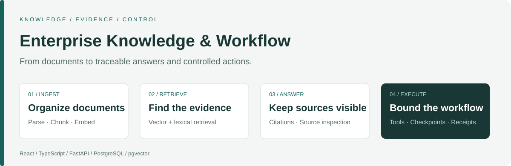
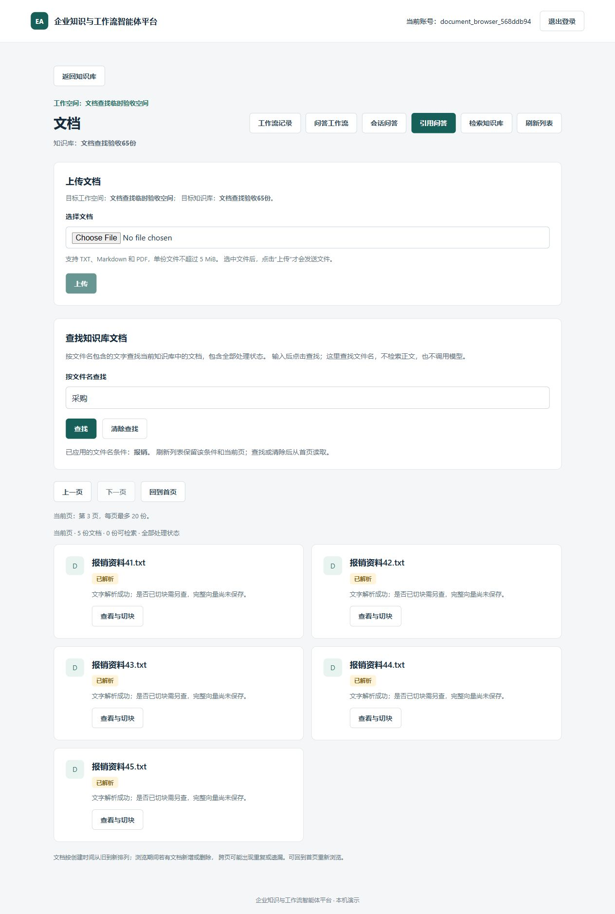

<div align="center">

# 企业知识与工作流智能体平台

**让企业资料可检索，让回答有出处，让任务按规则执行。**

Enterprise Knowledge & Workflow Agent Platform

[](https://github.com/cenxv46597/enterprise-ai-agent-platform/actions/workflows/frontend-ci.yml)
[](https://github.com/cenxv46597/enterprise-ai-agent-platform/actions/workflows/backend-contract-ci.yml)
[](https://github.com/cenxv46597/enterprise-ai-agent-platform/actions/workflows/backend-postgres-ci.yml)

[快速开始](docs/product/getting-started.md) · [产品演示](docs/product/showcase.md) · [架构设计](docs/product/architecture.md) · [测试验证](docs/product/verification.md)

</div>



面向企业制度、操作手册和业务资料的全栈应用原型。把分散文档转成可检索证据，提供带原文引用的回答，
并通过受控Agent与固定工作流处理需要工具或多步执行的任务。

Built with **React · TypeScript · FastAPI · PostgreSQL · pgvector**.

## 核心能力

- **资料管理**：创建工作空间和知识库，上传TXT、Markdown和文字层PDF；手动切块、按预算向量化，支持文件名/状态查找与分页。
- **证据检索与问答**：向量/词项混合检索、证据预算、逐字引用核验与证据不足弃答。可查看完整来源块及高亮，并导出当前问答TXT。
- **受控任务执行**：有界工具调用、结构化条件补充、来源绑定计算和标准规则估算；后端提供白名单本地MCP接入。
- **固定工作流**：显式创建与执行、持久检查点、版本校验、有限恢复、保存答案和只读历史。
- **范围与可靠性**：工作空间成员边界、父子资源校验、迟到响应隔离、未知结果不自动重试，以及安全的HTTP排错编号。

网页已接入主要知识库流程和明确范围的会话/工作流能力；后端可选重排、MCP等能力以各自接口说明为准。

## 一次完整使用


例如，员工查询住宿报销标准时，不只看到一个金额，还能沿引文检查发票要求、审批条件和例外。
如果本次证据不足，系统明确弃答；它不会把“没有找到足够证据”写成“公司没有相关规定”。

<details>
<summary>查看文档管理实际界面（受控演示数据）</summary>



截图来自2026-10-23独立测试库浏览器验收，使用临时账号和合成文档，无模型调用。
该截图展示文件名查找与分页，不代表当前全部功能或真实问答验收；[版本与场景说明](docs/product/showcase.md)。

</details>

## 技术架构

React负责交互与请求状态，FastAPI执行权限和业务规则，PostgreSQL/pgvector保存资源、文本块、向量和执行状态。
外部模型通过适配器调用；模型等待位于数据库事务外。整体采用模块化单体，保持业务链路可追踪和测试可替换。

```text
frontend/             React + TypeScript 页面与模拟测试
backend/app/          API、知识服务、Agent、会话、工作流与模型适配器
backend/alembic/      数据库迁移
backend/tests/        业务、契约与数据库测试
examples/             公开虚构资料与固定评测输入
docs/product/         使用、架构、演示与验证说明
docs/adr/             架构决策
```

[后端代码导航](backend/README.md) · [前端开发说明](frontend/README.md) · [架构决策索引](docs/adr/README.md)

## 快速开始

需要Python 3.13、项目允许版本的Node.js，以及PostgreSQL/pgvector环境。当前提供本地部署，没有托管在线体验地址。

```cmd
git clone https://github.com/cenxv46597/enterprise-ai-agent-platform.git
cd enterprise-ai-agent-platform
```

按[本地快速开始](docs/product/getting-started.md)安装依赖、准备私有配置、初始化全新数据库并启动前后端。
模板不含可登录的默认密码。已有环境可复用账号和数据，不重复初始化；模型服务在需要真实调用时配置。

## 测试与验证

前端隔离入口：

```cmd
cd frontend
..\.venv\Scripts\python.exe -I scripts\check.py all
```

后端固定契约入口（仓库根目录）：

```cmd
.venv\Scripts\python.exe -I backend\scripts\run_contract_tests.py
```

最近已记录基线为前端**38文件1386项**及类型/生产构建、后端**274项固定契约**通过。
前端使用模拟HTTP，后端契约与PostgreSQL CI各有固定范围；它们不等于全后端回归或答案正确率。
历史六题真实RAG和29块检索评测、对应版本CI及复现边界见[验证说明](docs/product/verification.md)。

## 当前范围

这是可本地运行的产品原型。PDF支持文字层，尚无扫描件OCR；权限为基础空间成员边界；
固定工作流不等于通用可视编排。即时问答保存在当前页面，TXT不是服务器历史。

引文存在不能自动证明答案每项结论正确。当前网页真实问答/来源全链、TXT实际落盘、质量与费用比较仍需专项验收；
公网生产部署和大规模性能不在当前验收范围内。

## 文档与参与

- [产品文档导航](docs/README.md)：从使用到技术设计的统一入口。
- [示例与演示资料](examples/README.md)：公开虚构语料和固定评测输入。
- [参与开发](CONTRIBUTING.md)：复现问题、验证和PR说明。
- [开发方式与历史档案](docs/development/README.md)：AI辅助开发、实际参与程度及历史沿革。
