# 架构设计与已实现的数据流

## 问题与首个使用场景

企业文档往往难以可靠检索。第一条完整业务链路允许本地用户创建工作空间和知识库、上传受支持的文档，并根据检索到的段落回答问题，同时提供可核查的来源信息。

首批数据已选择可公开展示的产品文档或技术文档。[虚构产品技术说明](../examples/knowledge/demo-product.md)与六个标注问题已完成首轮真实模型链路验证；较大知识库的质量验收仍待进行。

## 最小可用版本的范围

- 提供创建和管理工作空间、知识库的接口。
- 支持纯文本、Markdown 和可提取文本的 PDF 入库，并明确记录处理失败。
- 完成解析、确定性切块、向量生成，以及限定范围的精确向量检索。
- 根据证据回答问题，校验文档、页码或章节、文本块的引用；证据不足时明确弃答。
- 建立少量带标注的问题，并编写接口、检索和端到端测试。

这一阶段仅是本地单用户原型。工作空间和知识库的过滤条件用于组织数据，不能代替权限控制。部署给多名用户使用前，必须实现身份认证和权限校验。

## 模块职责

- `api`：验证请求并定义 HTTP 响应格式。
- `core`：管理配置和应用共用行为。
- `db`：负责文档、文本块与向量持久化、数据库会话和结构迁移。
- `knowledge`：负责文档入库与检索业务。
- `knowledge/answers.py`：选择检索证据、生成单次回答并校验引用；持久会话由独立 `conversations` 层管理。
- `conversations`：知识库内的会话、待补字段、用户输入来源、有限近期决策上下文和版本条件提交。
- `workflows`：独立固定问答流程的领取、原文检查点、有限显式恢复与不可变执行回执；不是会话记忆或任意 Agent 的步骤恢复。
- 显式答复偏好：知识库级有限枚举、版本条件保存与清除；会话最终生成使用读取快照，不从聊天自动抽取，也不改变工具或业务条件。
- `billing`：严格标准规则绑定、两个计费条件、固定公式和独立估算结果；不承担会话记忆或通用政策解释。
- `providers`：以轻量适配层连接模型与向量生成服务。
- `providers/compatible_chat.py`：共用有限 HTTP 传输与独立 JSON 正文协议，处理配置、超时与响应边界。
- `providers/compatible_tools.py`、`native_planner.py`：原生工具消息校验、调用响应解析与业务动作转换，不直接执行工具。
- `agents/calculator.py`：读取本次原文快照，绑定数值来源并进行有界 Decimal 运算。
- `agents/calculation_answers.py`：确定性生成算式说明和输入引用，计算结果不进入文档原文证据池。
- `providers/review.py` 与 `compatible_review.py`：独立评审契约及兼容接口，返回 AI 辅助建议。
- `evaluation/retrieval.py`：纯 Python 检查预标注证据的完整覆盖；执行脚本负责调用正式路由和保存结果。
- `knowledge/context.py`：正式回答与离线评测共用完整块选择规则；`evaluation/context.py` 分别记录选择前后的证据覆盖。
- `evaluation/answers.py`：核对已保存的公开回答与引用，验证逐项审核记录绑定同一答案；区分人工完成、待审核和 AI 辅助，重新计算审核覆盖率与已审核通过比例。

当前智能体通过注册表调用绑定知识库范围的只读工具，并复用知识检索服务；范围检查尚不代表身份授权。评测应当调用与正式应用相同的检索、问答和智能体入口。

资源浏览已有工作空间、知识库、文档三级集合 GET，复用现有响应模型。工作空间列表
是本地单用户全局集合；知识库列表先确认工作空间存在，再按工作空间过滤。文档列表
核对工作空间与知识库归属后限定范围，并可选追加状态条件。各级均由数据库过滤、按
创建时间/ID排序后应用有界 `limit/offset`，不在获取一页后才筛状态；三级浏览请求可
由上一级返回的ID驱动。这条只读路径只经过 API 与 PostgreSQL，不进入 RAG、Agent、
文件存储或模型提供方，不修改表结构，不是权限系统或语义相关性检索。文档管理默认
展示各处理状态，仅返回元数据；可选筛选不改变检索的 ready/非空向量要求。契约见
[资源接口设计](data-api-design-proposal.md#文档列表小步补齐)。

## 数据流

阶段 3.1 新增独立 `/agent-runs` 入口：先校验范围，动作模型在事务外提出搜索或结束，注册表校验参数，知识工具调用既有检索，再将固定观察与去重原文交给下一次决策。范围由后端绑定，模型不能改写知识库。循环限制决策次数、重复动作和证据量；结束直接复用证据快照及现有引用校验，返回步骤和原文来源映射。阶段 3.2 将默认传输升级为原生工具请求与同编号结果回传，旧 JSON 适配器仍可显式选择。阶段 3.3 增加原文绑定计算器，结果独立记录，由程序生成算式和输入引用。该单次入口共两个受限工具，只保留运行内状态；阶段 4.1 的独立会话入口另增加 ask_user 与持久待补任务，不提供任意工具步骤恢复。详见[阶段 3.1](phase3-knowledge-agent.md)、[阶段 3.2](phase3-native-tools.md)、[阶段 3.3](phase3-calculator.md)与 [ADR 0016](adr/0016-bounded-knowledge-agent.md)、[ADR 0017](adr/0017-native-tool-calling.md)、[ADR 0018](adr/0018-evidence-bound-calculator.md)。

阶段 2.2 在召回后增加可选重排：`candidate_k` 控制先取得的候选数，模型仅返回这些编号的完整排列，业务层验证后保留 `top_k`；再进行原有上下文选择、生成与引用核对。重排在数据库事务外执行，超时或输出故障保留原排序并返回可见降级状态；配置和输入问题报错。默认关闭，现有生成配置可复用但多一次调用；真实排序收益尚待验收。见[阶段 2.2](phase2-candidate-reranking.md)与 [ADR 0015](adr/0015-optional-candidate-reranking.md)。

阶段 2.1 增加可选混合策略，默认请求仍是向量基线。问题向量生成前后检查范围和容量，第二个短事务在同一批就绪块上独立取向量与词项前二十，然后按块 UUID 合并并融合名次，选出最终前 K。词项评分采用有界 Python BM25，中文双字、英文及错误码完整词项；超过 2000 块或 100 万正文字符拒绝混合请求。搜索返回各路排名和融合分数，回答沿用上下文预算与引用校验。实现、数据流图和取舍见[阶段 2.1](phase2-hybrid-retrieval.md)及 [ADR 0014](adr/0014-bounded-hybrid-retrieval.md)。独立两路真实召回收益尚未测量。

文档入库：上传并校验 → 保存原文和处理状态 → 解析 → 切块并记录来源信息 → 生成向量 → 将文本块与向量存入 PostgreSQL。

问题回答：问题及工作空间、知识库范围 → 检索相关段落 → 组装证据 → 调用模型 → 对照检索结果校验引用 → 返回回答和引用，或在证据不足时弃答。

当前文档入库与维护边界：

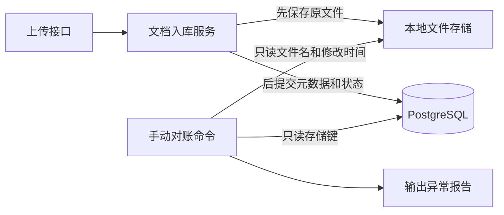

对账用于观察跨存储写入的失败结果，详细取舍见 [ADR 0001](adr/0001-document-storage-audit.md)。当前没有自动补偿或共享事务。

阶段 1.2 已实现的切块保存路径：

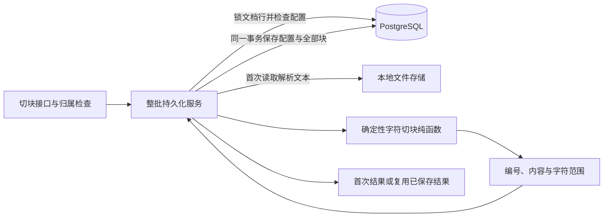

上传和切块由两个接口分别触发。切块成功后文档仍保持原状态，没有向量索引。字符范围对应解析文本，设计取舍见 [ADR 0002](adr/0002-deterministic-text-chunks.md)；同配置重试、并发与事务边界见 [ADR 0003](adr/0003-idempotent-chunk-persistence.md)。

阶段 1.3 已实现的向量生成与保存路径：

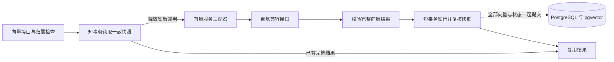

真实模型调用期间没有活动数据库事务；读写阶段均按知识库、文档顺序短暂锁行。文档原文和切块配置当前不可原地修改，向量写回前仍核对快照。模型身份固定在知识库中，结果全部提交后才更新为 `ready`。代码已接入百炼 `text-embedding-v4` 的 1024 维兼容接口，并完成首个公开语料的真实向量保存和复用验证。详见 [ADR 0004](adr/0004-embedding-generation-and-storage.md)。

阶段 1.4 已实现的检索路径：

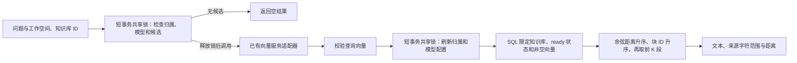

查询向量必须与知识库已保存向量使用相同接口身份、模型和 1024 维配置。模型调用在事务外完成，返回后复核配置；查询不写库。范围筛选先于取前几名，避免其他知识库占满结果后再过滤造成漏检。当前使用精确余弦检索，没有近似索引、阈值或重排；返回的距离不是答案正确率。空库在模型配置依赖正常时跳过外部调用，配置缺失仍返回 `503`。取舍和接口边界见 [ADR 0005](adr/0005-scoped-vector-retrieval.md)。已记录六题的真实检索延迟，但由于只有 5 个候选，检索筛选质量仍待扩大语料验收。

阶段 1.5 已实现并通过本地故障验证的回答路径：

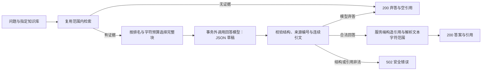

主题相关不等于证据足够。当前选择生成判断与程序校验，不设置未经语料评测的距离阈值。程序能验证引文存在、引用属于本次传入的证据，不能证明答案在语义上忠于证据。文档按不可信数据处理，尚不能保证抵御所有提示注入。详见 [ADR 0006](adr/0006-evidence-grounded-answers.md)。

向量与回答使用独立适配器和配置，复用现有 HTTP 客户端，不引入编排框架。首个回答模型由学习者确认使用 DeepSeek 官网的 `deepseek-flash`；完成本机配置后，首轮真实六题返回四个答案、两个弃答，详见[验证报告](evaluation/live-rag-smoke-2026-10-10.md)。一次回答使用检索已返回的文本快照，无持久会话、版本引用或跨网络请求的数据库事务。真实联调脚本通过同进程的 TestClient 调用路由、真实数据库和供应商；部署网关及更广泛的语义效果仍待验证。

检索评测按学习者选择，预先标注支持问题的具体原文段落；返回同一文档的无关章节不算有效证据命中。独立评测已使用 4 份公开虚构资料、29 个候选块和 6 个固定问题，通过正式路由完成真实向量检索。前 5 和前 10 均覆盖正例的 5 条必需证据，详见[结果与复现说明](evaluation/retrieval-eval-2026-10-10.md)和 [ADR 0007](adr/0007-evidence-level-retrieval-evaluation.md)。本轮没有生成答案，检索覆盖与回答忠实性分别评估。

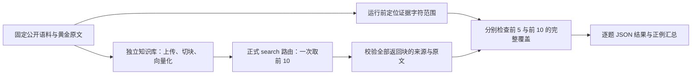

纯评测模块不读取配置或调用外部服务。脚本负责语料身份、演示资源与复跑校验；负例不记空集满分，跨块完整覆盖和重叠去重由纯函数处理。当前只检查固定黄金证据，未完整标注全部相关块，不能称为正式 Recall@K 或完整 RAG 质量评测。

2026-10-11 加入离线上下文评测：固定检索快照 → 校验公开来源 → 前 K 候选 → 共用 `select_context` → 检查选中证据覆盖 → 记录原排名与来源编号。600、2000 和代码默认 12000 字符预算下，必需证据分别覆盖 2/5、4/5、5/5。它测量业务选择规则拟送入的证据，不调用真实生成模型；正文字符限制尚不是完整 token 预算，详见 [ADR 0008](adr/0008-context-evidence-coverage.md)。

### 离线答案审核

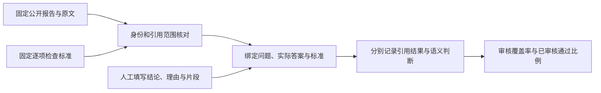

`evaluate_answers.py` 只读现有公开资料，不读取本机 `.env`、连接数据库或调用模型。审核副本改动展示答案或标准时，拒绝复用旧结论；旧报告中的 AI 辅助备注保留，不自动转为人工完成。初始六题逐项人工完成数为 0/6，质量比例为 `null`，不能把引用检查成功写成答案正确率。详见 [ADR 0010](adr/0010-offline-answer-review.md)。

### 离线模型辅助评审

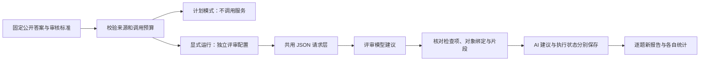

线上问答不调用评审。每题失败继续后续题，超时不算答案不通过；AI 判断不计人工质量分，未知费用不填零。原报告没有实际生成上下文，本轮以固定公开完整文档复核，不能证明模型只使用当时证据。共享请求层不共用问答与评审的业务契约，详见 [ADR 0011](adr/0011-offline-model-review.md)。

### 公开演示的生成请求快照

常规 API 不开启记录。快照保存失败阻止请求，不接收认证头；收到正常路由响应也不等于语义正确。旧报告不能补写后来重跑的输入；新快照报告续跑须保持采集选项。实现与限制见 [ADR 0012](adr/0012-generation-request-snapshots.md)。

### 固定证据的提示词实验

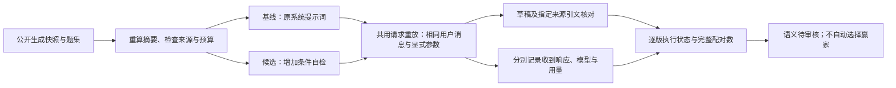

实验无需数据库或重新生成向量。模拟样例不是历史真实输入，禁止默认受控输入直接执行付费模式。模型返回后输出验证失败仍保留已知用量；任一版失败不构成完整配对，不自动重试。见 [ADR 0013](adr/0013-fixed-evidence-prompt-comparison.md)。

## 已确定的方案与重新评估条件

### 原生工具协议与运行内历史

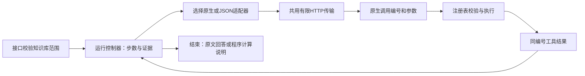

默认原生协议，旧 JSON 协议显式选择；不自动降级。历史由本次运行控制器保存并按轮复制，适配器本身没有跨运行记忆。一次多调用整组拒绝，编号重复是协议错误；新编号不绕过工具名与参数的重复保护。模型普通文本只表示结束，最终答案仍独立生成和校验。实现与边界见[阶段 3.2](phase3-native-tools.md)、[ADR 0017](adr/0017-native-tool-calling.md)。

阶段 3.3 注册第二个工具 `calculator`。控制器把已取得的原文快照作为不可变上下文传给工具，程序验证两项输入的证据编号、逐字引文、完整数字与值，再用 Decimal 运算。原文证据和派生计算记录独立保存，原生结果消息也分别回传；结束时有成功计算则由程序生成算式和输入出处，无计算则继续已有问答生成。最后一次计算错误未恢复时明确失败，防止绕过计算工具。详见[阶段 3.3](phase3-calculator.md)、[ADR 0018](adr/0018-evidence-bound-calculator.md)。

两个受限执行工具、范围限制和内存轨迹不代表已经实现完整多工具平台或 RBAC。阶段 4.1 增加持久会话和有限近期上下文，阶段 4.4 有限持久偏好已完成程序回归及应用库升级；通用长期记忆、自动抽取和私有用户记忆仍未实现。真实原生服务、单位与公式选择、任务成功率、风格质量和成本尚未验收。

### 模块化单体应用

**采用理由：** 单个 FastAPI 应用便于先完成端到端链路，同时保留清晰的模块边界和可测试性。

**代价与调整条件：** 初期文档入库与接口请求共用一个进程。如果实测入库耗时或可靠性问题要求任务独立执行，再引入可靠的后台任务处理进程。

### PostgreSQL 与 pgvector

**采用理由：** 元数据和向量可以存放在同一个数据库中。先使用限定范围的精确检索，建立质量基线。

**代价与调整条件：** 数据规模增加后，专用向量服务或近似索引可能更合适。变更存储方案前，应先测量数据量、召回率和延迟。

### 轻量模型适配层

**采用理由：** 将模型服务特有的请求和响应格式隔离在业务用例之外。

**代价与调整条件：** 在真正接入第二个模型服务，并发现明确的共性需求之前，不设计通用的多服务框架。

## 待确定的设计

### 阶段 4.1：持久会话与待补条件

新增 `conversations` API 与业务层，PostgreSQL 增加 Conversation 和 ConversationTurn。
只有会话入口注册 ask_user；原单次入口继续保持原有响应。会话任务保存原问题、一个整数
待补字段和规则原文快照，用户补充单独标记 user_message 来源，不进入企业原文证据池。
有限近期问答只辅助决策器，最多三组与 4000 正文字符，不保存内部思考。

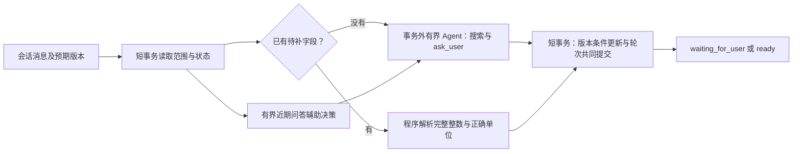

阶段 4.1 的 ready 表示输入已恢复，不表示原业务任务完成。阶段 4.2 接入下述来源绑定
算术；单位换算与业务条件验证继续留到后续模块。已提交编号重放与版本保护不保证模型恰好
调用一次。原文变化时拒绝接受旧任务条件；详见 [ADR 0019](adr/0019-persistent-conversation-clarification.md)。

### 阶段 4.2：来源引用与显式算术执行

旧 calculator 和单次入口保留原契约；会话注册 sourced_calculator。
参数只引用原文、当前已确认用户字段与确认请求编号、当前运行先前成功计算编号。
程序从不可变工具上下文取值，共用 Decimal；聊天历史与以前执行的结果不进入可信数值池。
每次成功计算保存平面来源记录，不递归复制公式树，最多七次成功计算与八次决策。

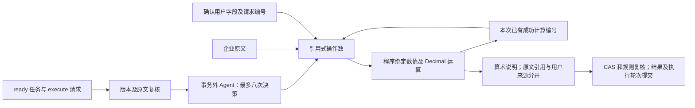

execute 不使用消息正文替换任务条件；失败保留确认输入，提交成功可重放。
完成后仍为 ready，不声称业务 completed。来源校验不能代替公式、计费月份或单位兼容
验收，当前不能自动认定全年费用为 1530。详见
[阶段 4.2](phase4-sourced-calculations.md)、[ADR 0020](adr/0020-source-referenced-chained-calculations.md)。
迁移 `20261011_0006` 仅扩展轮次模式约束；已有执行历史时拒绝无损降级。

### 阶段 4.3：受控标准计费工作流

会话初始 Agent 可选择 prepare_billing；只能提交所选完整块的编号与正文。
严格标准语法决定月费和次费的角色与单位，程序从真实原文绑定价格，不接受自由公式。
保存的 clarifications 依次为上门次数及 1..12 个计费月数，clarification 指向当前缺失字段。
确认“三次”后继续等待月份，两个字段均齐全才 ready；不根据“全年”自动代入 12。

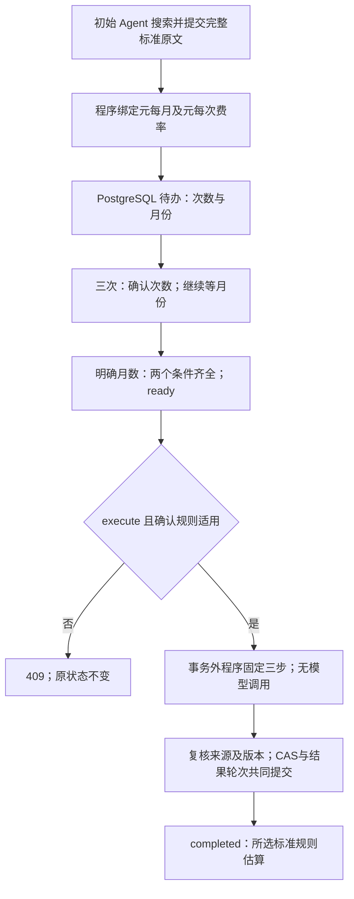

固定步骤为 monthly_fee × billing_months、visit_fee × visit_count，再把两个元小计相加。
BillingResult 保留费率原文、两条用户消息及确认请求的不同编号、固定步骤与派生金额。
只有该结果通过规则回验并提交，才进入 completed；旧来源绑定算术仍为 ready。
执行正文不替换已保存条件；修改条件用 new_task，原结果仍保存在历史轮次中。

这不是通用单位换算、税费验证或账单系统。首版完整块有任何其他条款都会拒绝，
但无法证明其他块没有适用政策；必须由用户明确确认所选标准规则用于同一期间估算。
初始模型选对证据与工具仍需真实语义验收，消息接口仍需现有向量服务配置，
不调用模型不等于无需现有应用配置。详见[阶段 4.3](phase4-standard-billing.md)
和 [ADR 0021](adr/0021-controlled-standard-billing.md)。迁移 0007 不重写旧任务，
允许新状态，存在当前计费计划或历史计划/结果时拒绝不兼容降级。

### 阶段 4.4：显式答复偏好与生成快照（程序验收完成）

独立 GET/PUT answer-preferences 保存同一知识库的 answer_detail：concise、detailed 或 null。
更新使用 expected_version；清除保留版本墓碑，不恢复为初始版本，不从聊天自动提取。
没有 TTL，跨新任务、新会话保留，直到显式修改或清除。这是本地单用户设置，不是身份隔离。

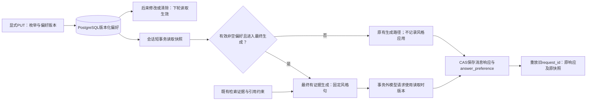

风格固定映射只在最终生成路径使用，不进入决策器或可信工具输入；不改变检索、原文、
计费公式和证据不足弃答要求。MessageRead.answer_preference 记录进入偏好生成调用路径时的设置，
不是模型已收到请求或风格通过的标签；不支持该能力时失败且不记录，调用超时可保留尝试版本。
空检索、追问、停止、计算器说明与确定性计费不标记应用。
没有设置或已经清除时 answer_preference 整体为 null，清除墓碑的版本只通过偏好 GET 展示。
内部 AgentRun 元数据在会话公开 run 中排除，避免重复。单次 /answers、/agent-runs 不读取偏好。

读取之后的并发偏好更新不重写本请求，也不因最终写回时已出现新值而替换快照。
会话版本与偏好版本独立，已提交请求重放原响应；清除当前值不删除历史轮次快照。
迁移 20261012_0008_answer_preferences.py 与本机实际升级分开核对；降级在同一事务先取得
ACCESS EXCLUSIVE 表锁再检查，仅空表允许删除，偏好或清除墓碑存在时拒绝，防止并发误删。
恢复前 324 项纯程序/模拟 HTTP 专项通过、无跳过（3.11 秒），包含此前 311 项而不相加；
当时收集 1361 项（2.48 秒）未全跑，锁顺序 fake-op 不代表真实并发锁已验收。
Docker Desktop 最初初始化 dockerInference 报文件无法访问，进程存在但引擎未就绪、5432
检查为 False，当时数据库/API 用例没有断言成绩。随后用户恢复 Docker，既有数据库容器
启动 Healthy，未删除或重建卷。恢复后专项 69 项通过、无跳过，包括 API、会话、故障、
迁移及纯程序用例，不全是数据库测试；pytest 原样报告 4087.46 秒（1:08:07）仅为执行记录，
不作性能指标或正常耗时，不推断等待原因。最终完整后端回归 1361 项通过、无跳过，
独立 eaap_test PostgreSQL 与模拟模型，本轮新增 88 项；pytest 原样报告 9840.44 秒（2:44:00）
也仅作执行记录。324 项与 69 项专项为重叠子集，不能相加。应用库已正常 0007 → 0008，
六张旧表记录数前后完全一致，新 answer_preferences=0，compare_metadata=[]。
阶段 4.4 程序验收完成，真实风格与忠实性、学习者实践及面试讨论仍待；本轮按完成模块
本地提交、不推送、不预填编号，真实模型请求为零。数据核对明细见阶段文档。
详见[阶段 4.4](phase4-answer-preferences.md)与 [ADR 0022](adr/0022-explicit-answer-preferences.md)。

### 阶段 4.5：固定本地只读 MCP 知识搜索（程序验收完成）

单次 /agent-runs 接受 search_backend=local 或 mcp，缺省 local。MCP 模式通过官方 Python
SDK mcp==2.3.0 启动固定项目模块；工作空间、知识库与检索策略由 Host 绑定，模型仍仅
提供 query。vector/hybrid 复用既有检索；首版 MCP 不支持重排，rerank=true 明确返回 422。
会话、单次 /search 和 /answers 不改动，无新增数据库表或迁移，schema 保持 0008。

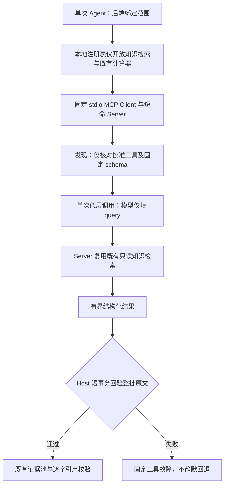

发现不自动注册远端工具；名称、描述和 readOnlyHint 不授予权限。批准 schema 变化、
分页或超限发现、额外内容、错误结果和输入补充请求均不自动适配。调用采用 SDK 的单次
低层 session.call_tool，避免高层输入补充/schema 变化重发。每次搜索单独进程及 async
生命周期，由同步 API 工作线程调用 anyio.run；不跨线程共享数据库 Session 或缓存 SDK
Session。服务端检索工作线程内创建独立数据库会话。

当前 SDK 默认 auto 先通过 server/discover 协商，必要时回退旧式 initialize；协议协商
探测不等于 tools/call 自动重发。工具调用仍使用经过白名单检查的低层单次请求。

结构化结果最多五块、合计 12000 正文字符、应用层序列化最多 100000 UTF-8 字节。
Host 复核范围、文档 ready、非空向量、块身份、文档名、完整正文及位置，整批成功才进入
证据池；populate_existing 刷新 ORM 快照。距离/排名只是检索元数据，未验收语义正确性。
应用层限制晚于 SDK 解码，不是针对任意恶意服务的进程/内存隔离。本地自建程序持有必要
配置，不是沙箱；未开放任意 URL、启动命令、SQL、删除、远程 MCP 或多用户权限。

EAAP_MCP_TOOL_TIMEOUT_SECONDS 默认 30、上限 180，覆盖连接、发现和调用的取消预算，
SDK 进程清理可额外消耗有界宽限时间。嵌套异常组只映射固定故障码，stderr 不向用户转发。
最终完整后端回归 1501 项通过、无跳过（482.40 秒），包含本轮新增 140 项；协议专项
95 项通过、无跳过（13.02 秒）是全量子集，不相加。使用独立 eaap_test PostgreSQL 与
受控模型；另覆盖生产固定模块、真实 stdio 和测试库空结果链，不请求真实向量或模型。
真实 stdio 公开替身、Host 数据库反例回验、生产空结果链与真实非空向量/模型质量是
不同验收层，不相互替代。真实端到端质量、用户实践及逐题面试尚未验收；没有新迁移。
执行故障和后续修正明细见[阶段 4.5](phase4-mcp-search.md)和学习记录。

### 阶段 4.6：固定问答检查点与显式恢复（程序验收完成）

独立 answer-workflows 入口先创建 pending 任务，再显式 execute。第一步复用本地
vector/hybrid 检索并保存本次选中的原文；第二步生成答案、核验引用并保存结果。
生成失败而检查点有效时，新请求可从 generate 继续，不再生成问题向量或重新检索。
旧 /answers、Agent、会话、MCP 与偏好接口保持原有行为。
execute 复用现有向量依赖，构造仍需基本向量配置；没有配置时可能在领取前返回 503。
复用检查点意味着不再发出向量请求，并不等于该端点无需配置。创建和 GET 不依赖向量提供方。

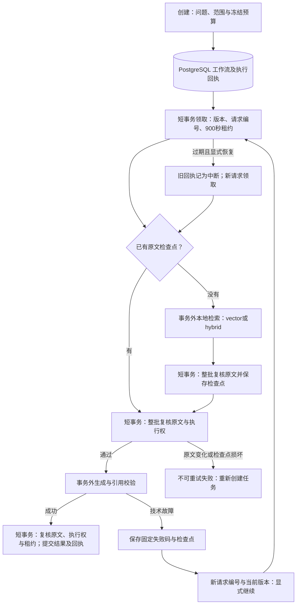

模型调用不持有事务或行锁；来源锁等待结束后再次核对当前数据库时间，不能使用
事务开始时刻判断租约。领取后即有 running 状态，不能只依赖最后写回的 CAS。
旧执行者必须同时满足请求编号、版本及未过期租约，才可提交检查点或结果。
最多五次执行，租约固定 900 秒且不自动续租；恢复用新编号、当前版本和
recover_interrupted=true，不自动重试。已有执行编号重放不可变原回执，GET 读取当前状态。

检查点最多五块、12000 正文字符和 100000 UTF-8 字节，且不得超过创建时冻结预算；
它是所选证据快照，不是知识库版本快照。新增其他文档不会自动触发重新检索；选中原文
的身份、归属、ready 状态、向量存在性、正文与位置变化则拒绝恢复。原文复核是数据库
操作，不消耗模型 Token；不能为降低费用而省略。进程丢失或提交结果未知时须读取状态
再显式恢复；本地写入隔离不保证外部请求或费用恰好一次。

迁移 20261012_0009 增加 answer_workflows 和 answer_workflow_attempts，不重写旧表。
降级先锁两表再检查，仅两表都为空才可删除；pending 请求也属于须保留的数据。
最终完整后端回归 1646 项通过、无跳过（633.72 秒，0:10:33），新增 145 项：
134 项工作流和 11 项迁移；专项是重叠子集，不相加。首次全量为 1645 通过、1 个错误
（1486.14 秒），旧问答用例准备测试库时连接超时、清理也超时，未进入业务断言；
该节点独立复跑 1 项通过（5.17 秒）后，未改业务代码重新全量获得上述通过成绩。
这些耗时只记录测试执行，不作性能指标或环境根因判断。独立 eaap_test PostgreSQL 与
受控模型验证程序边界，没有新增真实模型请求；真实语义质量和个人实践仍待验收。
应用库已正常 0008 → 0009，七张旧表计数前后不变：workspaces=2、knowledge_bases=2、
documents=5、chunks=34、conversations=0、conversation_turns=0、answer_preferences=0；
新两表各 0 行，compare_metadata=[]。未重建卷、删除资料或在应用库运行数据库测试。
详见[阶段 4.6](phase4-answer-workflows.md)与 [ADR 0024](adr/0024-checkpointed-answer-workflows.md)。

工作空间、知识库和文档的字段与基础接口路径已在[数据模型与接口设计](data-api-design-proposal.md)中确认。上传上限默认 5 MiB，首个向量模型、1024 维和精确余弦检索已确认；证据回答与引用校验按 ADR 0006 实施。真实模型质量、引用版本和身份认证仍待后续验收或设计。Redis、LangGraph和前端开发仍不属于首条完整业务链路的范围；后续 MCP、混合检索及重排的实际能力以对应阶段为准。
