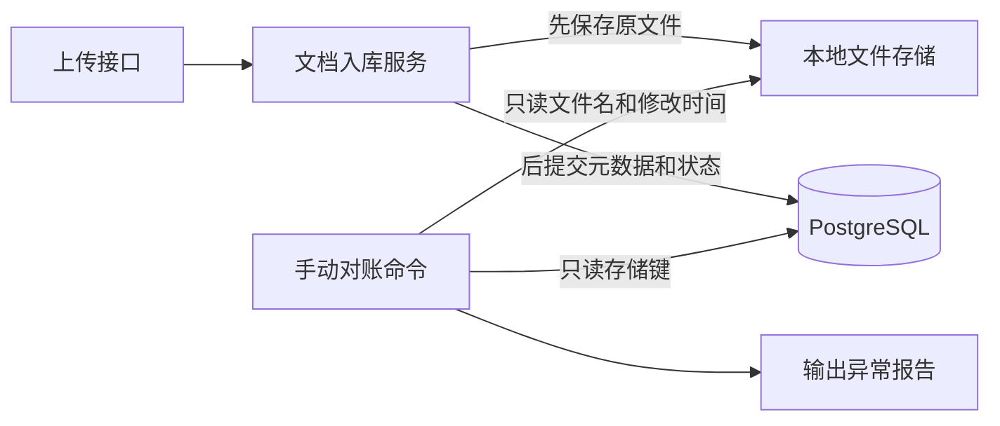
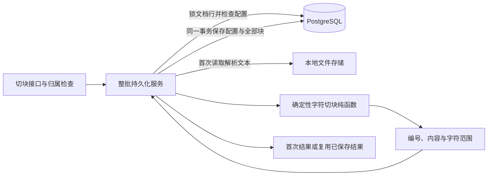

# 架构设计：阶段 0.1 决策记录

## 问题与首个使用场景

企业文档往往难以可靠检索。第一条完整业务链路允许本地用户创建工作空间和知识库、上传受支持的文档，并根据检索到的段落回答问题，同时提供可核查的来源信息。

首批数据建议采用可公开展示的产品文档或技术文档。具体文档及带有预期答案和来源的问题，将在文档入库开发前确定。

## 最小可用版本的范围

- 提供创建和管理工作空间、知识库的接口。
- 支持纯文本、Markdown 和可提取文本的 PDF 入库，并明确记录处理失败。
- 完成解析、确定性切块、向量生成，以及限定范围的精确向量检索。
- 根据证据回答问题，校验文档、页码或章节、文本块的引用；证据不足时明确弃答。
- 建立少量带标注的问题，并编写接口、检索和端到端测试。

这一阶段仅是本地单用户原型。工作空间和知识库的过滤条件用于组织数据，不能代替权限控制。部署给多名用户使用前，必须实现身份认证和权限校验。

## 模块职责

- `api`：验证请求并定义 HTTP 响应格式。
- `core`：管理配置和应用共用行为。
- `db`：负责文档及文本块持久化、数据库会话和结构迁移；向量字段留到后续步骤。
- `knowledge`：负责文档入库与检索业务。
- `chat`：负责组装证据并生成回答。
- `providers`：以轻量适配层连接模型与向量生成服务。

后续的智能体模块将通过明确的接口调用经过授权的工具，并复用知识检索服务。评测应当调用与正式应用相同的检索、问答和智能体入口。

## 数据流

文档入库：上传并校验 → 保存原文和处理状态 → 解析 → 切块并记录来源信息 → 生成向量 → 将文本块与向量存入 PostgreSQL。

问题回答：问题及工作空间、知识库范围 → 检索相关段落 → 组装证据 → 调用模型 → 对照检索结果校验引用 → 返回回答和引用，或在证据不足时弃答。

当前文档入库与维护边界：

对账用于观察跨存储写入的失败结果，详细取舍见 [ADR 0001](adr/0001-document-storage-audit.md)。当前没有自动补偿或共享事务。

阶段 1.2 已实现的切块保存路径：

上传和切块由两个接口分别触发。切块成功后文档仍保持原状态，没有向量索引。字符范围对应解析文本，设计取舍见 [ADR 0002](adr/0002-deterministic-text-chunks.md)；同配置重试、并发与事务边界见 [ADR 0003](adr/0003-idempotent-chunk-persistence.md)。

## 已确定的方案与重新评估条件

### 模块化单体应用

**采用理由：** 单个 FastAPI 应用便于先完成端到端链路，同时保留清晰的模块边界和可测试性。

**代价与调整条件：** 初期文档入库与接口请求共用一个进程。如果实测入库耗时或可靠性问题要求任务独立执行，再引入可靠的后台任务处理进程。

### PostgreSQL 与 pgvector

**采用理由：** 元数据和向量可以存放在同一个数据库中。先使用限定范围的精确检索，建立质量基线。

**代价与调整条件：** 数据规模增加后，专用向量服务或近似索引可能更合适。变更存储方案前，应先测量数据量、召回率和延迟。

### 轻量模型适配层

**采用理由：** 将模型服务特有的请求和响应格式隔离在业务用例之外。

**代价与调整条件：** 在真正接入第二个模型服务，并发现明确的共性需求之前，不设计通用的多服务框架。

## 待确定的设计

工作空间、知识库和文档的字段与基础接口路径已在[数据模型与接口设计](data-api-design-proposal.md)中确认。文件大小上限、向量模型与维度、引用响应格式和身份认证方案，仍需要在相关功能实现前与项目负责人共同评审。Redis、LangGraph、MCP、混合检索、重排和前端开发不属于首条完整业务链路的范围。
