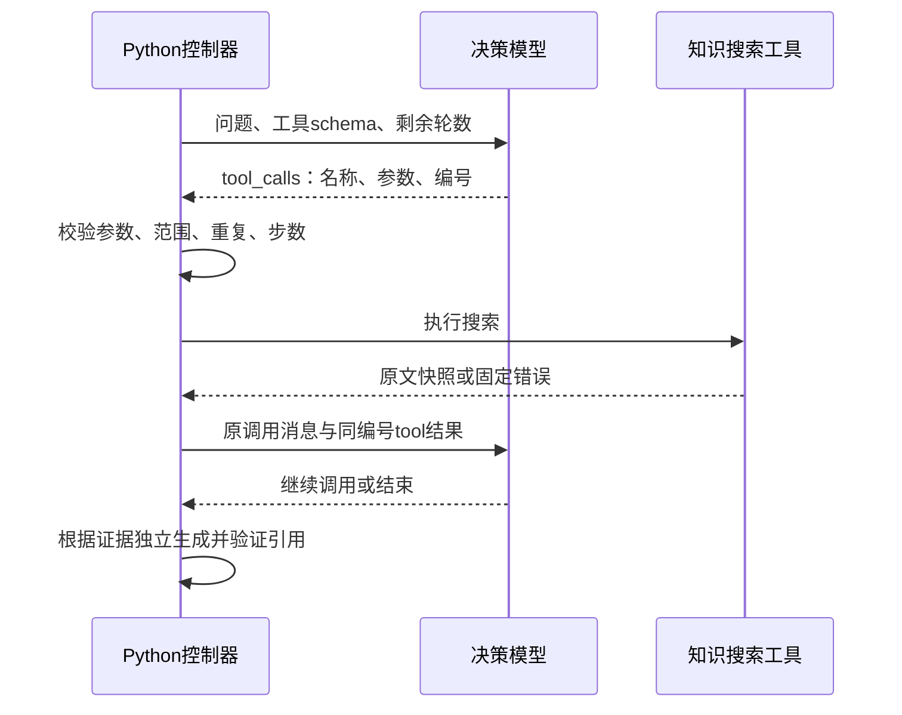

# 阶段 3.2：原生工具调用

## 1. 当前目标

将知识智能体从正文 JSON 动作升级为原生工具协议，验证模型请求、后端执行、工具结果回传和下一轮决策。仍只有一个只读知识搜索工具，代码改动先累计在本地。

## 2. 为什么需要它

它对应岗位要求中的工具调用、模型接口抽象、后端校验与故障恢复。模型提供调用请求，实际函数始终由 Python 程序执行。工具调用接口本身不授予权限，也不保证参数正确。

## 3. 核心概念

- `tools`：后端提供可用工具名称、描述与参数 schema。
- `tool_calls`：模型提出的函数调用，参数仍是待验证的 JSON 字符串。
- `tool_call_id`：将程序结果关联到那次调用的编号。
- `role=tool`：程序给模型的执行观察，包括成功结果或固定错误码。
- `FinishAction`：结束动作循环，随后使用已收集资料生成引用答案。

编号只负责关联，不负责去重。例如两次编号分别为 `call_1` 与 `call_2`，但都是同一工具和同一规范化问题，仍然属于重复动作。



## 4. 设计与取舍

正文 JSON 动作实现轻，适合早期理解循环；原生协议能显式关联调用和结果，需要更多协议验证。当前保留两种适配器，默认原生，通过本机 `EAAP_AGENT_PROTOCOL=json` 可显式选旧方案，不自动降级或重试。

继续使用现有 httpx、Pydantic 与 Python 循环。没有新增 SDK 或 LangGraph。一次只能有一个动作，多调用整体拒绝；真正支持并行之前，不能只执行第一条并默默丢弃其他请求。

DeepSeek 官网请求显式关闭思考模式；其他服务不带该专属参数。本轮不支持思考模式历史，也不收集内部思考。协议依据见 [ADR 0017](../adr/0017-native-tool-calling.md)。

## 5. 实现与数据流

1. `core/config.py` 新增 `agent_protocol`，API 延迟读取配置并选择适配器。
2. `providers/compatible_chat.py` 抽出公共 HTTP 传输；旧 JSON 客户端继续严格限制正文与重放格式。
3. `providers/compatible_tools.py` 发送原生 schema，验证消息配对、响应结束原因、单调用、编号与 JSON 参数。
4. `providers/native_planner.py` 把原生响应转换成既有 `ToolAction` 或 `FinishAction`。模型普通文本只代表结束，不返回为最终答案。
5. `agents/engine.py` 持有运行内历史，把执行结果与原编号配对，下一轮传副本给适配器。范围、重复、最后一轮和证据保护照常执行。

回传的最小消息关系：

```json
[
  {"role":"assistant","content":null,"tool_calls":[
    {"id":"call_1","type":"function","function":{
      "name":"knowledge_search","arguments":"{\"query\":\"退款流程\"}"}}
  ]},
  {"role":"tool","tool_call_id":"call_1","content":"{\"status\":\"success\",\"evidence\":[]}"}
]
```

示例的空 evidence 表示搜索正常完成但没有返回段落，工具故障另用 `status=error` 与固定 `error_code`。实际成功检索会包含运行内证据编号和原文。业务参数不合法不执行工具，但回传对应编号的错误观察，允许模型下一轮改正。

最后一轮仍要求搜索会停止；一次返回两个调用会 `failed/planner_error`；未知工具可通过观察恢复。新编号不绕过重复保护，重复编号则是协议错误。公开轨迹增加 `tool_call_id`，内部历史不返回到 API。

## 6. 验证与运行

先运行不需要数据库和密钥的模拟：

```powershell
.\.venv\Scripts\python.exe -m pytest backend/tests/test_native_planner.py -q -p no:cacheprovider
```

核心测试 `test_native_search_result_and_finish_complete_with_original_citation` 真实构造 HTTP 正文，但 MockTransport 拦截全部请求。它检查调用参数、同编号回传、下一轮剩余预算，以及“结束文字不会覆盖已校验的引用答案”。没有付费调用。

数据库集成测试使用本机独立测试库，沿用 README 测试命令。不要打印 `.env` 或完整数据库连接地址。

正式 API 路径不变：

```text
POST /api/v1/workspaces/{workspace_id}/knowledge-bases/{knowledge_base_id}/agent-runs
```

```json
{"question":"如何提交退款申请？","max_steps":4,"strategy":"hybrid","rerank":false}
```

此请求会调用真实决策、向量与回答服务，不能将它当作零费用模拟。本轮没有执行。默认原生协议生效，旧 `.env` 未改；想显式选择旧方案时自行配置 `EAAP_AGENT_PROTOCOL=json`。修改配置后重启正在运行的应用。

初轮定向 190 项通过（2.19 秒）；增加 API、协议选择与时间边界后定向 258 项通过（21.23 秒）。随后加强历史副本测试的断言，最终完整后端回归 **921 项通过、无跳过（219.87 秒）**，使用独立 PostgreSQL/pgvector 与受控模型。本轮新增 53 项测试，没有真实模型调用、依赖或迁移。测试不证明真实模型任务成功率或两种协议的质量差异。

## 7. 学习与小实践

此前学习者将 `max_steps` 理解为工具调用次数；导师说明本项目数的是决策轮数，并预留最后一轮结束，学习者表示理解，未记录为已独立实现。

当前核心面试题：一次返回两个工具调用，是整体拒绝还是只执行第一条？学习者已选择整体拒绝，符合当前单动作契约。导师补充原因：执行第一条而忽略第二条，会造成部分执行与缺失配对结果；因此应在任何工具执行前拒绝整组。选择不等于已独立解释理由，学习日志分别记录。

小实践：打开 `test_native_search_result_and_finish_complete_with_original_citation`，临时把第二轮断言中的 `tool_call_id` 从 `call_1` 改为 `call_wrong`，运行单个测试，观察失败定位。再恢复，并运行 `test_invalid_or_oversized_history_is_rejected_before_http` 的 `mismatch` 场景，观察程序在发送前拒绝错误配对。第一步练习阅读测试，第二步验证真正的协议保护，都不消耗 API 额度。

模块复盘逐题讨论：

1. 为什么一次返回两个调用时，不能只执行第一条却报告整轮成功？
2. `call_1` 和 `call_2` 调用同一工具与同一参数，为什么仍判为重复动作？
3. 模型结束文字声称退款一定成功，程序为什么不能直接返回这段文字？

## 8. 下一步

新增受限计算器，先明确数值参数、允许运算、精度和计算结果来源，再接入真正的多工具任务。原文引用不应冒充计算结果来源；不把任意表达式交给 `eval`。真实任务评测、用量统计、持久化、记忆和 MCP 继续按模块推进。

今天改动尚未提交或推送，等学习者决定收尾后统一展示提交内容。
