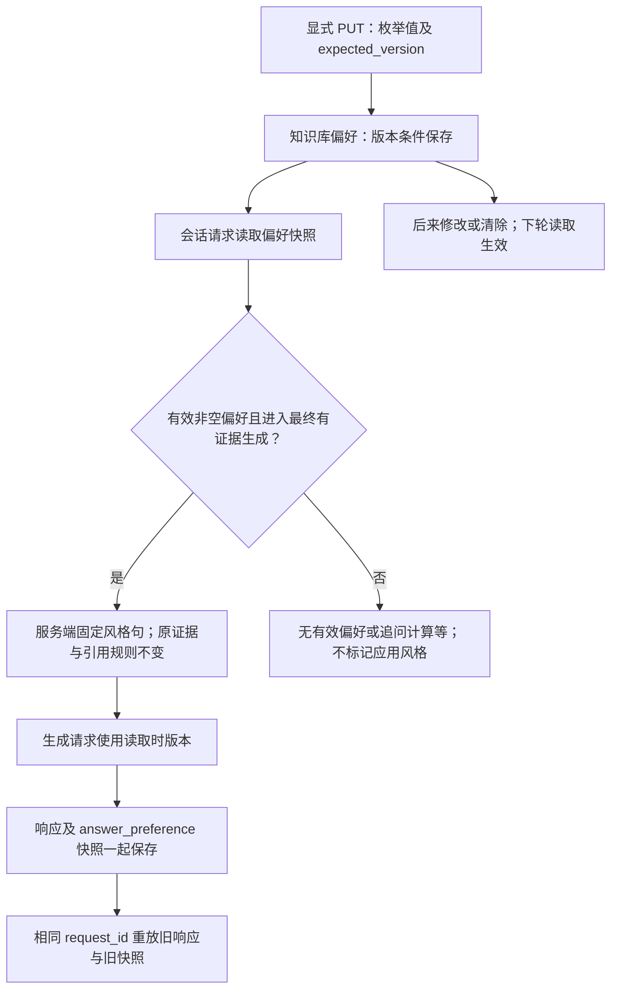

# 阶段 4.4：显式答复偏好与有限长期记忆

当前状态：阶段 4.4 程序验收完成，应用库已正常升级至 0008；真实风格与忠实性、学习者小实践及逐题面试讨论仍待完成。

## 1. 目标

让本地单用户能为一个知识库显式保存“简洁/详细”的持续答复偏好，跨新任务、新会话保留，
并知道某一回答究竟使用了哪个偏好版本。需要时可以明确修改或清除。

它是有限字段的持久偏好，不是“把全部聊天交给模型永久记住”，也不是私有用户记忆系统。

## 2. 原因

近期三组聊天只提供上下文，结构化待办只保存当前业务条件，都不应自动承担长期偏好的职责。
“这次详细”与“以后详细”的时间范围不同；如果程序随意抽取，可能把一次要求变成长期行为。
先做一个可以设置、清除、追溯和验证的最小闭环，再根据真实需求扩展记忆类型。

## 3. 概念

- 短期上下文：近期有限问答，滚出窗口并不删除数据库历史。
- 当前任务状态：原问题、待补字段与确认条件；new_task 替换它，不靠模型回忆恢复。
- 持久偏好：独立于当前任务保存的有限设置，直到用户修改或清除；当前没有自动过期。
- 版本墓碑：清除值但保留更新后的版本，防止旧请求把已清除的设置重新写回。
- 生成快照：一条回答使用读取时的设置；后来的修改不重写原回答及其快照。

偏好版本不是会话版本，偏好快照也不是模型已经达到该风格的质量证明。

## 4. 设计

采用学习者选择的 B：显式 API 加有限字段。自动从聊天抽取自由偏好的方案更方便，
但当前缺少歧义处理、撤销与语义质量验收；取舍见 [ADR 0022](../adr/0022-explicit-answer-preferences.md)。
复用 PostgreSQL 和现有版本条件更新，不引入 Redis 或新的记忆框架。



设置作用域是同一知识库、本地单用户。new_task 或新建会话不清除它，清除当前设置也
不删除原轮次中的历史快照。没有身份认证前不能把知识库范围检查称为私有用户隔离。
单次 /answers 和 /agent-runs 不读取该设置，旧接口行为保持兼容。

## 5. 实现

知识库路径下增加 GET/PUT answer-preferences：
`/api/v1/workspaces/{workspace_id}/knowledge-bases/{knowledge_base_id}/answer-preferences`。
公开响应 PreferenceRead 包含 knowledge_base_id、version、answer_detail。
answer_detail 只允许 concise、detailed 或 null，不接受自由文本指令。

尚未设置时 GET 返回 version=0、answer_detail=null。使用 GET 返回的版本显式保存：

```json
{
  "expected_version": 0,
  "answer_detail": "detailed"
}
```

成功后用新的 version 执行下一次更新。清除当前偏好，例如当前版本为 1：

```json
{
  "expected_version": 1,
  "answer_detail": null
}
```

成功后当前值为空，但版本继续递增，而不是回到 0。使用旧 expected_version 写入返回冲突。
不要把更新响应丢失当作未执行；先 GET 核对当前值与版本。

会话最终生成把读取快照映射为服务端固定风格句；MessageRead.answer_preference 记录
进入偏好生成能力调用路径时的有效非空 PreferenceRead。没有设置、已经清除，或没有走最终生成
偏好能力时，该字段整体为 null，例如结构化追问、空检索、运行停止、计算器说明或
确定性计费；并不是每种回复都应用风格。清除后的版本墓碑只从偏好 GET 查询。
不支持该能力的适配器明确失败且不记录快照，不静默改用普通生成；进入该路径后超时，
失败响应仍可保存尝试时的版本。这不证明网络请求已经发出或模型已收到。
有证据生成的模型可能仍弃答，风格快照不是质量通过标签。

并发修改发生在快照读取之后时，本次仍用旧版本，下一请求使用新版本；已提交 request_id
重放原快照，不因为新偏好改变旧响应。固定风格句不会改变检索、工具或计费公式。

迁移 20261012_0008_answer_preferences.py 新增偏好存储。应用启动仍需正常迁移流程；
本机应用库已按正常流程从 0007 升级至 0008，并核对旧数据和模型一致性；脚本存在不等于已升级。
降级先在同一事务取得表级 ACCESS EXCLUSIVE 锁，再检查空表；有任意偏好行或清除后的
版本墓碑就拒绝删表，避免检查后并发写入的数据被删除。不把 null 当作无数据。
“这次/以后”的教学例子不等于自然语言设置功能，持久修改只通过显式 PUT。

## 6. 验证

纯程序/模拟请求验证严格枚举、固定风格句、证据规则不变及各回复路径的快照边界。
独立 PostgreSQL 验证知识库归属、首次创建、版本冲突、并发更新、清除墓碑、跨会话保留、
new_task、请求内固定版本和旧请求重放；迁移验证旧数据与模型一致性。

恢复前纯程序/模拟 HTTP 专项 **324 项通过、无跳过（3.11 秒）**，包含并替代此前
311 项，不相加。当时收集 **1361 项（2.48 秒）**，没有执行全量；收集不是通过成绩。
迁移锁顺序 fake-op 只验证调用顺序，该用例不能代替真实 PostgreSQL 并发锁验收。

最初新增数据库/API 用例未运行到业务断言：Docker Desktop 进程虽已启动，但启动日志报告
`initializing Inference manager ... dockerInference: The file cannot be accessed by the system`。
该次引擎未就绪，5432 检查为 False，数据库专项中断。只停止了自己挂起的 CLI，
没有删除 Docker 文件、重置数据或修改权限，不把该错误直接归因为某个权限配置。
用户随后恢复 Docker，既有项目数据库容器启动并 Healthy，没有删除或重建卷。
恢复后专项 **69 项通过、无跳过**，包括偏好 API、会话集成、故障、迁移及纯程序用例，
不把全部 69 项称为数据库测试。pytest 原样报告 **4087.46 秒（1:08:07）**，只保存为执行记录，
不称接口性能或正常执行耗时，也不推断额外等待原因。模型使用模拟，真实请求为零。
最终完整后端回归 **1361 项通过、无跳过**，使用独立 eaap_test PostgreSQL 与模拟模型，
本轮新增 88 项测试（1273 → 1361）。pytest 原样报告 **9840.44 秒（2:44:00）**，仅作执行记录，
不作接口性能或正常耗时指标，不推断额外等待原因。324 项、69 项专项是重叠子集，不能相加。
应用库从 0007 正常升级至 0008；六张旧表记录数前后完全一致：workspaces=2、
knowledge_bases=2、documents=5、chunks=34、conversations=0、conversation_turns=0。
新 answer_preferences=0，compare_metadata=[]；应用库核对与测试库迁移是两项独立证据。
此前 1273 项通过是阶段 4.3 的历史回归，不是本轮新验证。
模拟模型及受控 HTTP 能验证固定句映射和调用边界，不能证明真实模型达到预期简洁/详细效果；
本轮真实模型调用为零，真实风格与证据忠实性质量仍待验收，不报告模型任务成功率。
阶段 4.4 程序验收完成，本轮按完成模块进行本地提交、不推送；实际提交结果另行核对，不预填编号。
这不代表所有长期记忆、真实模型质量或整个项目完成。

## 7. 学习总结与小实践

学习者选择 B，并独立区分“这次详细”与“以后详细”的时间范围；这是一个明确设计理由。
导师补充显式写入、版本、清除、生成快照与权限边界。不记录为学习者已经亲自编码，
也不把一个偏好字段称为掌握了所有长期记忆设计。

小实践待学习者亲自完成，优先复用 backend/tests/test_memory_conversations.py 中的
TestClient、独立 retrieval_context 与 StyledGeneration 等现有替身；可以在导师协助下修改
枚举和断言验证设置/清除及会话快照。不要将本练习理解为必须调用真实模型。
若直接在 /docs 连接已配置的真实模型，发送会话消息可能产生费用；真实请求需另行明确预算。

实践核对步骤：

1. 对同一知识库 GET 偏好，用返回版本 PUT detailed，再新建会话。
2. 用有证据、最终进入回答生成的问题发消息，检查 answer_preference 中的版本和值。
   若只是追问、计算或空检索，不应据 null 判断设置失败，要先核对本轮回复路径。
3. GET 最新版本，再 PUT null 清除；重新 GET 偏好，核对 answer_detail=null 且墓碑版本
   已递增。创建新会话并执行同类有证据生成，会话响应 answer_preference 应整体为 null，
   不是带空值的偏好对象。读取旧会话响应时，原 detailed 快照应仍保持历史值。

该实践不是观察回答字数就宣称风格准确；先验证设置、作用域和快照，再讨论语义效果。
学习者尚未执行这些操作，导师测试不能替代个人实践记录。

准备三道真实岗位面试题，教学时每次只讨论一道：

1. 为什么清除偏好后还要保留版本，而不是删除记录后重新从 version=0 开始？
2. 回答生成期间用户改了偏好，本次、下一次和重放旧 request_id 各应使用哪个版本？
3. 为什么知识库级持久设置还不能叫“私有用户长期记忆”？多用户需要补哪些边界？

## 8. 下一步

程序回归和应用库升级核对已完成，模块实现已本地提交 8a99e6b，未自动推送。
2026-10-12 学习者独立说明任务条件与持久偏好的区别，并明确跳过本次添加“三次”反例
的输入白名单小实践；该实践未修改或运行，不计为个人代码验证。上述设置/清除实践与
逐题面试仍未完成，按用户要求继续主线；真实模型风格及证据忠实性需另行明确预算和
固定案例验收，不把模拟验证当作真实质量成绩。
是否扩展更多偏好、跨会话事实或自动抽取，要以明确需求和来源/撤销设计为前提。
下一模块先设计自建只读 MCP Server/Client 与现有知识搜索适配，围绕工具发现与执行
许可讨论一个核心问题；尚未实现 MCP。随后补受限工作流、身份权限、资源管理、部署
与前端，不因一个持久设置字段完成就宣布长期记忆平台或整个项目完成。
