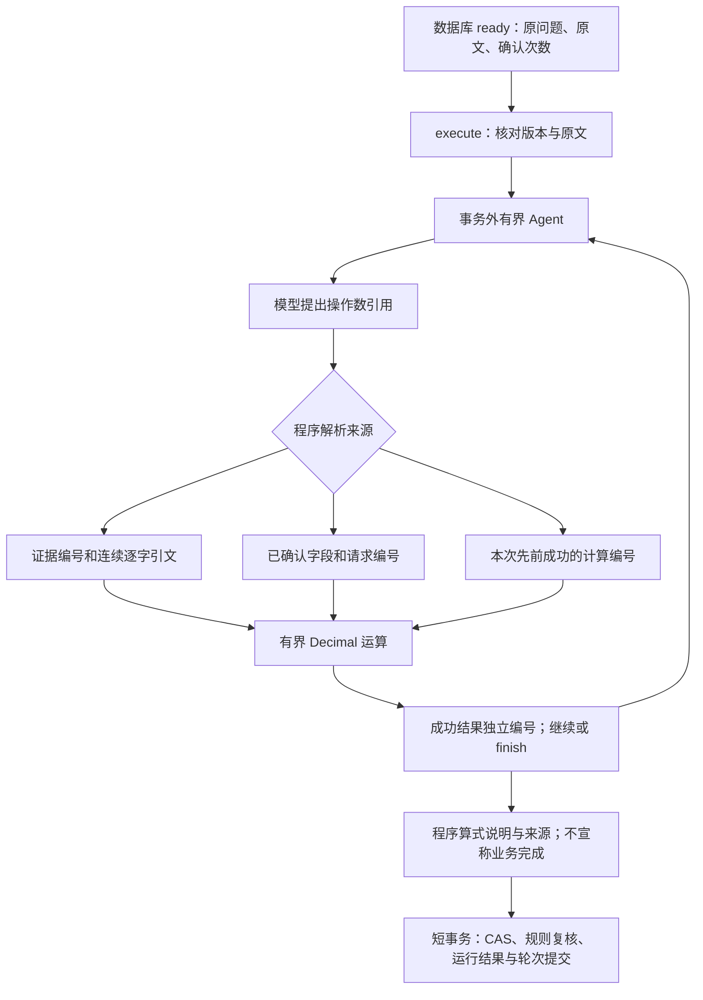

# 阶段 4.2：用户数值与有界链式计算

## 1. 目标

让已确认的用户条件参与算术，并引用本次运行先前成功的结果继续计算。
不把来源绑定与会话记忆、单位换算或业务条件验证混为一谈。

## 2. 原因

会话已经知道“三次”绑定 visit_count，但旧计算器不能把用户消息冒充原文。
复杂任务也需要中间结果。对应工具契约、可信边界、数据溯源与受限工作流能力。

## 3. 概念

区分企业原文、用户条件、程序派生数值。来源绑定证明数字确实来自指定记录，
不能证明模型选择的运算、单位和业务政策正确。计算引用采用本次运行内的顺序编号；
上一轮执行结果即使已持久保存，也不能自动成为新执行的操作数。

## 4. 设计

采用学习者确认的 B：模型给引用、程序取值。比较与限制见
[ADR 0020](../adr/0020-source-referenced-chained-calculations.md)。保留旧 calculator，
会话新增 sourced_calculator，共享 Decimal 运算，不用 eval 或自由表达式。



## 5. 实现

- sourced_contracts.py：带 source 区分的严格引用联合类型与平面来源记录。
- sourced_calculator.py：引用查找、用户原回复回验和计算执行。
- arithmetic.py：两个计算器共用 Decimal 运算、除零与舍入政策。
- engine.py：控制器提供已确认输入及本次成功结果；保留原有步数和去重规则。
- calculation_answers.py：原文引用、用户来源及派生输入分开展示。
- conversations：显式 execute，保存本轮运行结果，不自动将 ready 变为业务 completed。
- 20261011_0006：仅放宽执行轮次的 mode 检查，旧数据不重写。

先按正常迁移方式启动新版本：

```powershell
.\.venv\Scripts\python.exe -m alembic -c backend/alembic.ini upgrade head
```

已有 ready、版本为 2 的会话，可向同一消息接口发送：

```json
{
  "request_id": "00000000-0000-0000-0000-000000000003",
  "expected_version": 2,
  "content": "执行已确认输入的来源绑定算术",
  "mode": "execute"
}
```

示例 UUID 仅表示格式，新请求生成新编号；重试保持原 payload。
模型的用户操作数形如下面结构，request_id 必须是确认“三次”那条消息的编号，
不是执行消息编号。没有 value 字段：

```json
{
  "operation": "multiply",
  "left": {"source": "evidence", "evidence_id": 1, "quote": "服务费 30 元"},
  "right": {
    "source": "user_input",
    "field_name": "visit_count",
    "request_id": "00000000-0000-0000-0000-000000000002"
  }
}
```

得到计算 1 的值 90 后，后续操作数可写
`{"source":"calculation","calculation_id":1}`。模型不能同时提交另一个值。
恢复执行最多八次决策；普通新会话任务仍默认四次。单次旧 agent-runs 保持原工具契约。

## 6. 验证

不连接数据库、不付费调用模型的专项：

```powershell
.\.venv\Scripts\python.exe -m pytest backend/tests/test_sourced_calculator.py -q -p no:cacheprovider
```

首轮 34 项通过（1.80 秒）。独立 PostgreSQL 的执行、会话、迁移与旧计算器联动专项
66 项通过（71.04 秒）。最终完整回归 **1134 项通过、无跳过（291.63 秒）**，新增 50 项；专项不能
直接相加为完整覆盖。模型为替身或 MockTransport，不新增真实模型调用。

迁移专项补充检查旧会话消息不变、新 mode 校验及有执行历史时拒绝降级。
本轮未在应用库运行测试。完整回归后核对本机应用库与测试库不同，再升级
20261011_0005 → 20261011_0006，既有六张表记录数保持一致。首次完整回归的临时目录
权限错误与审核后重跑分别保留在学习记录。真实模型公式选择、步骤完整性和年度计费语义均待验收。

## 7. 学习总结与小实践

学习者选择 B 并认可可核对性，主要依据导师提供的理由；不能记为独立完成设计说明。
导师完成实现与自动化验证；之前单位测试实践按学习者要求跳过，新实践仍未执行。

小实践：在 test_sourced_calculator.py 的
test_cannot_override_confirmed_value_or_reference_other_task 中观察 `{"value":"4"}`。
它与合法用户引用合并后，应该先在参数校验阶段失败，而不是进入乘法得到 120。
可以在该测试函数增加下面的断言，验证夹带自由值是在 schema 边界被拒绝，再运行
`-k cannot_override_confirmed_value`：

```python
if "value" in change:
    assert outcome.steps[0].error_code == "invalid_arguments"
```

这是待学习者修改的小实践，导师尚未替学习者添加；不能仅修改 expected，让不正确业务结果“通过”。

收尾面试题逐题讨论：

1. 为什么“引用已确认用户输入”比“模型传数字加一个来源标签”更可验证？
2. 为什么只允许引用当前运行先前成功的计算编号？如何避免环、伪造结果与跨任务串用？
3. 来源都是真的、算术也对，为什么仍不能宣称全年费用任务成功？

## 8. 下一步

在计算能力之上设计多个业务条件、明确计费期间及有限单位兼容规则，再验收完整年度费用
链路。不能把“全年”简单当作可无条件使用常数 12，也不能将其他原文中的 12 偷换为月份。
随后回到长期记忆、MCP 与工作流主线；不为每一种费率建立自由解释器。
