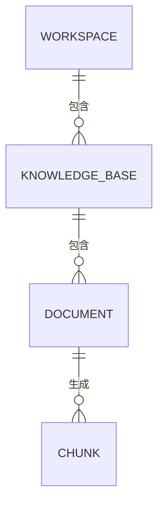

# 第 0.3 阶段：数据模型与接口设计草案

**状态：** 待你评审。目前尚未创建数据库表、迁移文件或新接口。

## 范围与学习目标

这份草案只覆盖本地单用户版本的第一条 RAG 链路。写 SQLAlchemy 模型和 FastAPI 路由之前，先明确数据归属与引用来源。工作空间 ID 用来限定数据范围，并不等于用户权限；对多用户开放之前必须实现身份认证与角色权限控制。

## 实体关系

- **工作空间（`Workspace`）：** `id`（UUID）、`name`、`created_at`（UTC 时间）。一个工作空间包含多个知识库。名称无需全局唯一，因为资源由 ID 唯一标识。
- **知识库（`KnowledgeBase`）：** `id`（UUID）、`workspace_id`（外键）、`name`、`created_at`。建议约束 `(workspace_id, name)` 唯一，避免同一工作空间出现两个同名知识库。
- **文档（`Document`）：** `id`（UUID）、`knowledge_base_id`（外键）、`original_filename`、`media_type`、`storage_key`、`byte_size`、`sha256`、`status`、可选且经过清理的 `error_code`、`created_at`、`updated_at`。开发阶段原文件保存在本地文件存储中，数据库只保存定位它的存储键，不保存文件字节。重复上传会获得新的 ID；`sha256` 只作诊断信息，不强制唯一。
- **文本块（`Chunk`，第 1 阶段实现）：** `id`（UUID）、`document_id`（外键）、`chunk_index`、非空的 `content`、可选的 `page_number` 或 `section_heading`、`created_at`；选定模型后再加入固定维度的向量。`(document_id, chunk_index)` 唯一。PDF 页码从 1 开始；第一版不让一个 PDF 文本块跨页，保证引用能指向明确的页码。

暂不在文档或文本块中重复保存 `workspace_id`。查询时沿外键找到所属知识库，再核对路径中的工作空间。外键能保证父子记录存在，但应用仍须检查“这个知识库是否属于这个工作空间”“这个文档是否属于这个知识库”。文本块由入库流程生成，第一版不开放手工创建或修改文本块的接口。

用户、工作空间成员关系、持久会话、删除与恢复、版本历史，以及一个文本块对应多组向量，都留到后续阶段。第一版一个知识库只使用一种已固定的向量生成模型和维度；更换模型需要重新建立索引。创建向量列之前，我们会先选定并记录模型。

## 文档处理状态

`uploaded → processing → ready`，或 `uploaded → processing → failed`。

- 空文件、超过大小限制的文件或不支持的类型，在创建 Document 记录前拒绝。
- 文件被接受后，即使解析或向量生成失败，也保留状态为 `failed` 的记录和安全的错误代码。接口不返回原文内容或模型服务的原始报错。
- 所有文本块写入成功后，在同一个数据库事务中把文档标记为 `ready`。检索只读取 `ready` 文档，避免部分处理结果进入回答。
- 解析文件和调用向量生成服务期间不长时间占用数据库事务。文件存储与数据库提交无法组成一个原子事务；实现时需要明确清理或恢复路径。
- 进程崩溃可能使文档一直停在 `processing`。自动检测与重试留到后续工程阶段，第一版要如实记录这一限制。

**第一版建议：** 限制文件规模，在上传请求中同步完成处理，并返回 `201 Created` 及文档的最终 `status`（`ready` 或 `failed`）。HTTP 状态码表示文档资源已创建；是否可检索要看响应体中的处理状态。以后加入可靠的后台任务后，再评估返回 `202 Accepted` 和状态查询地址。此选择仍待你评审。

## 接口契约（草案）

所有 ID 都以 UUID 字符串传输。路径前缀采用 `/api/v1`。JSON 接口使用 Pydantic 请求与响应模型；文件上传使用 `multipart/form-data`，字段名为 `file`。`storage_key` 属于内部实现，不返回给客户端。

### 第 0.3 阶段至第 1 阶段初期的资源接口

- `POST /api/v1/workspaces`：提交 `{ "name": "产品文档" }` 创建工作空间；返回 `201`，包含 `id`、`name`、`created_at`。
- `GET /api/v1/workspaces/{workspace_id}`：读取一个工作空间。
- `POST /api/v1/workspaces/{workspace_id}/knowledge-bases`：提交 `{ "name": "接口指南" }` 创建知识库；返回 `201`，包含知识库 ID 和 `workspace_id`。
- `GET /api/v1/workspaces/{workspace_id}/knowledge-bases/{knowledge_base_id}`：读取指定工作空间下的知识库。
- `POST /api/v1/workspaces/{workspace_id}/knowledge-bases/{knowledge_base_id}/documents`：上传一个文件；返回 `201`，包含文档 ID、文件名、处理状态、失败时的安全错误代码和时间戳。
- `GET /api/v1/workspaces/{workspace_id}/knowledge-bases/{knowledge_base_id}/documents/{document_id}`：查询文档处理状态。

等前端需要浏览资源时，再加入带分页的列表接口。第一批测试可以直接使用创建接口返回的 ID。

### 第 1 阶段的检索与回答接口

- `POST /api/v1/workspaces/{workspace_id}/knowledge-bases/{knowledge_base_id}/search`：提交 `{ "query": "...", "top_k": 5 }`，返回限定范围内的结果，包含 `chunk_id`、`document_id`、文本及来源位置。若以后公开检索分数，必须写明距离指标及排序方向。
- `POST /api/v1/workspaces/{workspace_id}/knowledge-bases/{knowledge_base_id}/answers`：提交 `{ "question": "..." }`，返回 `answer`、`abstained` 和引用。引用只能指向本次检索到的文本块。这是单次回答；持久会话留到后续阶段。

### 错误与范围校验

- 资源不存在，或路径中的父子 ID 不匹配，返回 `404`。
- 若采用“同一工作空间内知识库名称唯一”，重复名称返回 `409`。
- 文件超过配置上限返回 `413`；类型不支持返回 `415`；请求格式错误返回 `422`。
- 不用 JSON 请求体里由调用方填写的工作空间 ID 来决定查询范围。路径 ID 必须与数据库中的归属关系核对。这仍只是本地数据范围控制，不能代替用户权限校验。

## 迁移与验证顺序

1. 先确认下方关于文档归属、知识库命名和处理方式的选择。
2. 接入 PostgreSQL；每个请求独立管理 SQLAlchemy 数据库会话；加入 Alembic。先迁移工作空间、知识库和文档。
3. 选定向量生成服务、模型、维度和距离指标，再迁移文本块与 pgvector，建立带范围条件的精确检索。Alembic 自动生成的迁移必须人工审阅。
4. 从空数据库验证迁移、外键、同名处理、路径归属不匹配、处理失败时无可检索残留，以及引用来源位置。

## 需要你参与的设计选择

1. **文档归属：** 一次上传只属于一个知识库（推荐），还是允许多个知识库共用同一文档？共用可节省存储，但需要关联表，索引与删除行为也更复杂。
2. **处理时机：** 第一版的小文件在上传请求中同步处理（推荐），还是把上传与处理拆成两个接口？拆分更容易控制重试，但会增加一步操作。
3. **知识库名称：** 同一工作空间内必须唯一（推荐），还是允许重名？唯一便于查找，但需要处理 `409` 冲突，未来也要考虑重命名规则。
4. **示例资料：** 实现检索前，选择一套可公开展示的产品或技术文档，并准备 5～10 个标注了预期来源的问题。

## 参考资料

- [FastAPI 文件上传说明](https://fastapi.tiangolo.com/tutorial/request-files/)：文件通过表单上传；实现 `UploadFile` 时需要安装 `python-multipart`。
- [Alembic 自动生成迁移说明](https://alembic.sqlalchemy.org/en/latest/autogenerate.html)：生成的迁移需要人工审阅。
- [pgvector 官方说明](https://github.com/pgvector/pgvector)：向量维度和精确检索的基础行为。
