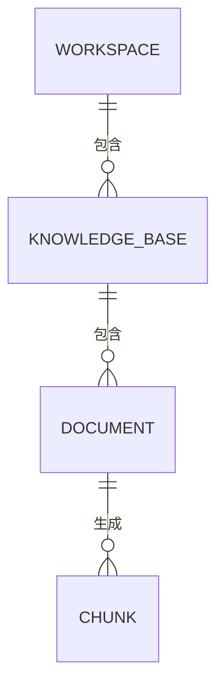

# 第 0.3 阶段：数据模型与接口设计

**状态：** 关键设计选择已确认。三张元数据表与基础资源接口、文本和 Markdown 上传与解析、文本块持久化、向量生成与保存、限定知识库的精确余弦检索已实现。真实模型联调与检索质量待本机配置和标注语料验证；问答仍待下一阶段。下列接口契约是否已经实现，以代码和测试为准。

## 范围与学习目标

这份设计覆盖本地单用户版本的第一条 RAG 链路。本轮先建立元数据持久化基础，阶段 1 再实现上传、切块、向量检索和问答。工作空间 ID 用来限定数据范围，并不等于用户权限；对多用户开放之前必须实现身份认证与角色权限控制。

## 实体关系

- **工作空间（`Workspace`）：** `id`（UUID）、`name`、`created_at`（UTC 时间）。一个工作空间包含多个知识库。名称无需全局唯一，因为资源由 ID 唯一标识。
- **知识库（`KnowledgeBase`）：** `id`（UUID）、`workspace_id`（外键）、`name`、`created_at`，以及可空的 `embedding_provider`、`embedding_model`、`embedding_dimensions`。首个完整向量结果提交后固定接口身份、模型和 1024 维配置，不保存密钥。数据库约束 `(workspace_id, name)` 唯一：同一工作空间不可创建同名知识库，不同工作空间可以同名。
- **文档（`Document`）：** `id`（UUID）、`knowledge_base_id`（外键）、`original_filename`、`media_type`、`storage_key`、`byte_size`、`sha256`、`status`、可选且经过清理的 `error_code`、`created_at`、`updated_at`。一次上传只属于一个知识库；若同一文件要进入另一个知识库，需要重新上传。开发阶段原文件保存在本地文件存储中，数据库只保存定位它的存储键，不保存文件字节。重复上传会获得新的 ID；`sha256` 只作诊断信息，不强制唯一。
- **文本块（`Chunk`，已实现）：** `id`（UUID）、`document_id`（外键）、从 1 开始的 `chunk_index`、`content`、`start_char`、`end_char`，以及可空的 `embedding`（`VECTOR(1024)`）。`(document_id, chunk_index)` 唯一，字符范围满足 `解析文本[start_char:end_char] == content`。当前无页码、章节或创建时间字段；PDF 页码和章节追溯待对应解析模块设计。

暂不在文档或文本块中重复保存 `workspace_id`。查询时沿外键找到所属知识库，再核对路径中的工作空间。外键能保证父子记录存在，但应用仍须检查“这个知识库是否属于这个工作空间”“这个文档是否属于这个知识库”。文本块由入库流程生成，第一版不开放手工创建或修改文本块的接口。

接口接收名称时会去掉首尾空白，并拒绝空名称；当前数据库唯一约束按原样比较大小写，例如 `API` 与 `api` 是两个名称。如需不区分大小写，之后应明确迁移规则并处理已有冲突。

用户、工作空间成员关系、持久会话、删除与恢复、版本历史，以及一个文本块对应多组向量，都留到后续阶段。第一版一个知识库只使用一种已固定的向量生成模型和维度。首个模型已选择百炼 `text-embedding-v4`、1024 维；当前更换模型需要新知识库，尚无原地重建接口。取舍见 [ADR 0004](adr/0004-embedding-generation-and-storage.md)。

## 文档处理状态

阶段 1.1：`uploaded → processing → parsed`，或 `uploaded → processing → failed`。`parsed` 表示原文件已保存并通过文本解析验证；切块后保持 `parsed`。阶段 1.3 完整向量提交后变为 `ready`；阶段 1.4 检索只读取该状态下的非空向量文本块。

- 空文件、超过大小限制的文件或不支持的类型，在创建 Document 记录前拒绝。
- 文件被接受后，解析失败保留状态为 `failed` 的记录和安全错误码。向量生成失败保留原有 `parsed` 状态和文本块，以便重试；向量接口不返回原文内容或模型服务的原始报错。
- 所有文本块和向量写入成功后，在同一个数据库事务中把文档标记为 `ready`。检索只读取 `ready` 文档，避免部分处理结果进入回答。
- 解析文件和调用向量生成服务期间不长时间占用数据库事务。文件存储与数据库提交无法组成一个原子事务；实现时需要明确清理或恢复路径。
- 进程崩溃可能使文档一直停在 `processing`。自动检测与重试留到后续工程阶段，第一版要如实记录这一限制。

**第一版已确认：** 限制文件规模，同步处理。上传接口完成解析，返回 `201 Created` 和 `parsed` 或 `failed`；切块与向量生成由两个独立接口触发，各自同步返回。完整向量保存后才是 `ready`。HTTP 状态码表示请求结果，处理状态表达数据准备程度。以后加入可靠的后台任务后，再评估返回 `202 Accepted`。首批上传细节见[阶段 1.1 设计](phase1-document-ingestion.md)。

## 接口契约（分阶段实施）

所有 ID 都以 UUID 字符串传输。路径前缀采用 `/api/v1`。JSON 接口使用 Pydantic 请求与响应模型；文件上传使用 `multipart/form-data`，字段名为 `file`。`storage_key` 属于内部实现，不返回给客户端。

### 第 0.3 阶段：工作空间与知识库接口

- `POST /api/v1/workspaces`：提交 `{ "name": "产品文档" }` 创建工作空间；返回 `201`，包含 `id`、`name`、`created_at`。
- `GET /api/v1/workspaces/{workspace_id}`：读取一个工作空间。
- `POST /api/v1/workspaces/{workspace_id}/knowledge-bases`：提交 `{ "name": "接口指南" }` 创建知识库；返回 `201`，包含知识库 ID 和 `workspace_id`。
- `GET /api/v1/workspaces/{workspace_id}/knowledge-bases/{knowledge_base_id}`：读取指定工作空间下的知识库。

文档元数据表也在第 0.3 阶段建立；文档接口随阶段 1 的上传处理实现。

### 第 1 阶段：文档接口

- `POST /api/v1/workspaces/{workspace_id}/knowledge-bases/{knowledge_base_id}/documents`：上传一个文件；返回 `201`，包含文档 ID、文件名、处理状态、失败时的安全错误代码和时间戳。首批文本解析成功时状态为 `parsed`。
- `GET /api/v1/workspaces/{workspace_id}/knowledge-bases/{knowledge_base_id}/documents/{document_id}`：查询文档处理状态。
- `POST .../documents/{document_id}/chunks`：传入 `chunk_size`、`overlap`（或 `{}` 使用默认值）保存全部文本块；相同配置复用结果。
- `GET .../documents/{document_id}/chunks`：按编号返回块与字符范围，不返回内部存储键或向量。
- `POST .../documents/{document_id}/embeddings`：无需请求体，为已保存文本块生成向量；返回文档 ID、状态、模型、维度、块数和 `reused`。

等前端需要浏览资源时，再加入带分页的列表接口。第一批测试可以直接使用创建接口返回的 ID。

### 阶段 1.4：检索接口（已实现）

- `POST /api/v1/workspaces/{workspace_id}/knowledge-bases/{knowledge_base_id}/search`：提交 `{ "query": "...", "top_k": 5 }`。`query` 是严格字符串，去首尾空白后非空，最多 2000 字符；`top_k` 是严格整数，默认 5，范围 1 至 20。拒绝未知字段。
- 返回 `metric="cosine_distance"`、`model`、`dimensions` 和 `results`。每条命中包含 `chunk_id`、`document_id`、`document_name`、`chunk_index`、`content`、`start_char`、`end_char`、`distance`。距离为 0 至 2，越小越接近，不是答案正确率；来源字符范围对应解析文本，不公开磁盘目录或原始向量。
- SQL 先限定路径中的工作空间与知识库、文档 `ready` 状态和非空向量，再按距离升序及块 ID 升序排序，最后取前 `top_k` 段。候选不足时返回实际数量，不用其他知识库补齐。
- 问题向量使用知识库固定的接口身份、模型和维度；模型调用前后以短事务复核归属与配置，调用期间没有活动数据库事务。没有候选时不调用模型，返回空列表；尚未固定模型的空库返回空的模型与维度。接口配置依赖仍须有效，否则返回 `503`。

当前没有距离阈值、近似索引或重排。测试使用可控制的查询向量和真实 pgvector 验证边界与排序，真实模型相关性仍待联调。见 [ADR 0005](adr/0005-scoped-vector-retrieval.md)。

### 阶段 1.5：回答接口（待实现）

- `POST /api/v1/workspaces/{workspace_id}/knowledge-bases/{knowledge_base_id}/answers`：提交 `{ "question": "..." }`，返回 `answer`、`abstained` 和引用。引用只能指向本次检索到的文本块。这是单次回答；持久会话留到后续阶段。

### 错误与范围校验

- 资源不存在，或路径中的父子 ID 不匹配，返回 `404`。
- 同一工作空间内创建同名知识库，返回 `409`。
- 文件超过配置上限返回 `413`；类型不支持返回 `415`；请求格式错误返回 `422`。
- 检索模型身份冲突返回 `409`；配置缺失或无效返回 `503`；模型调用或结果异常返回 `502`；模型超时返回 `504`；已有配置、向量或命中距离异常返回 `500`。响应与日志不包含问题正文、密钥或模型服务原始报错。
- 不用 JSON 请求体里由调用方填写的工作空间 ID 来决定查询范围。路径 ID 必须与数据库中的归属关系核对。这仍只是本地数据范围控制，不能代替用户权限校验。

## 迁移与验证顺序

1. 本轮接入 PostgreSQL；每个请求独立管理 SQLAlchemy 数据库会话；加入 Alembic，并迁移工作空间、知识库和文档元数据表。核验从空数据库迁移、外键、同名约束及资源归属关系。
2. 阶段 1 实现单文件同步上传与处理，验证失败状态及无可检索残留。
3. 选定向量生成服务、模型、维度和距离指标，再迁移文本块与 pgvector，建立带范围条件的精确检索；核验来源位置。Alembic 自动生成的迁移必须人工审阅。

## 已确认的选择与待准备资料

1. 一次文档上传只属于一个知识库。
2. 第一版的小文件在上传请求中同步处理。
3. 知识库名称在同一工作空间内唯一；重复创建返回 `409`。
4. 验证语料采用可公开展示的产品或技术文档。具体文档和 5～10 个标注预期来源的问题，用于后续真实检索质量验收，仍待准备。
5. 检索先限定知识库，再取最相似的段落；当前采用精确余弦距离，不增加近似索引。真实质量验收前仍需完成上述语料与标注问题。

## 参考资料

- [FastAPI 文件上传说明](https://fastapi.tiangolo.com/tutorial/request-files/)：文件通过表单上传；实现 `UploadFile` 时需要安装 `python-multipart`。
- [Alembic 自动生成迁移说明](https://alembic.sqlalchemy.org/en/latest/autogenerate.html)：生成的迁移需要人工审阅。
- [pgvector 官方说明](https://github.com/pgvector/pgvector)：向量维度和精确检索的基础行为。
