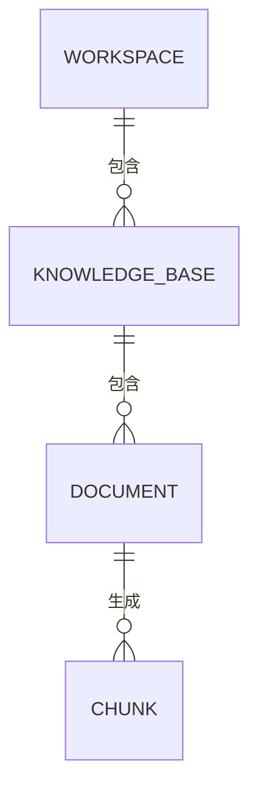

# 第 0.3 阶段：数据模型与接口设计

**状态：** 关键设计选择已确认。三张元数据表与基础资源接口、文本和 Markdown 上传与解析、文本块持久化、向量生成与保存、限定知识库的精确余弦检索、基于证据的单次回答与引用校验已实现并通过本地故障测试；执行结果见 README。真实模型联调、检索与回答质量待本机配置和标注语料验证。

## 范围与学习目标

这份设计覆盖本地单用户版本的第一条 RAG 链路。本轮先建立元数据持久化基础，阶段 1 再实现上传、切块、向量检索和问答。工作空间 ID 用来限定数据范围，并不等于用户权限；对多用户开放之前必须实现身份认证与角色权限控制。

## 实体关系

- **工作空间（`Workspace`）：** `id`（UUID）、`name`、`created_at`（UTC 时间）。一个工作空间包含多个知识库。名称无需全局唯一，因为资源由 ID 唯一标识。
- **知识库（`KnowledgeBase`）：** `id`（UUID）、`workspace_id`（外键）、`name`、`created_at`，以及可空的 `embedding_provider`、`embedding_model`、`embedding_dimensions`。首个完整向量结果提交后固定接口身份、模型和 1024 维配置，不保存密钥。数据库约束 `(workspace_id, name)` 唯一：同一工作空间不可创建同名知识库，不同工作空间可以同名。
- **文档（`Document`）：** `id`（UUID）、`knowledge_base_id`（外键）、`original_filename`、`media_type`、`storage_key`、`byte_size`、`sha256`、`status`、可选且经过清理的 `error_code`、`created_at`、`updated_at`。一次上传只属于一个知识库；若同一文件要进入另一个知识库，需要重新上传。开发阶段原文件保存在本地文件存储中，数据库只保存定位它的存储键，不保存文件字节。重复上传会获得新的 ID；`sha256` 只作诊断信息，不强制唯一。
- **文本块（`Chunk`，已实现）：** `id`（UUID）、`document_id`（外键）、从 1 开始的 `chunk_index`、`content`、`start_char`、`end_char`，以及可空的 `embedding`（`VECTOR(1024)`）。`(document_id, chunk_index)` 唯一，字符范围满足 `解析文本[start_char:end_char] == content`。PDF 的解析文本是按固定规则合并的提取文字；当前无页码、章节或创建时间字段，不能把字符位置当作 PDF 页码或字节偏移。

暂不在文档或文本块中重复保存 `workspace_id`。查询时沿外键找到所属知识库，再核对路径中的工作空间。外键能保证父子记录存在，但应用仍须检查“这个知识库是否属于这个工作空间”“这个文档是否属于这个知识库”。文本块由入库流程生成，第一版不开放手工创建或修改文本块的接口。

接口接收名称时会去掉首尾空白，并拒绝空名称；当前数据库唯一约束按原样比较大小写，例如 `API` 与 `api` 是两个名称。如需不区分大小写，之后应明确迁移规则并处理已有冲突。

用户、工作空间成员关系、持久会话、删除与恢复、版本历史，以及一个文本块对应多组向量，都留到后续阶段。第一版一个知识库只使用一种已固定的向量生成模型和维度。首个模型已选择百炼 `text-embedding-v4`、1024 维；当前更换模型需要新知识库，尚无原地重建接口。取舍见 [ADR 0004](adr/0004-embedding-generation-and-storage.md)。

## 文档处理状态

阶段 1.1：`uploaded → processing → parsed`，或 `uploaded → processing → failed`。`parsed` 表示原文件已保存并通过文本解析验证；切块后保持 `parsed`。阶段 1.3 完整向量提交后变为 `ready`；阶段 1.4 检索只读取该状态下的非空向量文本块。

- 空文件、超过大小限制的文件或不支持的类型，在创建 Document 记录前拒绝。
- 文件被接受后，解析失败保留状态为 `failed` 的记录和安全错误码。向量生成失败保留原有 `parsed` 状态和文本块，以便重试；向量接口不返回原文内容或模型服务的原始报错。
- 所有文本块和向量写入成功后，在同一个数据库事务中把文档标记为 `ready`。检索只读取 `ready` 文档，避免部分处理结果进入回答。
- 解析文件和调用向量生成服务期间不长时间占用数据库事务。文件存储与数据库提交无法组成一个原子事务；实现时需要明确清理或恢复路径。
- 进程崩溃可能使文档一直停在 `processing`。自动检测与重试留到后续工程阶段，第一版要如实记录这一限制。

PDF 扩展沿用相同状态机：已接收文件在损坏、加密、无可提取文字或超过 PDF 解析上限时保留 `failed` 和固定安全错误码；扩展名不支持、空文件或超过上传字节上限仍在创建记录前拒绝。`parsed` 只表示提取文本通过校验，尚未切块或生成向量；不支持扫描件 OCR。取舍见 [ADR 0025](adr/0025-text-layer-pdf-ingestion.md)。

**第一版已确认：** 限制文件规模，同步处理。上传接口完成解析，返回 `201 Created` 和 `parsed` 或 `failed`；切块与向量生成由两个独立接口触发，各自同步返回。完整向量保存后才是 `ready`。HTTP 状态码表示请求结果，处理状态表达数据准备程度。以后加入可靠的后台任务后，再评估返回 `202 Accepted`。首批上传细节见[阶段 1.1 设计](phase1-document-ingestion.md)。

## 接口契约（分阶段实施）

所有 ID 都以 UUID 字符串传输。路径前缀采用 `/api/v1`。JSON 接口使用 Pydantic 请求与响应模型；文件上传使用 `multipart/form-data`，字段名为 `file`。`storage_key` 属于内部实现，不返回给客户端。

### 第 0.3 阶段：工作空间与知识库接口

- `POST /api/v1/workspaces`：提交 `{ "name": "产品文档" }` 创建工作空间；返回 `201`，包含 `id`、`name`、`created_at`。
- `GET /api/v1/workspaces/{workspace_id}`：读取一个工作空间。
- `POST /api/v1/workspaces/{workspace_id}/knowledge-bases`：提交 `{ "name": "接口指南" }` 创建知识库；返回 `201`，包含知识库 ID 和 `workspace_id`。
- `GET /api/v1/workspaces/{workspace_id}/knowledge-bases/{knowledge_base_id}`：读取指定工作空间下的知识库。

文档元数据表也在第 0.3 阶段建立；文档接口随阶段 1 的上传处理实现。

### 第 1 阶段：文档接口

- `POST /api/v1/workspaces/{workspace_id}/knowledge-bases/{knowledge_base_id}/documents`：上传一个文件；返回 `201`，包含文档 ID、文件名、处理状态、失败时的安全错误代码和时间戳。支持 UTF-8 TXT/Markdown 与可提取文字 PDF；解析成功时状态为 `parsed`。
- `GET /api/v1/workspaces/{workspace_id}/knowledge-bases/{knowledge_base_id}/documents/{document_id}`：查询文档处理状态。
- `POST .../documents/{document_id}/chunks`：传入 `chunk_size`、`overlap`（或 `{}` 使用默认值）保存全部文本块；相同配置复用结果。
- `GET .../documents/{document_id}/chunks`：按编号返回块与字符范围，不返回内部存储键或向量。
- `POST .../documents/{document_id}/embeddings`：无需请求体，为已保存文本块生成向量；返回文档 ID、状态、模型、维度、块数和 `reused`。

工作空间、知识库与文档三级列表已按下节补齐；调用方可以使用上一级列表返回的 ID 查询下一级，不必只依靠创建接口返回的 ID。尚无管理页面或身份授权。

### 可提取文字 PDF 扩展

- `.pdf` 使用 `application/pdf` 媒体类型；默认单文件字节上限继续为 5 MiB，额外限制最多 100 页和 1,000,000 个提取字符。上限仅约束本地单用户版本的常见输入规模，不能证明能抵抗恶意压缩流的资源耗尽；对外开放时需进程隔离与更严格的资源预算。
- 上传先按既有流程保存一份原 PDF，再调用共用文本解析函数验证；首次切块从原 PDF 调用该函数再次提取。TXT/Markdown 通过同一入口按 UTF-8 读取。不另外保存文字文件，不修改数据库表或 `Chunk`/`Document` 响应结构；同配置切块重试沿用已有结果。
- PDF 提取文字按固定规则合并为一个字符串，切块的 `[start_char,end_char)` 针对该字符串，引用不声称原 PDF 字节位置或页码。真实 PDF 的文字顺序、表格、版面与后续语义质量仍需另行验收。
- 不做 OCR；扫描件或只有图片且无可提取文字的文件保留 `failed` 记录。损坏、加密或超解析上限也以固定安全错误码表达，不返回解析器原始异常；调用切块时若原件后来不可读，则走既有来源错误路径。
- PDF 固定错误码为 `PDF_INVALID`（损坏或无法安全解析）、`PDF_PASSWORD_REQUIRED`（加密）、`PDF_NO_TEXT`（无可提取文字）、`PDF_TOO_MANY_PAGES` 和 `PDF_TEXT_TOO_LONG`。列表与详情仍返回相同的安全元数据字段。

### 工作空间列表与三级浏览

- `GET /api/v1/workspaces?limit=20&offset=0`：返回 `WorkspaceRead` 数组，仅包含 `id`、`name`、`created_at`，复用现有详情模型。
- 分页与另外两级一致：`limit` 默认20、范围1–100；`offset` 默认0、范围0–`2**63-1`；非法参数返回422。数据库按 `created_at`、`id` 升序后分页；空集合或超出末页返回200[]。
- 工作空间是根级集合，不需要父资源存在检查；当前返回本地单用户的全局工作空间，不查询用户成员关系，不宣称身份授权或公司隔离。
- 三级浏览用工作空间列表返回的ID请求知识库列表，再用知识库列表返回的ID请求文档列表，文档详情同样使用文档列表返回的ID。集成测试覆盖两个工作空间的同名知识库/文档及错配父级404，但不代表真实用户权限验收。
- 本轮工作空间/知识库/文档相关回归66项通过、无跳过（59.62秒），使用独立PostgreSQL测试库与临时存储，无模型调用，不是完整后端回归；详见学习记录。

### 文档列表：小步补齐

- `GET /api/v1/workspaces/{workspace_id}/knowledge-bases/{knowledge_base_id}/documents?limit=20&offset=0`：复用 `DocumentRead` 数组，返回 ID、知识库 ID、文件名、媒体类型、字节数、摘要、状态、安全错误码及创建/更新时间，不返回正文、存储路径、向量或原始异常。
- 分页参数沿用知识库列表：`limit` 默认20、范围1–100；`offset` 默认0、范围0–`2**63-1`；非法参数或路径UUID返回422。先核对知识库与工作空间归属，再在数据库内限定二者、按 `created_at`/`id` 升序后分页；错误父级或缺失知识库404，合法空库或超出末页200[]。
- 学习者确认方案B：这是文档管理视图，展示 `uploaded`、`processing`、`parsed`、`ready`、`failed` 各状态，不把可检索性当作可见性。方案A只列ready适用于可检索资料视图，但不满足查看待处理/失败文件的管理需求。
- 后续补齐可选查询参数 `status`，只能取上述五种精确值；省略返回全部，空字符串、大小写变体或其他值返回422，不自行猜测“正常”的含义。Python参数命名为 `document_status`，通过 `Query(alias="status")` 保持HTTP名称，避免覆盖 `fastapi.status`。
- 方案A获取一页后筛选，会把页外的失败记录漏掉或产生假空页；选择方案B由数据库先限定工作空间/知识库，再加可选状态条件，最后排序分页。存在的知识库无该状态记录返回200[]，父级不存在或错配仍返回404。减少无关结果传输是预期收益，未进行性能基准测量。
- 列表不读取原文件或构造模型提供方，不调用模型；检索仍只使用ready且有向量的候选。此处列表接口不增加总数/游标、删除或身份授权；PDF 上传与解析作为独立扩展，不改变列表契约。offset分页并非跨请求数据快照。
- 增加状态筛选前的文档专项30项通过、无跳过（27.09秒），仅是当时版本的验证证据。本轮相关测试结果另记于学习记录，不把构造的测试状态记录称为真实向量处理或模型质量验收。

### 知识库列表：小步补齐

- `GET /api/v1/workspaces/{workspace_id}/knowledge-bases?limit=20&offset=0`：返回 `KnowledgeBaseRead` 数组，仅包含 `id`、`workspace_id`、`name`、`created_at`；不返回向量配置或内部字段。
- `limit` 默认 20，合法范围为 1–100；`offset` 默认 0，合法范围为 0–`2**63-1`（PostgreSQL OFFSET 的整数边界）。非整数、越界或无效工作空间 UUID 返回 `422`。
- 先确认工作空间存在，再由数据库按 `workspace_id` 过滤，按 `created_at`、`id` 升序后应用 `offset` 和 `limit`；同一时间的记录以 UUID 打破平局。工作空间不存在返回 `404`；存在但无知识库，或偏移超过结果数，返回 `200 []`。
- 选择有界简单分页而非一次返回全部。这里是页面资源浏览，不是问题相关性检索；不依赖向量或生成配置，不调用模型，无新依赖或迁移。
- 首版不计算总数、不返回游标、不增加搜索或删除。固定排序不等于跨请求数据库快照，并发新增或删除仍可能让 offset 页移动；很大偏移也不保证低延迟，出现实际需求后再评估游标分页。
- 工作空间范围检查仍不等于用户身份与访问权限。资源专项16项通过、无跳过（9.90秒），使用独立PostgreSQL测试库，不调用模型；这是本轮资源接口验收，不是完整后端回归，详细轨迹见学习记录。

### 阶段 1.4：检索接口（已实现）

- `POST /api/v1/workspaces/{workspace_id}/knowledge-bases/{knowledge_base_id}/search`：提交 `{ "query": "...", "top_k": 5 }`。`query` 是严格字符串，去首尾空白后非空，最多 2000 字符；`top_k` 是严格整数，默认 5，范围 1 至 20。拒绝未知字段。
- 返回 `metric="cosine_distance"`、`model`、`dimensions` 和 `results`。每条命中包含 `chunk_id`、`document_id`、`document_name`、`chunk_index`、`content`、`start_char`、`end_char`、`distance`。距离为 0 至 2，越小越接近，不是答案正确率；来源字符范围对应解析文本，不公开磁盘目录或原始向量。
- SQL 先限定路径中的工作空间与知识库、文档 `ready` 状态和非空向量，再按距离升序及块 ID 升序排序，最后取前 `top_k` 段。候选不足时返回实际数量，不用其他知识库补齐。
- 问题向量使用知识库固定的接口身份、模型和维度；模型调用前后以短事务复核归属与配置，调用期间没有活动数据库事务。没有候选时不调用模型，返回空列表；尚未固定模型的空库返回空的模型与维度。接口配置依赖仍须有效，否则返回 `503`。

当前没有距离阈值、近似索引或重排。测试使用可控制的查询向量和真实 pgvector 验证边界与排序，真实模型相关性仍待联调。见 [ADR 0005](adr/0005-scoped-vector-retrieval.md)。

### 阶段 1.5：回答接口（已实现）

- `POST /api/v1/workspaces/{workspace_id}/knowledge-bases/{knowledge_base_id}/answers`：提交 `{ "question": "如何提交退款申请？", "top_k": 5 }`。`question` 为严格字符串，去首尾空白后 1 至 2000 字符；`top_k` 为严格整数，默认 5，范围 1 至 20。拒绝未知字段。
- 返回 `answer`、`abstained`、`citations`。引用包含 `chunk_id`、`document_id`、`document_name`、`chunk_index`、`quote`、`start_char`、`end_char`；范围表示引文在解析文本中的左闭右开字符区间，不是原文件字节偏移。
- 默认在 12000 字符预算内按排名选择完整文本块。过长块跳过，可放入后续块；不截断块。全部块无法放入返回 `422`。字符限制不等于 token 限制。
- 无命中直接 `200` 弃答，跳过回答模型；仍须满足检索的向量配置依赖。有证据时在事务外请求 JSON 草稿，程序严格检查结构、来源编号、连续引文和重复引用，再从本次传入的证据构造真实来源字段。
- 模型按契约弃答后，接口返回 `abstained=true`、空引用和固定提示“目前检索到的资料不足以确认这个问题的答案。”；证据不足是正常业务结果。模型不得据此断言企业全部资料中都不存在答案。
- 草稿正常回答必须有非空答案与引用。来源编号必须属于本次实际传入的证据，`quote` 必须是对应块的连续子串；非法结果返回 `502`。相同引文在块内重复时定位首次出现，不能据此确定模型所指的某次出现。引文存在也不证明答案的每项结论都受到支持。

回答适配器与向量适配器分别配置，需显式设置 `EAAP_GENERATION_BASE_URL`（HTTPS）、`EAAP_GENERATION_API_KEY`、`EAAP_GENERATION_MODEL`。学习者已选择 DeepSeek 官网的 `deepseek-flash`，配置示例记录 `https://api.deepseek.com`，新密钥配置仍待完成；地址、密钥或模型缺失时有证据的回答请求返回 `503`。当前非流式、单次回答，不保存会话或回答历史，也没有引用版本机制。流程与取舍见 [ADR 0006](adr/0006-evidence-grounded-answers.md)。

### 错误与范围校验

- 资源不存在，或路径中的父子 ID 不匹配，返回 `404`。
- 同一工作空间内创建同名知识库，返回 `409`。
- 文件超过配置上限返回 `413`；类型不支持返回 `415`；请求格式错误返回 `422`。
- 检索模型身份冲突返回 `409`；配置缺失或无效返回 `503`；模型调用或结果异常返回 `502`；模型超时返回 `504`；已有配置、向量或命中距离异常返回 `500`。响应与日志不包含问题正文、密钥或模型服务原始报错。
- 回答证据不足返回正常的 `200` 弃答；回答模型结构或引用非法返回 `502`，超时返回 `504`。这些技术错误不会转换成“资料没有答案”。
- 不用 JSON 请求体里由调用方填写的工作空间 ID 来决定查询范围。路径 ID 必须与数据库中的归属关系核对。这仍只是本地数据范围控制，不能代替用户权限校验。

## 迁移与验证顺序

1. 本轮接入 PostgreSQL；每个请求独立管理 SQLAlchemy 数据库会话；加入 Alembic，并迁移工作空间、知识库和文档元数据表。核验从空数据库迁移、外键、同名约束及资源归属关系。
2. 阶段 1 实现单文件同步上传与处理，验证失败状态及无可检索残留。
3. 选定向量生成服务、模型、维度和距离指标，再迁移文本块与 pgvector，建立带范围条件的精确检索；核验来源位置。Alembic 自动生成的迁移必须人工审阅。

## 已确认的选择与待准备资料

1. 一次文档上传只属于一个知识库。
2. 第一版的小文件在上传请求中同步处理。
3. 知识库名称在同一工作空间内唯一；重复创建返回 `409`。
4. 验证语料采用可公开展示的产品或技术文档。具体文档和 5～10 个标注预期来源的问题，用于后续真实检索质量验收，仍待准备。
5. 检索先限定知识库，再取最相似的段落；当前采用精确余弦距离，不增加近似索引。真实质量验收前仍需完成上述语料与标注问题。

## 参考资料

- [FastAPI 文件上传说明](https://fastapi.tiangolo.com/tutorial/request-files/)：文件通过表单上传；实现 `UploadFile` 时需要安装 `python-multipart`。
- [Alembic 自动生成迁移说明](https://alembic.sqlalchemy.org/en/latest/autogenerate.html)：生成的迁移需要人工审阅。
- [pgvector 官方说明](https://github.com/pgvector/pgvector)：向量维度和精确检索的基础行为。
