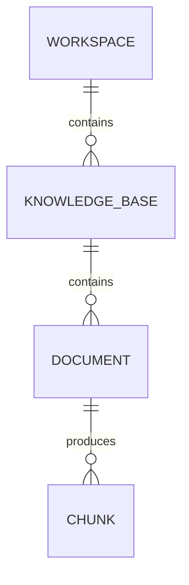

# Phase 0.3 — Data model and API proposal

**Status:** Draft for project-owner review. No tables, migrations, or new routes have been implemented.

## Scope and teaching objective

This proposal covers the first local, single-user RAG slice. It makes data ownership and citation provenance explicit before we write SQLAlchemy models or FastAPI routes. Workspace IDs are data scopes, not an authorization mechanism; authentication and RBAC must precede multi-user deployment.

## Entity relationships

- **Workspace:** `id` (UUID), `name`, `created_at` (UTC). A workspace groups knowledge bases. Names need not be globally unique because IDs identify resources.
- **KnowledgeBase:** `id` (UUID), `workspace_id` (foreign key), `name`, `created_at` (UTC). Proposed constraint: unique `(workspace_id, name)` to avoid two identically named bases in one workspace.
- **Document:** `id` (UUID), `knowledge_base_id` (foreign key), `original_filename`, `media_type`, `storage_key`, `byte_size`, `sha256`, `status`, optional sanitized `error_code`, `created_at`, `updated_at` (UTC). The original file lives in local storage during development; the database stores its key, not its bytes. Reuploads receive new IDs; `sha256` is diagnostic metadata, not a uniqueness constraint.
- **Chunk (Phase 1):** `id` (UUID), `document_id` (foreign key), `chunk_index`, nonempty `content`, optional `page_number` or `section_heading`, `created_at` (UTC), and an embedding of fixed dimension after the model is selected. `(document_id, chunk_index)` is unique. PDF page numbers are 1-based; initial PDF chunks remain within one page so a citation has an unambiguous page.

Do not duplicate `workspace_id` on Document or Chunk yet. Follow foreign keys through KnowledgeBase when checking scope. Foreign keys preserve parent-child validity; application queries must still verify that a requested KB belongs to the path's workspace and a document belongs to that KB. There is no public Chunk creation/update API: ingestion produces chunks.

We defer User, membership, conversations, delete/restore, version history, and multiple embeddings per chunk. A knowledge base will use one pinned embedding model and dimension at a time; changing that model requires re-indexing. We will choose and record the model before creating the vector column.

## Document lifecycle

`uploaded → processing → ready` or `uploaded → processing → failed`.

- Reject empty, oversized, or unsupported files before creating a Document record.
- After acceptance, retain a record when parsing or embedding fails, with a safe error code. Do not expose raw file content or provider errors in API responses.
- Insert all chunks and mark the document `ready` in the same database transaction. Search queries include only `ready` documents, so partial ingestion cannot become searchable.
- Do not hold a database transaction open while parsing or calling an embedding provider. File storage and a database commit are not one atomic operation; handle cleanup or recovery explicitly as the ingestion flow develops.
- A process crash can leave `processing` stale. Detection/retry is later production work; the first local slice makes this limitation visible.

**Proposed first implementation:** process a bounded small upload in the request and return `201 Created` with the final Document `status` (`ready` or `failed`). The status, rather than the HTTP code alone, tells the client whether it can search the document. A later durable worker would change the processing contract and may return `202 Accepted` with a status URL. This choice is awaiting project-owner review.

## HTTP contract (proposed)

All IDs are UUID strings. Paths use `/api/v1`. JSON endpoints use Pydantic request and response schemas; upload uses `multipart/form-data` with one `file` field. The original `storage_key` is internal and is not returned to clients.

### Phase 0.3 / early Phase 1 resource routes

- `POST /api/v1/workspaces` — create a workspace from `{ "name": "Platform Docs" }`; return `201` with `id`, `name`, `created_at`.
- `GET /api/v1/workspaces/{workspace_id}` — fetch one workspace.
- `POST /api/v1/workspaces/{workspace_id}/knowledge-bases` — create a KB from `{ "name": "API Guides" }`; return `201` with its ID and `workspace_id`.
- `GET /api/v1/workspaces/{workspace_id}/knowledge-bases/{knowledge_base_id}` — fetch one scoped KB.
- `POST /api/v1/workspaces/{workspace_id}/knowledge-bases/{knowledge_base_id}/documents` — upload one file; return `201` with Document ID, filename, status, safe error code if failed, and timestamps.
- `GET /api/v1/workspaces/{workspace_id}/knowledge-bases/{knowledge_base_id}/documents/{document_id}` — inspect processing status.

List endpoints with pagination can be added when the user interface needs them. The first tests can use the IDs returned by creation routes.

### Phase 1 retrieval routes

- `POST /api/v1/workspaces/{workspace_id}/knowledge-bases/{knowledge_base_id}/search` with `{ "query": "...", "top_k": 5 }` — return scoped hits with `chunk_id`, `document_id`, text, and source locator. If a score is exposed later, name the distance metric and its sort direction.
- `POST /api/v1/workspaces/{workspace_id}/knowledge-bases/{knowledge_base_id}/answers` with `{ "question": "..." }` — return `answer`, `abstained`, and citations that refer only to retrieved chunk IDs. This is a single answer; persistent conversations belong to a later phase.

### Errors and scope

- `404` when a resource is absent **or** its parent IDs do not match the path.
- `409` for a duplicate KB name within the same workspace, if the proposed unique constraint is accepted.
- `413` for a file over the configured size limit; `415` for unsupported file type; `422` for malformed input.
- Never rely on caller-supplied workspace IDs in a JSON body to establish scope. A path ID must be checked against database relationships. These checks organize local data but do not replace authorization.

## Migration and verification order

1. Agree on the ownership, naming, and ingestion decisions below.
2. Add PostgreSQL connection handling, one SQLAlchemy Session per request, and Alembic. Migrate Workspace, KnowledgeBase, and Document first.
3. Select an embedding provider/model, dimension, and distance metric. Then migrate Chunk plus pgvector and build exact, scoped search. Review autogenerated migrations before applying them.
4. Test migrations from an empty database, foreign keys, duplicate-name behavior, path-scope mismatch, failed ingestion with no searchable chunks, and citation locators.

## Decisions for project-owner review

1. **Document ownership:** one upload belongs to exactly one KB (recommended), or one document can be shared by several KBs? Sharing saves storage but needs a join table and more complex indexing/deletion behavior.
2. **Ingestion timing:** bounded synchronous processing in the upload request (recommended for the first local slice), or separate upload and processing API calls? The second option gives clearer retry control but adds another workflow step.
3. **KB names:** unique within a Workspace (recommended), or allow duplicates? Unique names simplify navigation but require a `409` path and rename policy later.
4. **Example corpus:** choose a publicly shareable product/technical documentation set and 5–10 labeled questions before implementing retrieval.

## References

- [FastAPI file uploads](https://fastapi.tiangolo.com/tutorial/request-files/) — multipart upload uses `UploadFile` and requires `python-multipart` when implemented.
- [Alembic autogeneration](https://alembic.sqlalchemy.org/en/latest/autogenerate.html) — generated revisions require human review.
- [pgvector](https://github.com/pgvector/pgvector) — fixed vector dimensions and exact search baseline.
