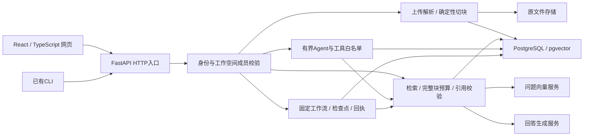

# 求职演示版：整体架构、完成线与讲解

2026-10-23。此文作为当前项目总入口，不再按每日小改动判断项目完成度。
交付目标是展示一个可以操作、可以解释关键取舍的企业知识与受控工作流原型；
不是在求职前完成无限范围的企业产品。旧实现和教学记录保留历史，各项证据以对应版本为准。

## 一个业务故事

员工把制度资料放入自己的工作空间和知识库，完成解析、切块与显式预算向量化；
查询时从当前知识库找证据，生成带原文引用的回答，证据不足则弃答。
员工可以查看引用所在完整文本块并下载这次答案。需要多步任务时，再使用受控会话或固定问答工作流。

网页核心路径：登录 → 创建/选择工作空间 → 创建/选择知识库 → 上传 → 切块 → 向量化 →
检索或引用问答 → 核对来源 → TXT导出。创建和列表读取不调用模型；向量化、检索、问答是用户显式提交。
新建资源按已确认201中的ID直接进入，不把当前20条列表当作全部记录。
工作空间、知识库和文档均可手动翻页，文档还支持文件名/状态交集筛选。

## 架构与职责

采用模块化单体：HTTP入口、业务服务、模型适配器与持久化分开，但不拆成多个部署服务。
当前项目规模用短数据库事务和普通函数即可组织流程，便于调试和测试；没有为框架或微服务数量增加复杂度。
模型调用放在数据库事务外，避免等待外部服务时占用长事务；代价是跨调用没有原子快照或外部费用恰好一次保证。

- `backend/app/api/`：请求校验、身份与父子范围、固定安全错误。
- `backend/app/knowledge/`：入库、切块、向量/混合检索、上下文选择和逐字引用定位。
- `backend/app/providers/`：外部模型协议与超时、输出校验；测试可替换为受控实现。
- `backend/app/agents/`、`conversations/`、`workflows/`：工具控制、保存条件、固定步骤及恢复边界；以实际目录为准。
- `frontend/src/`：明确提交动作、请求取消与迟到隔离、来源展示和本地导出。

## 四个最值得讲的设计

第一，检索与生成分工。向量检索用于语义关联，混合检索增加词项通道并按名次融合；
候选接近问题不等于包含答案。网页检索固定最多3段，问答可选最多3或5段；
`top_k`是候选上限，上下文预算还会选择能放入的完整文本块，最终引用数量也可不同。
更高上限和混合策略都需要实际评测，不能直接宣称提高正确率。

第二，模型草稿经过程序核验。模型只输出本次来源编号和引文，后端根据真实候选构造文档/块ID与字符范围；
越界、伪造或重复引用会被拒绝。引文必须是原文连续子串，但“原文存在”不能证明答案每项结论都被支持。
正常弃答与技术故障分别展示，零命中或弃答不能证明整个知识库没有相关资料。

第三，范围控制由后端执行。登录只确定用户身份，数据库成员关系决定能否访问工作空间；
查询再约束知识库、文档与块的父子归属。前端核验响应可避免展示串库数据，不能替代服务端授权。
当前是owner/member基础边界，不是细粒度RBAC或每用户私有会话。

第四，控制重复执行。创建、向量化、生成和工作流动作都显式触发，前端禁止重复点击并隔离迟到响应。
创建回执未知时先核对列表，不自动重发；会话/工作流使用请求标识和版本控制。
停止浏览器等待不保证后端停止；数据库重放也不能保证外部服务绝不重复收费。

## 这次求职版本的完成线

核心开发收尾范围是上述入库—检索—可信回答流程，以及已有受控会话/固定工作流演示能力。
本次补齐资源创建、两层列表翻页、仓库内隔离验证入口和统一说明。
运行方法与演示顺序见[运行和演示手册](run-and-demo.md)，验证范围见[本次交付记录](release-2026-10-23.md)。

仍需单独完成的真实验收：当前网页来源/模型问答全链、TXT实际落盘、当前两策略质量比较和费用。
本轮用户此前暂停的真实模型请求、Cookie到期等待和推送没有恢复授权，因此不能宣称已生产验收。
已有早期六题RAG和29块检索评测是真实历史证据，可以介绍范围，不能当作当前全站验收。

以下统一归为后续扩展，不再作为求职版开发的无限待办：即时问答服务器历史、会话列表/刷新恢复、
所有后端能力全量接入网页、文档版本与删除、细粒度权限/私有会话、OCR与PDF原页码、通用审批和可视编排、
大规模向量索引优化、集中日志/告警与公网生产部署。现有网页工作流历史不是即时问答历史。

## 如何向面试官介绍

可以先用约一分钟说明业务、流程、技术栈和风险边界，再选上面四项中的两项深入。
可参考：“这个项目解决企业资料入库、查找和基于原文回答的问题。我采用React、FastAPI和PostgreSQL/pgvector，
把文档变成带位置的文本块，检索后控制证据预算，让模型生成并由程序核验引用。
另有受控Agent、结构化条件补充和固定检查点工作流。工程上重点处理范围授权、重复执行和故障后的结果不确定性。
目前核心功能有模拟和部分真实数据库/历史模型验证，当前网页真实问答质量仍需专项验收。”

参与程度必须如实补充：主体方案、实现和验证多由导师完成，本人通过跟随实践、独立回答与讲解学习。
只把自己能独立说明、修改和验证的内容写成个人掌握；不要把仓库代码量等同于独立开发经历。
本次结束按整体项目做一个实践与2—3道面试讨论，每次一个核心问题；旧微模块练习不再阻碍主线。
