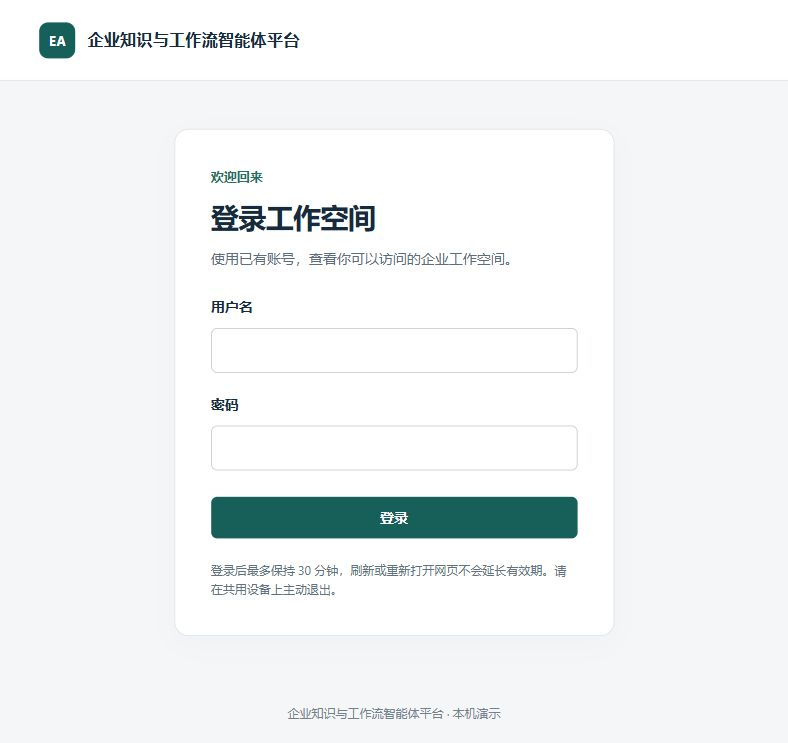

# 网页第二步：固定 30 分钟内恢复登录

2026-10-15，起点 `288ebc6`。本步改善刷新和重开浏览器后的登录体验，继续只展示本人工作空间第一页。
本步的实现替代[网页第一步](frontend-login.md)的内存 JWT；第一步的构建、模拟测试和真实操作记录保留为历史。

## 学习目标与调用链

学习者提出关闭浏览器后仍希望持续登录一段时间。导师比较 localStorage 与 HttpOnly Cookie 后采用后者，
沿用已有 30 分钟固定期限。学习者回答 10:00 登录、10:20 重开应在 10:30 到期；
记录为正确场景判断，不增加未表达的独立理由，也不记本人完成实现或测试。

登录时：浏览器提交账号密码 → 后端验证、签发原有 JWT 并设置 HttpOnly Cookie → 返回用户和到期时间 → 查询本人空间。
刷新或重开时：浏览器携带 Cookie 请求恢复 → 后端核验签名、原期限及当前用户 → 返回原到期时间 → 查询本人空间。
退出时：网页 POST 请求 → 后端删除 Cookie → 返回 204 → 网页清除用户与空间。退出失败时显示“退出尚未确认”，允许重试。

凭据由浏览器保存和发送，页面脚本不读取 Cookie；没有密码、JWT 或会话对象写入 localStorage/sessionStorage。
恢复不会重新计时；原有 CLI 继续使用 `/auth/login` 和 Authorization Bearer。
设计、请求来源校验和边界见 [ADR 0030](adr/0030-persistent-web-cookie-session.md)。

## 本机操作（CMD）

数据库结构和账号授权不变，无需再迁移、注册或指定 owner。此次修改了后端 Python 代码，
若旧进程没有自动重载，需要先在原后端窗口按 Ctrl+C，再执行：

```cmd
cd /d D:\workproject\enterprise_AI_agent_platform
.venv\Scripts\python.exe -m uvicorn app.main:app --app-dir backend --host 127.0.0.1 --port 8000
```

前端如已运行会热更新；未运行时另开 CMD：

```cmd
cd /d D:\workproject\enterprise_AI_agent_platform\frontend
npm run dev
```

使用固定地址 [http://127.0.0.1:5173/](http://127.0.0.1:5173/)。默认允许来源就是该地址；
不要混用 localhost、其他端口或额外 Vite 实例。若改变来源，需要在私有配置设置对应 `EAAP_WEB_ORIGIN` 并重启后端。
生产要求显式 HTTPS origin（无路径和末尾斜杠）与 `EAAP_APP_ENV=production`，Cookie 启用 Secure；
本机 HTTP 配置不能作为生产部署说明。签名密钥留空时，后端重启会令旧 Cookie 无效，需重新登录。

手动验证顺序：

1. 用已有 `demo_a` 登录，确认对应工作空间。密码仅在本机页面输入。
2. F5 刷新，观察恢复后仍显示本人空间。
3. 在原有效期内关闭页面并重开相同地址，观察仍可恢复。浏览器保留 Cookie 是前提。
4. 点击退出，等待回到登录页，再刷新确认不会恢复旧账号。

单个账号操作不代表另一账号、跨空间拒绝或完整部署验收。真实关闭浏览器再打开、到期等待、退出等证据按实际操作分别记录。

## 验证记录

- 最终 TypeScript 检查和 Vite 生产构建通过，无新增依赖。
- 前端最终联合：2 个文件、29 项通过、无跳过，Vitest 报告 7.51 秒。
  全部为替身 fetch，覆盖恢复成功/401/网络失败显式重试、绝对到期、退出失败保留会话、
  成功退出后重新挂载、StrictMode 重复挂载和迟到响应隔离。模拟不证明真实浏览器持久 Cookie 属性。
- 后端最终联合：`test_web_session.py`、`test_auth_workspace.py`、`test_auth_migration.py`、
  `test_auth_register_local.py` 共 65 项通过、无跳过，pytest 报告 19.45 秒。
  包含 29 项新纯替身 Cookie/安全响应专项及已有身份、迁移和本机注册兼容用例；
  其中新真实数据库用例校验 Cookie 身份建空间、来源拒绝、Bob 的 Bearer 兼容、跨空间拒绝、
  固定到期恢复与过期拒绝。数据库场景使用独立本机 `eaap_test` 随机 schema，前置检查与日常库不同。
  不是 65 项全部访问数据库，也不是完整后端回归或生产安全验收。
- 前置专项为 Cookie 29 项通过（2.75 秒）和身份兼容 36 项通过（31.80 秒），
  均包含在最终联合中，不与 65 相加。前端此前 21 项是首步历史，不与本轮 29 相加。
- 只读运行预检发现 8000 端口的旧后端与 5173 开发代理对新 `/auth/web/session` 均返回 404；
  说明当前运行进程尚未加载新路由，需要按上文重启。此次未停止学习者已有后端进程。
  新 Cookie 流程的真实账号浏览器操作、刷新及关闭重开仍待学习者本机验证，不沿用首步 A 的截图充当新证据。
- 学习者随后提供“暂时无法恢复登录”的页面截图。排查期间，8000 端口前两次请求短暂不可达，
  后续 OpenAPI 已包含新恢复路由，5173 代理匿名恢复返回 401 与 no-store。导师在现有浏览器页
  点击“重试恢复”，实际确认回到空登录表单，说明失败后显式重试入口可用；未输入账号密码。
  原失败请求状态未保存，不将其具体 HTTP 状态或根因写成已证实结论；此次不修改业务代码或重跑测试。
  该结果只验证未登录恢复与重试，不代表真实账号保持登录、到期或退出已验收。
- 学习者随后明确反馈“现在刷新后也可以保持登录”，新 Cookie 流程完成一次本人真实
  登录后刷新恢复的操作确认。完整退出浏览器后重开、主动退出后刷新、实际等待到期仍待分别确认；
  此次不是新增自动化测试或独立代码实践，也没有追加模型请求。
- 本步无日常库迁移/注册/owner 变更、真实模型请求或 GitHub 推送；未跑后端全量回归。



## 后续学习

代码实践与模块面试题仍待完成；下一步安排一个围绕固定到期时间的小实践，再逐题讨论。
完成本环节后再接工作空间下的知识库页面，不同时引入新的页面或 Agent 工具。
