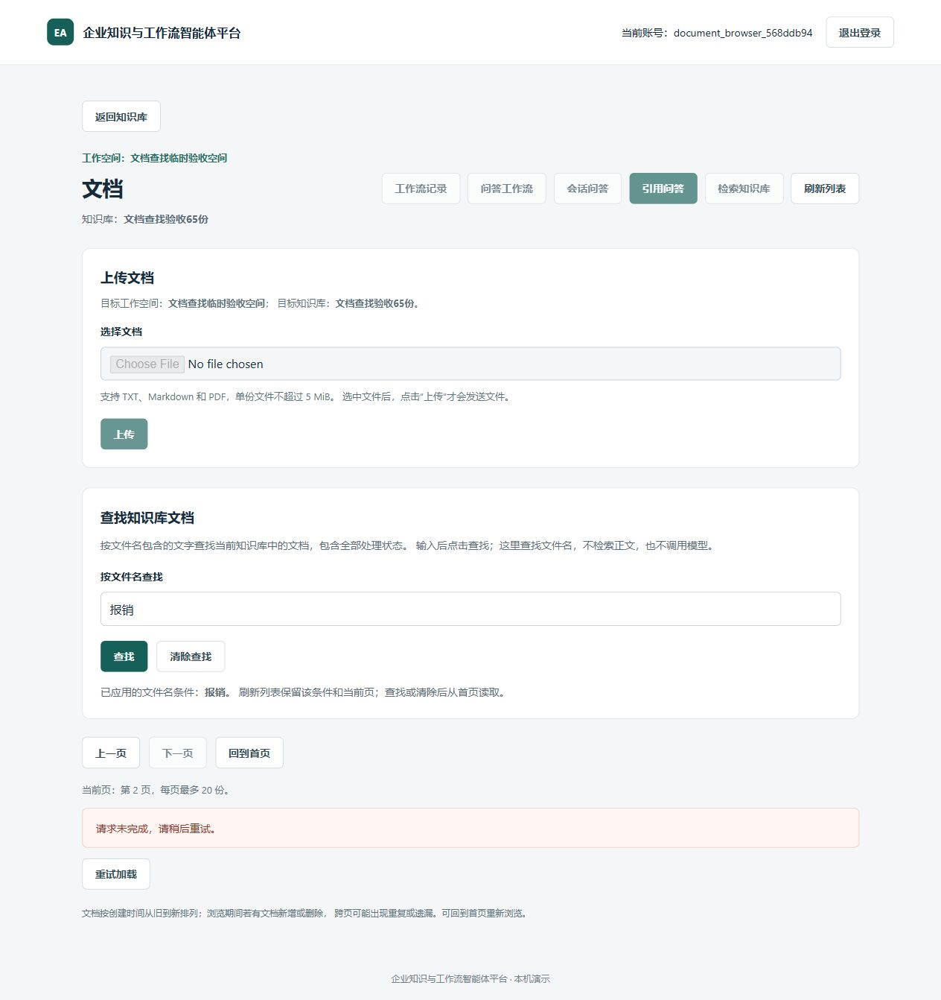
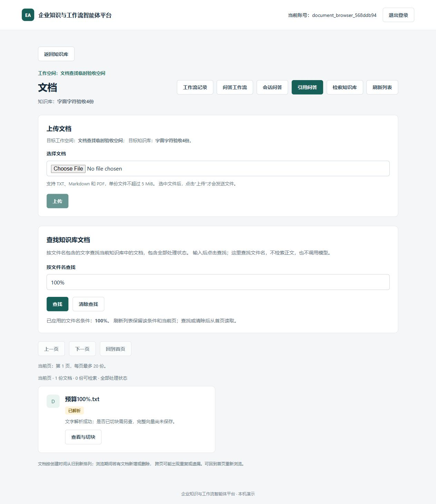

# 文件名查找与文档翻页：真实浏览器只读验收

2026-10-23最新教学收尾：实现`bef1fb1`，一个小读图实践与两道面试讨论已按实际参与程度结束。
主体工具实现、安全检查和浏览器操作均由导师完成，本人未亲自执行验收。
本次教学收尾未新增测试、数据库操作、模型任务或推送；不追加第三题或重复已收尾模块题目。

## 最新本人参与与学习结果

- **小读图实践：** 本人回答“特殊字符匹配规则”，识别了截图关注的方向。
  导师补充百分号`%`与下划线`_`应按普通字符做字面匹配，不作为任意字符的通配符。
  记录识别主题、规则由导师补充，不记本人独立完整解释特殊字符匹配。
- **面试讨论一：** 本人知道真实浏览器能进一步验证实际使用，但同时说能保证真实使用不会出错。
  导师纠正为提高对已覆盖场景的信心，不能保证所有使用场景无错；并补充本轮核对真实页面、HTTP请求、
  Cookie登录、成员校验、SQL查询与页面展示共同工作。合成数据、固定流程及本次只读范围仍限制结论，
  不能扩展为真实模型质量、所有异常或完整产品验收。
  记录本人识别实际使用验证价值，保证范围与调用链解释由导师纠正和补充。
- **面试讨论二：** 本人表示不清楚如何安排验收数据。
  导师用前20份基础资料、后45份报销资料说明：把匹配文件放在原第一页之外，
  才能暴露只筛选前端已加载20条的错误；本人随后表示明白。
  记录导师讲解后理解，不记本人独立设计测试数据或独立说明该负例的作用。

一个实践、两道讨论按上述程度收尾，不再作为待作答项目。
下一建议为网页文档处理状态筛选，尚在阅读代码、确定具体范围，未实现，也未因此授权任何模型任务。
下文保留验收完成、教学前的阶段记录，原“尚未完成实践/讨论”仅描述当时状态。

2026-10-23，上一[文件名查找与翻页模块](frontend-document-filename-pagination.md)实现`c2ef6a5`、
一个小阅读实践与两道讨论已按实际参与程度收尾，学习记录`df5f8b7`；不重复已结束题目。
本人要求继续，导师选择补齐本功能的当前浏览器证据，不改变生产接口或页面功能。

## 业务目的与数据范围

已有前端模拟与独立SQL验证，仍需确认当前页面、真实HTTP、登录Cookie、成员检查和数据库能一起工作。
本轮只验收文档查找、翻页与已有文档处理页读取，不调用候选检索、模型、向量化或工作流。

数据完全虚构，位于独立eaap_test本次随机schema，使用临时数据库身份及合成登录用户：

- 主知识库65份：创建顺序前20份名为基础资料，其后45份名为报销资料。
  普通列表应为20/20/20/5；查找报销应为20/20/5。
  把匹配文件放在原20条之外，能够暴露仅筛选前端已有列表的错误。
- 特殊字符知识库4份：预算100%.txt、预算1000.txt、RISK_PLAN.MD、riskXplan.md。
  查找100%应只得到含百分号的记录，risk_plan应只得到含下划线的记录，同时覆盖英文大小写。
- 空知识库0份。主库查找基础有20份，下一页为空；查找不存在应为首页无匹配。
- 主库报销资料第21份有1个合成文本块，其余无块。所有文档状态为parsed，
  不是真实上传/解析/切块的执行证据，没有embedding或真实原文件。

## 工具与安全边界

单独的文档验收入口复用既有临时库管理、私有配置隔离、loopback网络和结构化SELECT守卫，
不扩大原历史验收工具的路由。只允许本次范围内的登录、退出、列表、指定文档详情/块及当前静态资源。
禁止上传、切块、向量化、问答、工作流及范围外请求；不读取既有.env、凭据说明或日常账号密码。

文档列表仅允许约定查询和offset组合，重复参数、额外字段和越界范围均拒绝。
登录沿真实认证/Cookie/成员链，仅临时替换独有Cookie名，避免与其他本地端口共用日常Cookie；
这不是默认Cookie名或实际到期等待的新验收。

主库报销查询offset20的首个成功下游读取会被验收外层替换为一次503，
在真实认证、成员验证和SQL成功后才注入；401/404不消费故障，原200正文和成功排错编号不转发。
这是人为构造的读取故障，用于观察页面清旧、保留条件/页码和手动重读；不代表生产故障或模型失败。

响应覆盖要求19种规定结果，缺少任何一项不能报告完成；覆盖只说明请求路径经过，
页面可见的文件名、数量、页码、错误、草稿和条件需要另外由浏览器DOM与截图核对。
停止后比较完整六表快照，并确认临时身份、schema和停止目录清理；超时不能报成功。
结构化SELECT守卫允许生产成员查询的共享锁，不等于任意SQL的严格只读事务或系统沙箱。

## 实际结果

导师通过真实浏览器页面操作和可见DOM核对：

1. 主库普通列表依次为20/20/20/5。第一页仅基础资料01—20，报销资料在后续页，
   因此文件名查找确实覆盖原第一页之外的记录。
2. 输入报销草稿时原列表保持，点击查找后为报销01—20；下一页故意503，
   已应用条件仍是报销、第2页、旧文档列表消失，上一页/回首页可用而下一页禁用。
3. 手动重试后得到报销21—40。把草稿改成采购再刷新，仍为报销第2页，采购草稿保留。
   点击报销21详情并展开文本预览，看到本次唯一合成块；返回保留报销条件、第2页与采购草稿。
   继续下一页显示报销41—45共5份，下一页禁用。
4. 查找不存在时显示“未找到文件名匹配的文档”，不冒充空库；清除回普通首页。
   查找基础时恰好20份，下一页显示“当前页没有文档”，可返回上一页。
5. 特殊库默认4份；100%只得到预算100%.txt，预算1000.txt没有混入；
   risk_plan只得到RISK_PLAN.MD，riskXplan.md没有混入，同时验证英文大小写匹配。
6. 空知识库显示“该知识库暂无文档”，上一页/下一页禁用。
   真实退出204后回登录页，随后停止服务并关闭临时浏览器标签。






以上是原始全页JPEG，未拼图或修改页面。完整可见文件名与页码观察另存
[DOM观察](../screenshots/document-filename-2026-10-23/browser-observations.json)，
安全与服务摘要存[执行回执](../screenshots/document-filename-2026-10-23/service-result.json)。
没有读取React隐藏状态、浏览器Cookie值或其他浏览器存储。

## 安全检查与实际清理

- 新[文档入口](../../backend/scripts/serve_document_acceptance.py)与
  [安全入口](../../backend/scripts/check_document_acceptance_entry.py)新增，原历史入口和生产路由未改。
  固定双文件387项安全检查全部通过，skip/xfail/violations均0、pytest/final_exit0；
  首次沙箱仅临时目录ACL错误，同入口经自动审批在沙箱外通过，未放宽守卫。
- 复用同一生产代码版本已通过的隔离前端产物，资产为index-BWfPnF-L.js和index-jqEfThcA.css。
  本轮未重跑1260项前端、274项契约、134项DB入口或23项SQL，也没有把旧套件记成本轮新运行。
- 服务最终回执：requests33、rejected_requests1、injected_failures1、provider_violations0、
  violations0、timed_out0、unchanged=true、coverage_ok=true、cleanup_ok=true、final_exit0。
  19种响应覆盖全部满足；1个白名单外请求被拒，未进入生产app或计入覆盖。
- 比较了用户、空间、成员、知识库、文档、块六表的全字段快照和精确表清单，69文档/1块保持不变。
  原生产访问摘要记录下游成功200；外层替换的503由验收计数/实际页面证明，
  不用下游成功排错编号冒充503错误编号或生产故障日志。
- 之后只读核对独立eaap_test临时角色0、public.vector0.8.6，8811无监听、
  本次独有停止目录已删除、标签已关闭。起点已运行的原数据库容器保持运行。
  六份保护文档哈希与开工前相同，没有日常库迁移、卷重建或owner关系变更。

## CMD复现

先核对实际Git、原数据库容器、独立eaap_test前置及8811端口；只有确需重新构建时，
才运行已有通用安全构建脚本build_history_acceptance_frontend.py（名称保留历史，构建逻辑不接工作流）。
当前页面可直接使用本次同版本产物。检查并理解三个新入口文件后执行：

```bat
.venv\Scripts\python.exe -I -X utf8 backend\scripts\serve_document_acceptance.py --check-entry
.venv\Scripts\python.exe -I -X utf8 backend\scripts\serve_document_acceptance.py --docker-exe D:\docker\Docker\resources\bin\docker.exe
```

使用本次输出的合成用户名和脚本公开fixture密码，只登录临时loopback服务，不使用日常密码。
按上述流程覆盖全部19种响应；真实退出后，向本次输出的精确stop_file写空信号，不能沿用历史随机路径。
服务最多900秒，超时即失败；结束必须核对快照、覆盖、清理和final_exit，空跑不能绿。

## 验收完成时的学习参与与验证限制（历史）

本轮工具实现、安全检查和浏览器操作由导师完成，本人尚未亲自执行验收或完成本模块实践/讨论。
执行后先讲真实浏览器与模拟测试各自证明什么、合成数据如何暴露遗漏、503恢复与边界，
再安排一个小实践和逐题自然面试，每次一个核心问题并等待回答。
不重复上一文件名模块及更早已收尾题目，不把表示明白记为独立设计。

没有真实模型、候选检索、正文质量、TXT下载落盘、实际Cookie等待、并发变动分页或大规模性能新证据。
旧六题RAG与29块检索评测不移作本轮当前网页证据；六份保护文件原样，所有新提交仅本地，未来push另授权。
