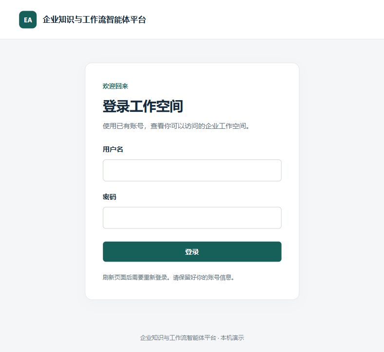

# 网页第一步：已有账号登录与本人工作空间

后续已增加[网页第二步：Cookie 恢复登录](frontend-session.md)，以下保留内存 JWT 首步的历史实现与验证记录。

2026-10-15，起点 `3f1e7ac`。本步把已有登录与工作空间列表接口接到浏览器：
登录 → 核对当前用户 → 显示本人工作空间第一页。原有 CLI 入库和问答流程继续可用。
下一步再接工作空间下的知识库；本步没有知识库、文档或问答页面。

## 设计与调用链

学习者确认接受 A：访问令牌只放在当前页面的 React 内存状态中，刷新后重新登录。
不写 localStorage、sessionStorage、Cookie 或 URL。此轮是确认选项，设计理由由导师解释；
实现与测试由导师完成，学习者尚未完成本模块代码实践或面试题。

1. 页面提交用户名和密码到 `POST /api/v1/auth/login`。后端验证已有账号，返回限时 Bearer 令牌。
2. 前端携带令牌请求 `GET /api/v1/auth/me`，核对真实用户后才进入工作空间页。
3. 前端继续携带令牌请求 `GET /api/v1/workspaces?limit=20&offset=0`。
   后端按数据库成员关系筛选；页面只显示名称，不让用户填写 UUID，也不自行授予权限。

`frontend/src/api.ts` 封装这三个请求及返回数据检查；`frontend/src/App.tsx` 管理页面状态。
`vite.config.ts` 在开发时把浏览器同源 `/api` 请求代理给本机 8000 端口。
React + TypeScript + Vite 复用现有 FastAPI 后端，本步不增加路由、全局状态库或第二套业务服务器。
取舍见 [ADR 0029](../adr/0029-web-login-memory-session.md)。

退出、令牌到期或业务接口返回 401 时，清除页面会话与工作空间列表。退出只清除本页状态，
不撤销后端已签发的 JWT。请求取消同时增加操作序号，过时的返回结果不能让退出后的页面
再次显示旧账号资料。一般网络故障保留当前会话，允许点击“刷新列表”重试；错误与正常空列表分别显示。
每次 HTTP 请求最多等待 10 秒，没有自动重试。

## 本机操作（CMD）

当前日常库已完成 `0010` 迁移和演示账号授权，无需重复注册、迁移或指定 owner。
密码只在本机网页登录框中输入，不发到聊天。需要 Docker 数据库和后端正常运行。

后端未运行时，在 CMD 窗口执行并保留该窗口：

```cmd
cd /d D:\workproject\enterprise_AI_agent_platform
.venv\Scripts\python.exe -m uvicorn app.main:app --app-dir backend --host 127.0.0.1 --port 8000
```

另开 CMD 窗口启动前端。依赖已在本机安装；首次克隆时先执行 `npm ci --ignore-scripts`。
本次验证使用 Node.js 24.18.0，支持范围见 `frontend/package.json` 的 engines。

```cmd
cd /d D:\workproject\enterprise_AI_agent_platform\frontend
npm run dev
```

浏览器打开 [http://127.0.0.1:5173/](http://127.0.0.1:5173/)，使用已有账号登录。
若前端已由导师启动，可直接打开页面；不要再启动第二份占用相同端口。
当前页最多 20 个工作空间，尚无翻页按钮；名称用于展示，列表项暂不进入下一页。

模拟测试与生产构建命令同样在 `frontend` 目录执行：

```cmd
npm test
npm run build
```

构建输出在被 Git 忽略的 `frontend/dist/`。开发代理只在 Vite 开发服务器生效；
本步未配置生产静态托管、生产 API 代理或 HTTPS。

## 验证与证据边界

- 最终 TypeScript 检查与 Vite 生产构建通过。
- 最终前端联合专项：2 个文件、21 项通过、无跳过，Vitest 报告 7.41 秒。
  12 项 API 测试和 9 项组件测试使用替身 HTTP，不访问日常数据库或真实模型。
  覆盖正常三请求链、无效返回、登录失败、网络错误与空列表、第一页上限、401、
  退出/取消后的迟到响应、刷新后无会话以及定时到期清理。
- 首轮构建发现两个测试查询参数类型错误并修正；首轮联合测试 20 项通过、
  1 项因 user-event 与模拟时钟等待而超时。仅调整到期测试的事件驱动方式，
  保留到期断言；单节点通过后，重新构建并取得上述 21 项最终联合全绿。
  单节点和前后联合结果不相加。
- 浏览器实际打开登录页，版式和空表单已检查；前端首页返回 200，经开发代理匿名请求
  `/api/v1/auth/me` 返回 401 与 Bearer 认证提示。这证明页面可加载、代理可达认证接口，
  单凭这两项不能证明真实账号登录成功。
- 随后学习者在本机亲自登录，反馈“可以成功登录”，所附截图显示当前账号 `demo_a`、
  当前页 1 个工作空间，以及对应的 `RAG真实联调演示-5fce1961ef0f`。这确认该账号的
  网页登录到本人工作空间展示链路已实际走通；没有据此宣称另一账号、跨空间拒绝、
  刷新、退出或到期的真实浏览器操作已验收。此次为学习者操作确认，不是本人代码实践，
  不增加自动化测试数量，也不代表完整部署验收。
- 学习者随后确认刷新后确实回到登录界面，A 方案的刷新行为完成一次真实操作验证；
  同时指出这与日常网站刷新仍保持登录的体验不同。该反馈是对使用体验的观察，
  不记为独立解释会话恢复原理，也不代表已经同意或实现持久登录。退出和到期的实际操作仍待确认。
- 本步没有后端改动、数据库迁移、真实模型请求或 GitHub 推送；未重跑后端回归。



## 下一步学习

亲自登录、查看对应空间和刷新回到登录页已确认；接着解释会话恢复的取舍，再确定后续设计。
代码实践和逐题面试尚待安排，不把操作确认记为独立实现。
之后沿用后端权限边界，接入“点击工作空间 → 知识库列表”，保持一次一个完整小环节。
