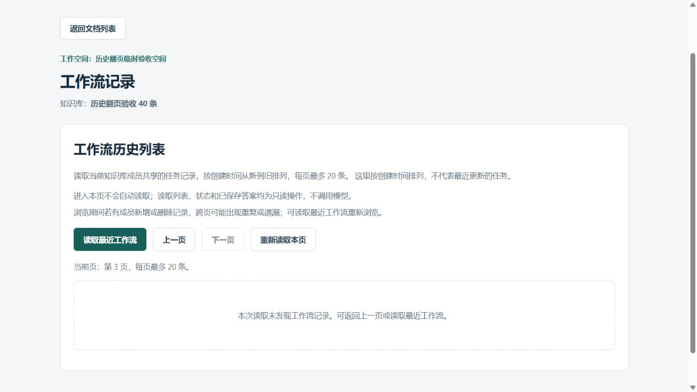
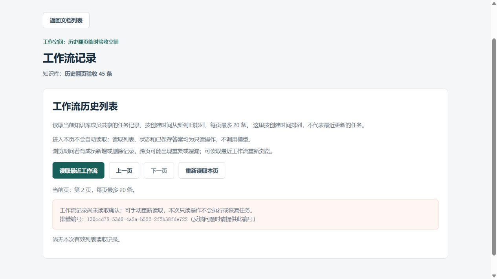
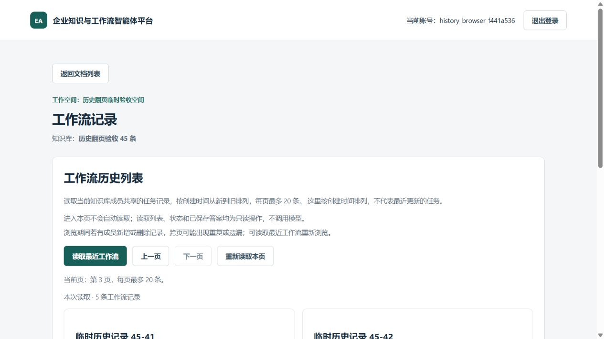

# 工作流历史翻页：真实浏览器只读验收

## 目标和方案

2026-10-21，本人要求继续开发学习，承接[手动翻页](frontend-workflow-history-pagination.md)已完成的实践与两题，本轮验证真实网页。完成条件：页码与记录一致、翻页清旧详情、空页能返回、失败编号属于本次请求、手动重读恢复，并且不执行任务。

此前模拟测试能够控制返回和迟到响应；本轮补充当前前端构建产物＋真实FastAPI登录/Cookie/成员校验＋真实PostgreSQL连接。仅使用独立`eaap_test`中本次随机角色/schema（分开的表所在区域），一个虚构用户和两组40/45条pending任务。没有修改生产前端、业务接口、迁移或CI配置，没有日常库、模型、真实候选或Cookie到期操作。

## 新增工具与限制

- `backend/scripts/build_history_acceptance_frontend.py`：隔离构建配置，类型检查后通过Vite API构建，显式`envDir:false`，不加载.env系列。
- `backend/scripts/serve_history_acceptance.py`：构造虚构数据，同源提供页面/API，注入一次指定页503，结束核对快照、响应覆盖和清理。
- `backend/scripts/history_acceptance_guard.py`：复用测试库目标约束，仅额外允许本次loopback监听与响应。
- `backend/scripts/check_history_acceptance_entry.py`与`backend/tests/test_history_acceptance_guard.py`：固定安全检查清单，不连接真实数据库/网络。

服务只监听`127.0.0.1:8810`，默认最多15分钟。HTTP白名单只允许本次对象的列表/详情GET、登录和退出；构建及应用启动隔离私有配置和相关继承变量，不读.env、用户Token、密钥或凭据正文。模型依赖主动拒绝，网络保护禁止额外外联。只清理本次生成的角色、schema和已核对路径的停止信号临时目录，既有容器保持原状态。

API连接使用本次临时身份和独立search_path，SQL执行前仅允许当前受信代码构造的结构化SELECT，拒绝DML、DDL、TextClause和写入CTE，结束再比较全部85条工作流和执行记录。它允许原有SELECT共享锁，**不是PostgreSQL只读事务或任意SQL/函数副作用沙箱**；当前固定GET未使用具有写入副作用的SELECT函数。真实登录与成员校验没有被跳过。

## 真实页面观察

导师通过浏览器页面按钮完成，另用可见DOM及截图核对：

1. 40条组依次为`40-01…40-20`、`40-21…40-40`、第3页0条。点选首条详情后翻页，详情和保存答案区域清除。
2. 空尾页禁用下一页，上一页返回第2页20条；读取最近回第1页并禁用上一页。
3. 45条组首页20条并选中详情，第2页首次读取在真实鉴权后被验收工具故意返回503。页面保留第2页，无旧列表/详情，显示实际合法排错编号。
4. “重新读取本页”成功返回`45-21…45-40`，仍在第2页，旧编号消失。下一页为`45-41…45-45`共5条，禁用下一页。
5. 真实退出返回登录页、响应204，然后停止本次服务并清理。

失败编号`130ccd78-53d6-4a2a-b552-2f2b38fde722`与服务端该次503摘要一致。503是故意安排的恢复场景，不是生产故障，没有自动重试或模型调用。







最后一图为视口截图，展示“本次读取5条”和按钮，完整5个标题由可见DOM核对。全页截图调用不可用后改用视口，没有拼接或修改截图。

## 执行结果与修正

首轮真实历史GET返回503，原因是临时连接的PG严格只读事务拒绝原范围查询的`SELECT … FOR SHARE`共享锁。先停止清理：`unchanged=true coverage_ok=false cleanup_ok=true final_exit=1`，不记成功；没有为此更改生产查询。

改为上述SELECT执行前检查并补测试后，用全新临时身份重跑，最终结果：

- 安全入口**161 passed / 0.73秒**，collected=passed=161，skip=xfail=violations=0，pytest/final_exit=0。
- 当前前端类型检查及隔离构建通过，构建266毫秒、子进程退出0；不是产品性能测量，未重复此前1054项前端套件。
- 服务摘要：`requests=24 rejected_requests=1 injected_failures=1 provider_violations=0 violations=0 unchanged=true coverage_ok=true cleanup_ok=true final_exit=0`。
- 完整85条任务快照相同，仍pending85、版本/执行次数0、执行记录0；临时角色/schema清理成功。结束独立只读复核临时角色0，public.vector仍0.8.6。

coverage只检查规定响应路径：登录/退出、两组offset0/20/40成功、指定503及任务详情；不允许闲置运行也报成功。**响应覆盖不等同于UI正确**，页面显示另有上述DOM/截图证据。额外被拒请求不计入覆盖。

未验证已完成任务答案、模型质量、真实检索、Cookie到期、所有屏幕尺寸或大数据性能；不是全站端到端验收。161项不与此前132/18/1054累加。六份受保护文档哈希不变，未混入本轮提交。

## CMD复现

先只读确认Docker、独立测试库和端口状态，入口不会自动启动既有容器。在项目根目录：

```bat
.venv\Scripts\python.exe -I -X utf8 backend\scripts\build_history_acceptance_frontend.py
.venv\Scripts\python.exe -I -X utf8 backend\scripts\serve_history_acceptance.py --check-entry
.venv\Scripts\python.exe -I -X utf8 backend\scripts\serve_history_acceptance.py --docker-exe D:\docker\Docker\resources\bin\docker.exe
```

服务输出本次URL、随机虚构用户名、知识库名和专属stop_file位置。密码为脚本公开的虚构夹具常量，只用于本次临时本地账号，不使用日常密码，聊天无需提供密码。完成页面操作并退出后，在另一CMD向**本次输出的精确stop_file路径**写空文件触发停止，不沿用历史路径；15分钟也会停止。结束必须检查cleanup_ok与final_exit；未覆盖规定响应的空跑不能通过。

## 学习与提交

本轮方案、脚本、测试和浏览器操作均由导师完成，实现与验收证据已本地提交`4d6f06f`，尚未推送。执行后导师讲解模拟测试与真实页面验证的区别、临时隔离及受控失败，再开展一个小阅读实践和两道自然讨论。

小实践中，本人回答“重新读取吗”，同时表示不确定；导师确认应点“重新读取本页”，并解释与返回上一页、读取最近的区别。记为在截图提示下选中正确方向，经讲解明确用途，不记本人亲自点击或独立完成浏览器验收。

第1题本人能说明需要确认浏览器、后端、数据库连接后正常工作。本人将自动化测试概括为只保证代码逻辑，导师纠正：自动化也可以操作真实数据库和浏览器，本次具体区别是先前前端模拟测试与当前真实网页验收。记为能说明整体连接验证价值，不扩大为独立完整测试分类或测试体系设计。

第2题本人在讲解后能复述独立测试库、虚构账号和临时记录、限制只能读取、禁止模型调用，并说明检查真实连接同时避免模型费用。记为讲解后能复述本次隔离方案和目的；实现、防护和实际运行由导师完成，不记独立设计或亲自配置。

本轮一个提示后阅读实践与两道讨论按上述实际程度收尾，不追加第三题或重复上一分页模块offset实践/两题。下一开发范围尚未确认。此次只整理学习及交接，不重跑检查、访问数据库/服务/远端或模型。

本轮仅本地提交，未来push另行授权，真实任务暂停要求继续有效。
