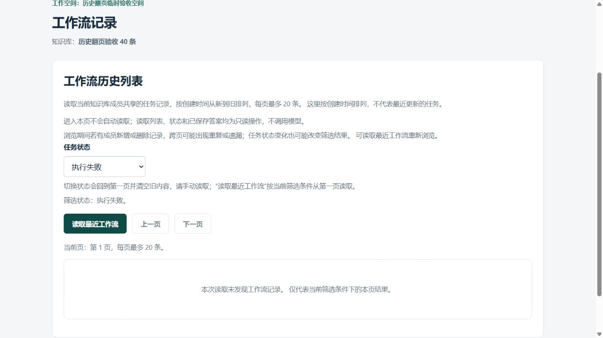
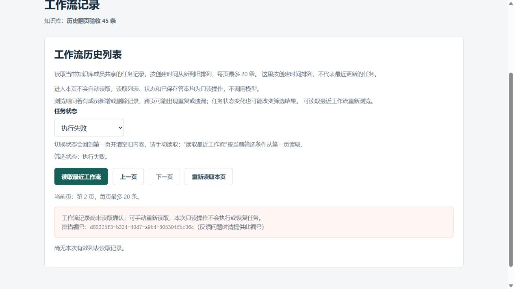
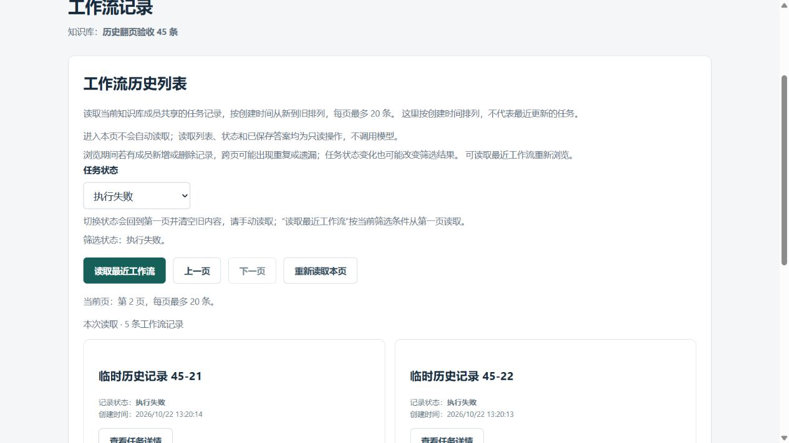

# 工作流状态筛选：真实浏览器只读验收

2026-10-22，用户要求继续开发学习，导师选择补齐[状态筛选](frontend-workflow-history-status-filter.md)的真实页面证据。复用[已有浏览器验收工具](frontend-workflow-history-browser-validation.md)，只扩临时服务和安全测试，生产前后端筛选仍为`dfb144f`。上一模块实践/两题已在`44d0849`按实际程度收尾，不重复。

## 业务目标与数据选择

用户在页面选择失败任务后，要能翻页、处理读取失败、切换其他状态，并准确理解空结果。先前前端模拟与真实SQL分别通过，本轮连接当前构建页面、真实FastAPI登录Cookie/成员校验及独立PostgreSQL临时数据，补这个使用流程。

保留共85条合成任务：40条组全部pending；45条组按创建顺序分为failed25（45-01…25）、completed10（26…35）、running5（36…40）、pending5（41…45）。全库合计pending45/failed25/completed10/running5。若只准备一种状态，即使程序忘了筛选也可能看似正确；混合状态和空匹配组能够暴露条件丢失、错误分页或回退全部的问题。

非pending元数据也人工构造为合法契约：失败固定公开错误码，运行中有合成执行编号与未来租约，完成有同空间/知识库的空检查点及虚构弃答。执行记录表始终0；这些数据不代表任务实际执行、模型生成、故障恢复或真实回答质量已通过。

## 工具改动与限制

[serve_history_acceptance.py](../../backend/scripts/serve_history_acceptance.py)仅在本次历史列表路径允许可选精确四状态；默认省略仍为全部。拒绝all、空串、大小写错、重复/额外键、范围外offset；其他空间/知识库/文档/详情/静态路径不新增status权限。原只读路由、loopback监听、临时库身份、私有配置隔离、模型/网络阻断、15分钟上限和清理保持。

一次503改为仅混合45条组的`status=failed&offset=20`，在真实登录/成员校验后注入；其他条件不消费该故障。服务包装兼容无状态5参数和有状态6参数。计数覆盖标签区分all与每种状态，要求16种响应：登录、退出、40条详情，两组无筛选0/20/40成功、混合组四状态首页、失败第二页503及成功、40条组失败首页成功。缺少任一项不能报告通过。

新增`fixture_fields`纯函数准备合法状态；启动预检85条、执行表0、pending45及精确四状态分布。退出比较全部85条完整字段快照、执行记录数量和分布，不仅比较总条数。结构化SELECT保护仍限当前受信查询，不是PG严格只读事务或任意SQL沙箱。

## 实际浏览器结果

导师使用真实浏览器页面按钮和下拉框，分别观察可见DOM与截图：

1. 40条组默认全部，20→20→空尾页；首条真实详情pending，翻页清除。第3页改选失败后立即回第1页、列表/详情为空且显示尚未读取；手动读取后为0条，前后页禁用。
2. 返回知识库再进入45条组，默认恢复全部/未读取。全部分页20→20→5，第二页同时包含失败、完成、运行状态；切换失败回第1页并清旧。
3. 失败首页显示45-01…20，全为失败；选中首条读真实失败详情。下一页第一次故意503，仍保留failed/第2页，旧列表/详情/答案区域消失，出现实际排错编号。
4. 本页重读成功，仍failed/第2页，显示45-21…25共5条，全部失败，旧编号消失、下一页禁用。上一页和读取最近均回失败首页20条，未丢条件。
5. 切到完成先回首页/尚未读取，再手动得到45-26…35共10条；运行45-36…40共5条、待执行45-41…45共5条，各条状态匹配、下一页禁用。切回全部再读为首页20条。
6. 真实退出204并返回登录页，随后停止本轮服务并关闭临时浏览器页。

受控失败编号`d82325f3-b334-40d7-a9b4-805304fbc36c`在页面与该次服务端503摘要一致。受控503不是生产故障；本次只有手动重读，没有自动恢复或模型调用。







截图均为原始视口JPEG；尾页图展示5条计数与前两张卡片，完整5个标题和状态另由可见DOM核对，不声称截图包含全部卡片。DOM读取没有访问隐藏React状态、凭据或浏览器存储。

## 本轮验证与清理

- 固定安全入口：**257项/2.84秒**通过，collected=passed=257，skip=xfail=violations=0，pytest/final_exit=0。包含原161项及状态查询、16种响应缺失审计、一次故障、85条数据的纯Pydantic契约/分布检查；总数不与旧161叠加。
- 当前前端类型检查和隔离构建通过，构建268毫秒、final_exit=0。无生产源码修改，不重复1117前端/242契约/132数据库入口/18 SQL旧套件，也不新增CI运行或安装依赖。
- 实际服务：`requests=31 rejected_requests=1 injected_failures=1 provider_violations=0 violations=0 unchanged=true coverage_ok=true cleanup_ok=true final_exit=0`。
- 16种响应覆盖证明规定请求路径已走到，**不等于页面断言**；上述DOM和截图另外证明状态、页码、条数、清旧及恢复。1个白名单外请求被拒，不计入覆盖。
- 独立只读复核临时角色回0、public.vector仍0.8.6；8810关闭、本次停止信号目录删除。原项目数据库容器起点已运行，结束保留原状态；六份保护文档逐字未变。

没有真实模型/候选检索、答案来源核验、Cookie实际到期、并发更新下稳定分页、多屏幕或负载测试；这些结果不是全站验收或模型质量证据。

## CMD复现与教学停点

先只读核对Git、原数据库容器/独立eaap_test和端口，不读取.env、容器环境或凭据。沿用现有入口：

```bat
.venv\Scripts\python.exe -I -X utf8 backend\scripts\build_history_acceptance_frontend.py
.venv\Scripts\python.exe -I -X utf8 backend\scripts\serve_history_acceptance.py --check-entry
.venv\Scripts\python.exe -I -X utf8 backend\scripts\serve_history_acceptance.py --docker-exe D:\docker\Docker\resources\bin\docker.exe
```

按上面的页面流程覆盖普通分页和新筛选，退出后向本次输出的精确stop_file写空文件停止；不要沿用历史路径。公开虚构夹具账号只用于本次loopback会话，不使用日常密码，不在聊天提供密码。结束须检查unchanged、coverage_ok、cleanup_ok及final_exit，空跑不能绿。

本轮实现、安全检查和浏览器操作均导师完成，本人仅要求继续开发学习。先讲混合数据为何必要、条件/页码/空结果及证据边界，再安排一个小阅读实践：失败筛选为空是否说明知识库没有任何任务。尚待本人回答，随后最多两道自然讨论，每次一个核心问题；不重复上一状态模块及旧浏览器模块已结束实践/题。仅本地提交，未来push另授权，真实任务暂停不变。
