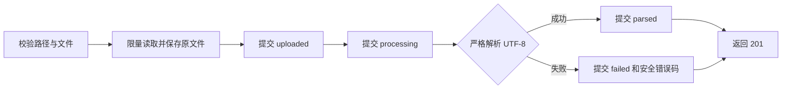

# 阶段 1.1：文本与 Markdown 文档入库

## 本步目标

在现有工作空间、知识库和文档元数据表上，实现单文件同步上传、原文件保存、UTF-8 文本解析验证，以及文档状态查询。本步暂不生成文本块或向量，也不提供检索和回答。

## 已确认与本步采用的规则

- 一次上传只属于路径指定的一个知识库；每次上传都有新的文档 ID，即使文件内容或文件名相同。
- 处理在本次请求中完成。上传成功创建文档资源时返回 `201`；解析后的最终状态是 `parsed` 或 `failed`。
- `parsed` 表示原文件已保存且文本能严格按 UTF-8 解码。它不表示可以检索；`ready` 留给后续文本块与向量索引全部写入成功后的状态。
- 首批采用 `.txt` 和 `.md`，单文件上限暂定 5 MiB；这一项仍可按项目负责人的选择调整。文件按扩展名初筛，实际内容必须通过严格 UTF-8 解码。客户端传来的媒体类型不作为可信的格式证明。
- 文件名只用于展示，不能包含路径分隔符或控制字符，也不参与磁盘路径生成。磁盘文件名由服务端生成的 UUID 决定。

## 状态与数据流

文件为空、超限、扩展名不支持或文件名非法时，在创建文档记录前拒绝。对已接受文件的解析错误，保留原文件和 `failed` 记录，响应只提供安全错误码，不返回原文或原始异常。非法 UTF-8 使用 `INVALID_UTF8`；只有空白字符的文本使用 `EMPTY_TEXT`。每次状态更新单独提交，解析期间不占用数据库事务。

文件与数据库无法共同原子提交：文件保存后，如果首次数据库写入失败，代码删除该文件；进程崩溃仍可能留下孤儿文件。后续状态提交失败时，记录可能停在 `uploaded` 或 `processing`。现已加入[只读文件对账](adr/0001-document-storage-audit.md)，用于识别孤儿候选文件和缺失文件；自动补偿、状态恢复和重试留到后续工程步骤。在入口层配置总请求体上限之前，端点内逐块检查只能限制业务接受的文件大小，不能阻止请求先经过表单解析。

## 接口契约

- `POST /api/v1/workspaces/{workspace_id}/knowledge-bases/{knowledge_base_id}/documents`：使用 `multipart/form-data` 的 `file` 字段。返回 `201` 和文档 ID、知识库 ID、原文件名、规范媒体类型、字节数、SHA-256、状态、安全错误码及时间；不返回内部 `storage_key`。
- `GET /api/v1/workspaces/{workspace_id}/knowledge-bases/{knowledge_base_id}/documents/{document_id}`：返回同一文档状态。路径中的工作空间、知识库和文档归属必须逐级匹配，否则返回 `404`。
- 上传前拒绝：空文件或非法文件名返回 `422`，超限返回 `413`，不支持的扩展名返回 `415`。缺少文件字段由接口框架返回 `422`。

## 验证标准

1. 成功上传文本和 Markdown 后，GET 得到相同的 `parsed` 状态；数据库中的字节数与 SHA-256 和保存的原文件一致，响应不泄漏存储键。
2. 相同文件重复上传产生独立文档；不同工作空间或知识库的路径不能读取它。
3. 空文件、超限、类型不支持和非法文件名不创建文档或残留文件；刚好等于上限的文件可接受。
4. 非 UTF-8 文件得到可查询的 `failed` 记录与安全错误码，不泄漏异常或文件内容。
5. 使用独立 PostgreSQL 测试库和临时上传目录运行集成测试，并执行 Alembic 迁移一致性检查。

## 下一小步

选定切块规则和向量生成模型、维度、距离指标后，新增文本块与向量迁移；索引全部成功后才将文档从 `parsed` 推进到 `ready`。
