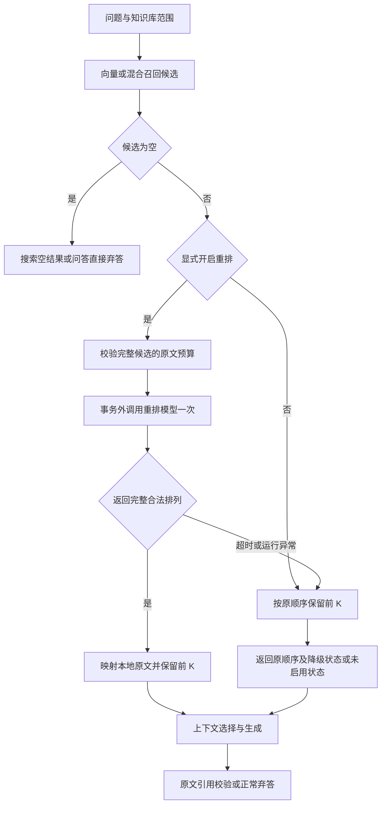

# 阶段 2.2：候选重排与可见降级

## 1. 当前目标

搜索与问答先召回最多二十段，再可选调用已有生成模型排列候选，保留最终前 K 作为搜索结果或问答证据。默认关闭；本轮没有真实模型请求。

## 2. 为什么需要

混合检索解决两路候选合并，重排进一步比较问题与候选原文。它训练检索管线分工、模型接口契约、故障降级、上下文和来源一致性等岗位能力。

例如问题是“如何提交退款”，一段讲“审核通过后多久到账”，另一段讲“在订单详情页提交”。两段都包含退款主题，后者更直接支持提问；模型是否能稳定区分仍须实测。

## 3. 核心概念

- **召回量与最终量：** `candidate_k=20` 先找二十段，`top_k=5` 重排后保留五段；不能先只拿五段，再期望重排补出第六段。
- **整组排序：** 本轮模型一次读取有界候选，返回全部编号的排列，不返回正确率或概率。
- **重排不扩大候选：** 不在本次二十段内的资料无法凭重排出现。混合并集也可能在前二十截取时失去候选。
- **契约正确不等于语义正确：** `[2,1]` 是有效排列，不证明第二段能回答；生成提示词、弃答和引用核对仍保留。
- **降级：** 超时或输出异常时使用原召回顺序，并标明增强未完成。配置缺失与输入超限明确报错。

## 4. 设计

专用交叉编码模型更适合对问题和段落进行相关性评分，但要增加模型或服务。当前选择已有 DeepSeek 的整组排序基线，复用兼容 JSON 请求层，保留独立重排协议便于替换。代价是多一次请求、增加等待和费用、可能受输入顺序影响，详见 [ADR 0015](adr/0015-optional-candidate-reranking.md)。

仅在 `rerank=true` 时启用，复用本机生成服务配置。候选最多二十段，全部原文最多两万字符；完整输入超限返回 422，不能截断后假装完整重排。模型请求在数据库事务外；不修改文本、向量和引用位置。

## 5. 实现与核心代码



图中空检索直接返回空结果，问答直接弃答；输入超限和配置错误报错。降级路径只用于已启用重排的运行时故障，关闭重排不标记降级。

`providers/reranking.py` 定义候选、完整排列和固定故障类型；`compatible_reranking.py` 负责一次兼容 JSON 请求。`knowledge/search_pipeline.py` 组合召回、重排、最终选择与降级；搜索和问答均调用这个入口。

关键映射是：

```python
checked = validate_order(response.order, len(candidates))
order = checked.ordered_ids
# identifier 是本次局部编号，1 对应候选列表下标 0。
hit = retrieved.results[identifier - 1]
```

保留原 `SearchHit`，意味着模型不能借排序结果修改文本或伪造引用出处。完整排列校验发生在映射前，不能直接信任模型编号。随后回答根据选中的完整块建立新 `source_id`，逐字引文仍从对应原文核对。

搜索在重排成功时增加 `reranking.status="applied"`；失败为 `degraded`，附固定 `reason`；空库为 `skipped_empty`。搜索每块保留 `retrieval_rank` 与 `rerank_rank`，以及原通道得分。原 `metric` 描述召回度量，开启重排后的最终顺序不再由它单独决定。问答同样显示重排状态；关闭时不增加问答响应字段。

## 6. 验证与运行

在本地 `/docs` 的搜索接口使用：

```json
{"query":"如何提交退款？","strategy":"hybrid","rerank":true,"candidate_k":20,"top_k":5}
```

问答接口将 `query` 换成 `question`。这些正式请求会使用真实服务：有候选时搜索增加至多一次重排调用，问答还可能增加一次生成调用；本轮开发测试不使用它们。单候选也执行一次重排，空库跳过；重排 200 不表示回答语义通过。

等待配置见 `.env.example` 的 `EAAP_RERANK_*`。超时、异常或无效排列不自动重试；配置缺失返回 503，原文总量超过两万字符返回 422。可减少 `candidate_k`，但必须不少于 `top_k`。字符预算不是模型的 token 上限，真实服务联调仍需检查输入限制。

运行本模块测试，数据库服务需启动，`.env` 需有独立测试库地址；地址只传给子进程：

```powershell
.\.venv\Scripts\python.exe -c "import os, subprocess, sys; from dotenv import dotenv_values; values=dotenv_values('.env'); os.environ['EAAP_TEST_DATABASE_URL']=values['EAAP_TEST_DATABASE_URL']; sys.exit(subprocess.call([sys.executable, '-m', 'pytest', 'backend/tests/test_reranking_provider.py', 'backend/tests/test_reranking_pipeline.py', '-q']))"
```

关键验证包含：第六名受控候选提升到第一、两种召回策略接入、各类无效排列拒绝、事务外调用、归属过滤、降级状态可见、候选完整预算、配置与故障区分、引用位置保持，以及成功排序后仍可弃答。它们不能代替真实排序质量评测。

定向回归 **158 项通过、无跳过（112.29 秒）**；补充延迟配置与生成配置复用测试后，完整后端回归 **818 项通过、无跳过（198.35 秒）**。首次完整运行受 Windows 测试临时目录权限限制，获准使用新忽略目录后完成。数据库为独立真实 PostgreSQL/pgvector，所有模型为替身，本轮真实模型调用为零。

## 7. 学习与小实践

学习者已选择“返回原顺序并明确降级”，具体理由和异常分类由导师补充；代码和测试由导师完成，不据此记录为独立实现能力。

小实践：在 `test_candidate_expansion_brings_sixth_hit_into_final_five` 中，先只把 `candidate_k=6` 改为 `5`，保留模型替身的 `[6,1,2,3,4,5]`。运行后观察为什么成功断言失败，以及状态是否变为 `degraded/invalid_output`。随后把替身改为合法五项排列，确认排列可以成功，但第六段仍无法出现。最后恢复原测试，或补充一个表达这项边界的独立测试。此练习只使用模拟模型，不消耗 API 额度。

三道面试题逐题讨论，不一次要求全部作答：

1. 已知正确段落排在召回第六名，如果只召回前五，重排能否让它进入最终结果？如何验证原因？
2. 为什么重排模型只能返回本次编号，而且必须验证完整排列？
3. 重排服务偶发超时，如何区分降级、正常弃答和模型输出质量问题，怎样验收可用性与质量？

## 8. 下一步

下一开发主线是有步数上限的智能体循环与知识搜索工具，让系统能根据任务选择工具。RAG 的真实混合召回、重排质量与成本验收仍列为交付任务，不因完成模拟验证而宣称提升。今天改动累计在本地，待学习者决定收尾再确认提交和推送。
