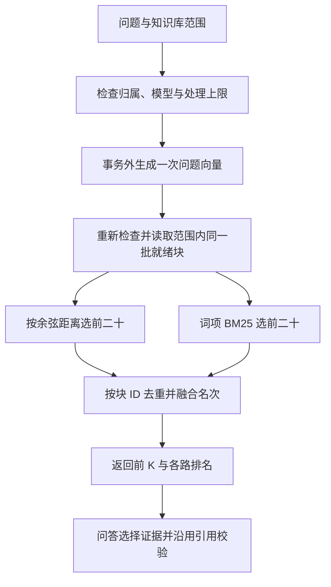

# 阶段 2.1：混合检索与可解释排序

## 1. 当前目标

为现有检索和问答增加可选混合策略：独立召回词项和向量候选，按文本块合并、融合排序，保留来源和两路排名。本轮完成业务接口、故障测试与离线回放，尚未重新调用真实模型测量收益。

## 2. 为什么需要

向量匹配用于表达不同而语义接近的问题；错误码、版本号、产品名称还需要检查精确词项匹配。这个模块训练检索架构、评分尺度、接口兼容、资源上限和可解释性能力。新增通道提供更多候选，是否更准确需要对照证据评测。

## 3. 核心概念

- **词项：** `TOKEN_EXPIRED` 保留一个完整词项；“更换令牌”拆为“更换”“换令”“令牌”等相邻双字。双字基线不是自然语言词典。
- **独立召回：** 两路分别取前二十，先合并候选再取最终前 K。只在向量前五内排序无法补回未入选资料。
- **BM25：** 稀有词得到更高权重，重复词频的收益递减，并考虑块长度。得分与余弦距离的量纲不同。
- **名次融合：** 每路按 `1/(60+名次)` 贡献得分，用排名进行比较；两路命中同一块会累积贡献，但只返回一次。
- **候选与证据：** 被召回只说明进入候选，不能直接判定能回答问题。弃答及事实、条件核对仍保留。

## 4. 设计与选择

Python 评分容易检查并适合当前二十九块演示库，但需要完整扫描。PostgreSQL 全文索引适合扩大规模，但要明确分词和索引更新。本轮选择有界 Python 基线，不引入搜索集群，详见 [ADR 0014](adr/0014-bounded-hybrid-retrieval.md)。

混合只处理目标知识库中已就绪、已有向量的块，最多 2000 块和 100 万正文字符。超限返回 `422`；不抽样，不自动降级成另一种结果。旧调用默认仍是向量检索。

## 5. 实现与数据流



`knowledge/hybrid.py` 是无外部依赖的评分纯函数；`knowledge/retrieval.py` 负责范围、数据库快照、容量和融合；`api/search.py`、`api/answers.py` 接入策略；`knowledge/answers.py` 复用融合后的来源顺序。

混合搜索返回 `metric="reciprocal_rank_fusion"` 与 `strategy="hybrid"`。每块含原余弦距离、融合分数、向量排名、词项排名和词项分数；缺席通道记空。距离用于解释原向量关系，最终排序依据融合分数。

## 6. 验证与运行

在 `/docs` 的知识库搜索接口发送：

```json
{"query": "TOKEN_EXPIRED", "top_k": 5, "strategy": "hybrid"}
```

问答接口对应请求：

```json
{"question": "TOKEN_EXPIRED 后应该如何处理？", "top_k": 5, "strategy": "hybrid"}
```

这两类正式请求会沿用已配置的模型服务。开发验证使用受控模型和独立真实 PostgreSQL，没有真实模型请求。无需迁移、新依赖或重新保存已有向量。

定向四文件 **119 项通过（86.59 秒）**。受控场景让正确错误码块排在向量第 21，纯向量前五没有它，混合结果把它补到第 2。另验证其他知识库和未就绪资料不参与评分及容量计算、超限在问题向量调用前拒绝、等待期间增长再次拒绝、参数与数据故障、融合后引用仍指向原文。

随后完整回归 **767 项通过、无跳过（198.25 秒）**，使用独立 PostgreSQL/pgvector 与模拟模型。完整验证曾发现既有六题命令行扩展缺失，恢复后重新运行全部测试通过。容量检查最终采用有界子查询，再以流式读取复核，完整回归覆盖这一最终实现。

[历史候选内回放](evaluation/hybrid-ranking-replay-2026-10-11.json)沿用六题各自原前十响应，在同一池内评分和融合。原前五与融合前五都覆盖四道正例的五条必需证据，两道负例排除评分；新增模型调用为零。这是有限候选内的回退检查，没有测量当前业务接口独立两路召回的质量或延迟。

## 7. 学习与小实践

学习者已选择“同一块合并一条、保留两路排名”，方向正确。面试时还需解释：这样避免重复占用上下文与重复计算证据，同时保留融合和排查依据。代码及测试由导师实现，个人实践尚未完成。

小实践：在 `test_exact_identifier_outside_vector_channel_is_recalled_and_explained` 中，只将问题改为 `FILE_NOT_FOUND`，保留资料中的 `TOKEN_EXPIRED`。先预测词项通道与最终来源变化，再运行测试。出现断言失败时，检查词项排名，而不是把测试简单改为总能通过。模型是替身，单个测试不需要 API 额度。

数据库服务需运行，本机 `.env` 需已有独立 `EAAP_TEST_DATABASE_URL`。下面从文件读取地址，仅传给测试子进程，不显示口令：

```powershell
.\.venv\Scripts\python.exe -c "import os, subprocess, sys; from dotenv import dotenv_values; values = dotenv_values('.env'); os.environ['EAAP_TEST_DATABASE_URL'] = values['EAAP_TEST_DATABASE_URL']; sys.exit(subprocess.call([sys.executable, '-m', 'pytest', 'backend/tests/test_hybrid_retrieval.py::test_exact_identifier_outside_vector_channel_is_recalled_and_explained', '-q']))"
```

模块复盘的三道岗位面试题，按顺序逐题讨论：

1. A 只在词项通道排第 1；B 在向量通道排第 3、词项通道排第 2。按融合公式，哪个会更靠前？说明计算依据。
2. 为什么需要在问题向量请求前后都检查混合处理上限？
3. 当前方案达到规模上限时，你会怎样选择数据库全文索引或独立搜索服务，如何验收迁移没有降低检索质量？

## 8. 下一步

先完成一次学习者的故障练习，再接入候选重排，并在同一语料与题目上比较排序收益。混合全库真实召回、生成忠实性和延迟仍是待验收项；保留默认向量策略直到有足够证据。今天所有修改留在本地，未提交或推送。
