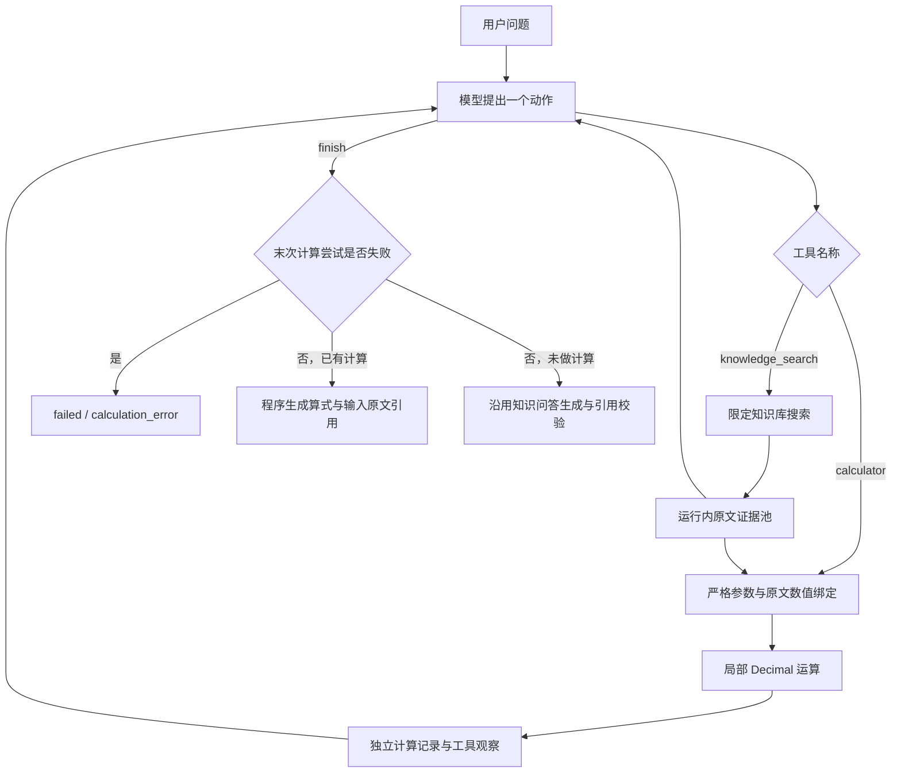

# 阶段 3.3：绑定原文证据的受限计算器

## 1. 当前目标

接入第二个工具 `calculator`，完成“搜索企业资料 → 绑定两个原文数值 → 程序计算 → 返回算式与输入出处”的可复现任务。与已有 `knowledge_search` 共用工具注册表和有界循环。

当前 Agent 与工具部分的基础收尾标准是：有界循环、原生调用协议、两个受限工具，以及可复现的多工具任务验证。这个标准不包含持久会话、记忆、MCP、并行工具或真实模型任务成功率。学习者已要求：达到这个收尾节点后，提醒其新开对话继续开发。

## 2. 为什么需要它

模型擅长提出下一步动作，但数值计算应交给可验证的程序。这个模块对应岗位中的工具设计、输入校验、确定性计算、执行观察与来源追踪。

之前讨论的“一致性”在这里落到两个具体规则：计算输入必须来自本次搜索取得的原文；展示的计算数值必须来自程序执行结果。模型是否选对公式、单位和业务条件，还需要单独验收。

## 3. 核心概念

- **原文证据**：搜索返回的真实文本块，具有块 ID、文档 ID 和字符位置。
- **绑定操作数**：运行内 `evidence_id`、逐字 `quote` 和十进制字符串 `value`，执行时再次核对原文。
- **程序计算结果**：标记 `provenance="program_calculation"` 的独立记录，不属于文档原文。
- **Decimal**：直接从十进制字符串构造，避免经过二进制浮点数。例如 `0.1 + 0.2` 的程序结果应为 `0.3`。
- **确定性收尾**：计算成功后，程序组装算式说明和输入引用，不让模型重新改写数值。

学习者已确认“计算结果独立记录，引用指向两个输入来源”。为什么这样能避免混淆原文与派生结果，由导师解释；尚不能据此认定学习者已经独立掌握全部实现。

## 4. 设计与取舍

### 两种方案

1. **任意表达式计算**：模型传入字符串表达式，表达能力较强，但需要处理语法、资源消耗、运算符白名单和每个数字的来源。直接使用 `eval` 会执行 Python 表达式，不能用于本模块。即使改用语法树，也会增加当前学习阶段的实现与解释成本。
2. **受限两个操作数**：只接受 `add`、`subtract`、`multiply`、`divide`，每个输入都必须绑定原文。表达能力有限，但参数、错误、精度和来源容易独立验证。当前规模选择此方案，没有引入新组件。

每次工具请求仍只有一个动作，每次计算只有左右两个操作数。计算结果不会进入原文证据池，也不能作为下一次计算的操作数；暂不支持链式表达式。

### 数值规则

- 输入使用十进制字符串：整数部分最多 12 位，小数部分最多 6 位，可以为负数，不接受正号和多余前导零。
- 参数规范化去掉无意义的小数尾零；`"120.50"` 的记录值为 `"120.5"`，原文引文保持逐字内容。
- 加、减、乘在本轮有界输入范围内保留精确十进制结果。
- 除法量化到 8 位小数，采用 `ROUND_HALF_EVEN`，即四舍六入五成双；展示时去掉尾零。发生舍入时，结果记录 `rounded=true`，说明中提示规则。
- 运算在新建局部 Decimal 上下文中执行，精度为 50，不受其他模块改变全局上下文的影响，也不把结果转回 float。
- 不支持百分数、科学记数法、千分位、分数表达式或单位换算。原文可以带单位文字，但程序只处理数值，不验证“元、美元、天、月”等单位是否可直接运算。

### 证据规则

后端要求编号属于本次证据快照，引文存在，且引文包含恰好一个受支持的完整数字词项；该数字必须与 `value` 数值相等。还会检查引文在完整原文中的数字边界，不能通过截短引文，把 `1999` 变成 `199`、把 `-10` 变成 `10`，或把 `1e3` 变成 `1`。

首版只接受已经搜索得到的原文输入，不接受用户问题里的任意数值，也不自动把百分数换成小数。引用存在只证明数值出处，不能证明它就是回答当前问题应选的数值。

具体决策见 [ADR 0018](adr/0018-evidence-bound-calculator.md)。

## 5. 实现与数据流



关键代码职责：

- `backend/app/agents/calculation_contracts.py`：请求 schema、绑定数值、计算结果及输出格式。
- `backend/app/agents/calculator.py`：原文核对、数字边界、Decimal 运算和固定错误。
- `backend/app/agents/contracts.py`：`ToolContext` 只包含本次原文快照；`ToolOutput` 分开记录原文命中与计算结果。
- `backend/app/agents/engine.py`：传入运行上下文、累积独立计算记录、回传原生配对消息，并选择收尾路径。
- `backend/app/agents/calculation_answers.py`：程序组装算式与真实输入引用，不调用回答模型。
- `backend/app/api/agent_runs.py`：注册两个工具，响应新增 `calculations`。原 `/answers` 契约保持原样。

### 参数示例

假设本轮搜索返回两段原文：证据 1 为“基础数值为120.50。”，证据 2 为“补充数值为30。”。以下为业务动作示例，原生协议中的函数参数使用同一 schema：

```json
{
  "action": "tool",
  "tool_name": "calculator",
  "arguments": {
    "operation": "add",
    "left": {
      "evidence_id": 1,
      "quote": "基础数值为120.50。",
      "value": "120.50"
    },
    "right": {
      "evidence_id": 2,
      "quote": "补充数值为30。",
      "value": "30"
    }
  }
}
```

程序生成的文字是：

```text
按以下原文数值计算：
计算 1：120.5 + 30 = 150.5。
```

响应的 `calculations` 单独记录操作、两份输入出处、结果 `"150.5"`、舍入信息及程序来源标记。`result.citations` 引用“基础数值为120.50。”和“补充数值为30。”，不是把计算得到的 `150.5` 伪装为文档引文。计算结果从不包装为 `GenerationSource`。

### 错误与收尾

- schema 错误为 `invalid_arguments`。
- 证据编号、引文、数字边界或数值匹配错误为 `invalid_numeric_source`。
- 除零为 `division_by_zero`；运算或结果范围超限为 `calculation_limit`。
- 错误作为工具观察返回，模型可以改用不同的有效参数；相同规范化动作仍按已有规则停止。
- `finish` 时，如果末次 `calculator` 尝试没有成功，运行返回 `failed / calculation_error`，最终 `result` 为 `null`。即使此前有成功计算，也不能悄悄以旧结果代替末次失败的计算。
- 错误后修正参数成功可以正常收尾，轨迹仍保留先前错误。
- 普通知识问答没有计算尝试时，继续使用原生成与引用校验流程。模型完全没有选择计算工具的情况，仍需要任务验收发现，不能仅靠本规则阻止模型自行给出数值。

`max_steps` 仍是决策轮数上限，默认 4、最多 8；最后一轮工具请求在执行前停止。一次“搜索 → 计算 → 结束”需要 3 轮决策。

## 6. 运行与验证

本轮验证使用本地 Python、模拟模型协议和独立测试数据库。数值与来源专项 72 项通过；多工具定向场景 16 项通过，另有两个真实数据库 API 场景纳入后续回归。相关专项 **263 项通过（71.48 秒）**；最终完整后端回归 **1011 项通过、无跳过（215.48 秒）**，比阶段 3.2 新增 90 项。程序与协议验收已完成，真实模型任务质量尚未验收。

以下命令验证计算规则和无数据库的多工具场景，使用模拟模型，不产生 API 费用：

```powershell
.\.venv\Scripts\python.exe -m pytest backend/tests/test_calculator.py backend/tests/test_calculator_agent.py -k 'not api' -q -p no:cacheprovider
```

`-k 'not api'` 仅排除真实数据库 API 场景，不能将这次结果称为完整后端回归。API 场景需要独立 `EAAP_TEST_DATABASE_URL`，按 README 的安全加载方法运行；不能指向日常应用数据库。

主要验收点：

- 精确十进制加减乘、8 位半偶舍入除法、除零与输入位数限制。
- 证据绑定、完整数字边界、错误数值、百分数和不支持格式被拒绝。
- JSON 与原生协议的“搜索 → 计算 → 观察 → 结束”，计算结果明确回传。
- 结果与真实输入引用分别返回；确定性计算收尾不调用回答模型。
- 错误恢复、末次计算失败、重复动作和步数停止。
- 原普通问答、检索与 `/answers` 回归。

阶段 3.2 的历史完整回归为 921 项通过，本轮完整回归已包含新增计算器和多工具路径。模型均由受控 HTTP 或测试替身提供，没有新增真实模型请求、依赖或数据库迁移；今天的修改仍在本地，未提交或推送 Git。

## 7. 本轮应该掌握什么

要能解释：模型提出动作，程序核对来源并执行；文档中的数字是事实输入，运算结果是派生值；Decimal 解决数值表示与舍入，不能验证业务公式和单位。

小实践：在已有原文数值为 `120.50` 的测试中，把请求的 `value` 改为 `"999"`，先预测结果，再运行该测试。预期工具报来源错误，结束时没有数值答案，也不会调用回答模型绕过；随后恢复原参数。该实践尚未由学习者完成。

收尾面试题在模块结束后一次讨论一个：

1. 为什么计算器已经算对数值，仍不能证明它正确回答了用户的业务问题？
2. 如果计算失败后仍调用回答模型生成费用，这会绕过哪条规则？你会怎样验证？
3. 为什么计算结果要单独保存，而引用只指向输入数值的原文？

## 8. 下一步

本轮受控多工具验证已完成，当前 Agent 与工具部分达到基础收尾节点，按约定提醒学习者新开对话。交接材料见 [后续开发交接](handoff-agent-tools.md)。新对话应先读取实际代码、确认学习者的理解，再设计会话状态与 Memory；不自动创建新对话，也不提前引入 LangGraph、Redis 或 MCP。

真实工具选择、业务公式选择、任务成功率和计费模型仍待验收；已有 RAG 六题真实生成快照与同证据提示词质量比较也继续保留为待办。
