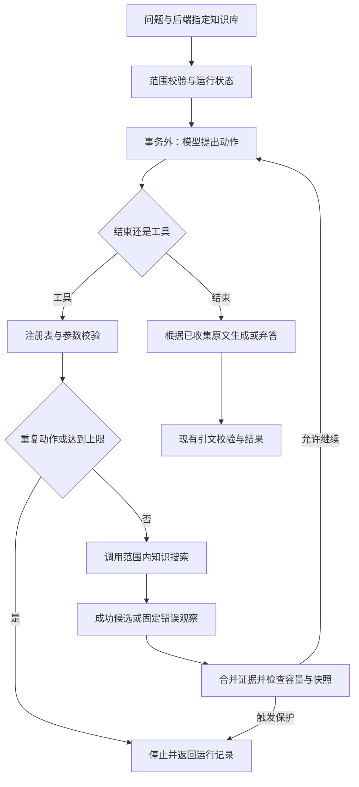

# 阶段 3.1：有界智能体循环与知识搜索工具

后续更新：[阶段 3.2](phase3-native-tools.md)接通原生工具协议并保留 JSON 显式选项。本页记录阶段 3.1 的实现与验收，循环边界继续有效。

## 1. 当前目标

实现一次知识任务运行：模型提出动作，程序校验并调用知识工具，把结果放回状态，模型选择继续或结束。结束后仍由已有证据问答逻辑生成与验证引用。

## 2. 为什么需要

已有 RAG 流程固定检索一次，智能体可以先搜索“退款申请入口”，读取结果，再搜索“退款到账条件”。它涉及工具接口、状态管理、任务编排、失败恢复与可观察性，是智能体开发岗位的基础能力。

## 3. 核心概念

- **动作：** 模型提出下一步，可以请求工具或结束；程序验证后执行。
- **工具：** 有名称、描述、参数 schema 和执行函数。当前只注册知识搜索，范围由后端绑定。
- **观察：** 工具返回的候选编号和状态，或固定故障码；下一次决策据此继续。
- **状态：** 当前问题、已执行步骤、去重证据池和剩余步数；本轮只是运行内存，没有长期记忆。
- **循环保护：** 步数上限、重复参数检测、证据预算，不能只相信提示词会让模型自觉结束。
- **完成与正确：** 运行正常完成还可能弃答，引用有效还需要语义验收。

## 4. 设计

当前选择显式 Python 循环，便于阅读每一次状态变化；LangGraph 在复杂分支、持久恢复和长期运行时更有价值，但当前一个工具无需新增框架。取舍见 [ADR 0016](adr/0016-bounded-knowledge-agent.md)。

首版动作是 JSON，复用已有兼容请求层。模型调用工具时返回：

```json
{"action":"tool","tool_name":"knowledge_search","arguments":{"query":"如何提交退款申请？"}}
```

选择结束时返回：

```json
{"action":"finish"}
```

模型不返回最终答案或内部思考过程。此协议不是服务商原生函数调用，本轮没有原生工具消息、多工具并行或持久恢复。

## 5. 实现与数据流



- `agents/contracts.py`：结构化动作、运行结果、步骤与工具观察。
- `agents/tools.py`：注册表、参数校验和绑定当前知识库的只读工具。
- `agents/engine.py`：显式循环、状态副本、重复检测、证据合并及结束。
- `providers/compatible_planner.py`：一次动作决策请求，不执行工具。
- `knowledge/answers.py`：抽取 `answer_from_hits`，复用已有原文引用规则。
- `api/agent_runs.py`：新入口和错误映射。

核心循环可以按这个顺序阅读：

```python
decision = validate_decision(planner.decide(state_copy))
arguments = registry.validate(decision.tool_name, decision.arguments)
output = registry.execute(decision.tool_name, arguments)
# 控制器保存有界观察与原文，再进入下一轮；finish 分支复用 answer_from_hits。
```

真实代码在执行前检查重复和剩余步数，并分别处理 `finish` 和工具故障。不能把上面教学片段当成完整可运行循环。

执行轨迹只记录可见动作与结果。`steps[].evidence_ids` 对应 `evidence[]` 中的编号，再映射真实文本块和字符位置；不会让模型自行指定数据库 UUID。原文池按块 UUID 去重，最多二十块和一万二千字符，保留首次出现顺序。

## 6. 验证与运行

新接口为：

```text
POST /api/v1/workspaces/{workspace_id}/knowledge-bases/{knowledge_base_id}/agent-runs
```

正式请求示例：

```json
{"question":"如何申请退款，审核通过后多久到账？","max_steps":4,"strategy":"hybrid","rerank":false}
```

它会调用真实服务：决策模型逐步收费，搜索还可能调用向量服务、可选重排模型，有证据结束后再调用生成模型。本轮开发没有运行这类真实请求。复用生成服务配置，新增 `EAAP_AGENT_*` 等待与输出配置见 `.env.example`。

响应 `status` 必须检查：

- `completed`：正常完成，`result.abstained` 区分回答和弃答。
- `stopped`：达到上限、重复动作或证据保护，`result=null`。
- `failed`：决策/生成故障，或全部工具失败后结束，`result=null`。

HTTP 200 仅表示拿到运行记录。配置缺失等仍返回 503；输入、范围和数据库错误分别保留对应错误状态。默认四次决策、上限八次；最后一次只能结束。单次模型超时不是全链路 deadline，整个运行的费用和延迟尚未实测。

测试模型全部是替身，数据库使用独立真实 PostgreSQL。运行本模块测试：

```powershell
.\.venv\Scripts\python.exe -c "import os, subprocess, sys; from dotenv import dotenv_values; values=dotenv_values('.env'); os.environ['EAAP_TEST_DATABASE_URL']=values['EAAP_TEST_DATABASE_URL']; sys.exit(subprocess.call([sys.executable, '-m', 'pytest', 'backend/tests/test_agent_engine.py', 'backend/tests/test_planner_provider.py', 'backend/tests/test_agent_api.py', '-q']))"
```

验证覆盖正常搜索后结束、补充检索、重复/上限停止、工具 schema、跨库参数拒绝、模型及工具超时、错误后换参数恢复、全部工具失败、证据上限、快照冲突和原文引用。单元测试不证明真实模型的工具选择与任务成功率。

基础规则与模拟 HTTP 33 项通过（2.12 秒），首次定向回归 119 项通过（67.63 秒）。补充最终保护和证据映射后，全部 868 项分段验证：首次完整运行 695 项通过，既有重排测试因本机新建数据库 TCP 连接报 `Address already in use` 中止（153.18 秒）；只读连接检查恢复，从失败项开始复测全部剩余 173 项通过（49.42 秒）。此前 695 项仅在第二段取消重复执行，没有跳过未验证项。未修改系统网络配置，根因尚未确认，本轮新增真实模型请求为零。

## 7. 学习与小实践

本轮代码与验证由导师完成。学习者此前理解重排数组是段落出场顺序，但尚未独立编写智能体或完成故障练习。

学习者已选择“停止并标记重复动作”，方向正确；导师补充重复请求与循环风险，以及还需步数上限防止不断改写问题而循环。选择本身不等于独立完成实现。

小实践：打开 `test_search_observe_finish_reuses_exact_evidence_and_citations`，将 `max_steps` 改为 1。先预测决策、搜索、生成分别调用几次，再运行测试观察 `step_limit`。为了看到输出，可以临时打印运行状态、步骤和工具调用数量；不要把原来的成功测试简单改成永远通过，最终恢复或另加一个边界测试。过程不消耗 API 额度。

模块复盘有三道面试题，逐题讨论：

1. 总共只允许三次决策，模型在第三次还要求搜索，为什么要停止而不执行？这与“允许三次工具调用”有什么区别？
2. 为什么工具参数不能接受模型自行提供的工作空间或知识库 ID？仅靠系统提示词能否保证范围？
3. 第一轮搜索超时，模型换了一个问题并成功找到资料，运行记录应该怎样同时表达恢复成功与中间故障？

## 8. 下一步

下一模块是服务商原生工具调用和第二个受限工具，练习工具选择与结果消息关联。此后再推进多步骤业务流程、记忆和 MCP。当前没有完整多工具平台、持久会话、后台任务、授权系统或部署界面；真实 RAG 与智能体质量仍待验收。

今天改动继续累计在本地，由学习者决定收尾时间后确认提交和推送。
