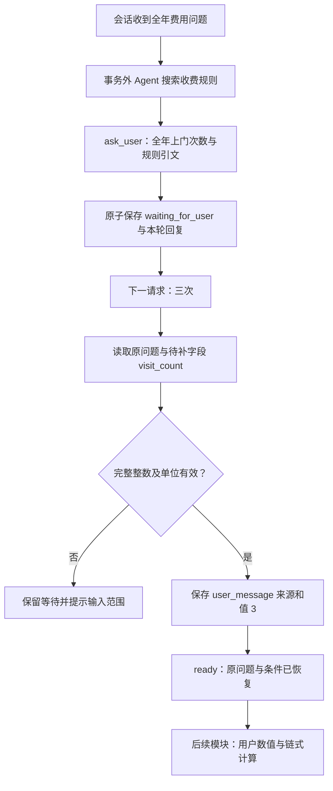

# 阶段 4.1：会话状态与短期记忆

后续更新：本文保留阶段 4.1 的范围与验证结果。阶段 4.2 已接入用户来源与链式算术，
新确认回复的暂缓原因改为 explicit_execution_required；显式执行及业务边界见
[阶段 4.2](phase4-sourced-calculations.md)。旧历史响应继续可读，ready 仍不等于业务完成。

## 1. 目标

让“全年费用是多少？”与下一条“三次”通过同一会话关联，保存原问题、已知规则和待补
次数，跨请求恢复为输入齐备的任务。年度总额计算在后续计算能力扩展中完成。

## 2. 原因

当前 Agent 每次请求创建新的内存状态。只保存聊天文本仍需模型反复推断当前任务。
结构化待补状态使用户输入可以被程序校验，数据库使服务重启后仍能读取任务。
对应岗位能力包括状态建模、Context Engineering、API 设计和数据库一致性。

## 3. 概念

会话状态决定程序当前处理哪个任务、正在等什么、可以转向哪里。
短期记忆提供有限的近期语言上下文，辅助决策理解指代。
原文证据解释企业规则，用户消息提供个人条件，派生计算记录表达程序运算结果；三种来源
分别保存，不能用一个来源替代另一个。

## 4. 设计

采用学习者选择的 B：结构化状态与有界近期消息共存，继续使用 PostgreSQL。
对比历史推断与结构化状态、PostgreSQL 与 Redis的理由见 [ADR 0019](adr/0019-persistent-conversation-clarification.md)。



最多一个待补字段、200 轮保存、最近三组问答和 4000 字符决策上下文。
支持非负次数，包括零；保守解析完整回复，不从模糊句子抽一个数字。

## 5. 实现

- `app/conversations/contracts.py`：待补条件、原文快照、用户数值来源和 API 契约。
- `app/conversations/counts.py`：中文与阿拉伯整数的保守解析。
- `app/conversations/service.py`：恢复、短期上下文、重放及版本条件提交。
- `app/agents/clarification.py`：先校验已知规则原文，再请求补充。
- `app/api/conversations.py`：创建会话、读取状态、提交消息。
- 迁移 `20261011_0005`：新增两张表，保留既有四张知识表。

接口位于知识库路径 `/api/v1/workspaces/{workspace_id}/knowledge-bases/{knowledge_base_id}` 后：

1. `POST /conversations`，无需模型配置，返回会话 ID 和版本 0。
2. `POST /conversations/{conversation_id}/messages`，首次请求：

```json
{
  "request_id": "00000000-0000-0000-0000-000000000001",
  "expected_version": 0,
  "content": "全年费用是多少？"
}
```

3. 返回 `waiting_for_user` 和版本 1 时，再提交：

```json
{
  "request_id": "00000000-0000-0000-0000-000000000002",
  "expected_version": 1,
  "content": "三次"
}
```

补充成功返回版本 2、`ready`、原问题与 `visit_count=3`，以及明确的计算暂缓原因。
示例 UUID 只说明格式，真实客户端每个新请求应生成新的编号；重试保持原请求不变。
`GET /conversations/{conversation_id}` 可在新的应用进程读取状态和有界近期消息。
切换问题显式增加 `"mode":"new_task"`，使用当前最新版本；会替换当前待办。

首版会话入口使用向量检索和默认四轮决策，不新增混合/重排或步数配置。
原单次入口继续支持原有配置。真实模型是否正确选择 ask_user 尚待验收。

## 6. 验证

最终完整后端回归 **1084 项通过、无跳过（287.96 秒）**，新增 73 项；独立 PostgreSQL 与
模拟模型验证程序行为。本机应用库已升级 `20261011_0005`，四张既有知识表记录数一致。
首次临时目录权限错误与修复后的重跑分别记录在学习记录，不删除失败记录。

零模型费用、无需数据库的练习命令：

```powershell
.\.venv\Scripts\python.exe -m pytest backend/tests/test_conversation_counts.py backend/tests/test_clarification_agent.py -q -p no:cacheprovider
```

数据库测试使用 README 的独立测试库方式，再指定
`backend/tests/test_conversation_api.py backend/tests/test_conversation_migration.py`。
不要把配置指向应用库。迁移测试只创建、降级、升级并清理自己生成的测试模式。

已覆盖新应用对象恢复、三次与零次绑定、错单位与歧义回复、显式新任务、近期上下文、
重放与编号冲突、陈旧版本、两个并发写回、提交前回滚、原文变化与状态损坏。
验证数字解析或受控任务恢复不代表真实模型的工具选择正确率。

启动新接口前需执行 `python -m alembic -c backend/alembic.ini upgrade head`。
新机器需要此步骤；本机已经完成。具体已执行结果见学习记录。

## 7. 学习总结与小实践

学习者已选择 B，并独立解释 A 存在歧义风险。字段、存储、代码和自动化执行由导师完成，
不能记录为学习者已经独立实现 Memory。

小实践：在 `test_conversation_counts.py` 的 `test_month_unit_must_match` 中，将
`parse_count("三个月", "个月")` 的第二个参数改为 `"次"`，保留原来的期望值 3。
先预测结果，再运行：

```powershell
.\.venv\Scripts\python.exe -m pytest backend/tests/test_conversation_counts.py -k month_unit_must_match -q -p no:cacheprovider
```

观察失败后，把本条断言改为 `assert parse_count("三个月", "次") is None`，再次验证。
最后解释为什么不能仅提取数字 3，就认为待补条件已经满足。导师未替学习者执行此练习。

模块收尾面试题按次序逐题讨论，不一次要求全部回答：

1. 为什么已经保存聊天记录，仍需结构化保存待补字段？如何解释“三次”的绑定？
2. 两个请求同时回复三次与四次时，怎样防止状态互相覆盖？为什么模型调用不能一直持锁？
3. 模型已经执行但数据库提交失败，request_id 能否保证不会产生第二次付费调用？

## 8. 下一步

接入用户数值与派生数值来源，设计链式计算和单位、适用条件验证，随后才执行费用任务。
会话状态与任务输入恢复已有程序验证，真实模型追问质量、计算结果与端到端任务成功率
仍需要独立验收。长期记忆、摘要压缩、用户偏好和任意步骤恢复继续保留在后续计划。
