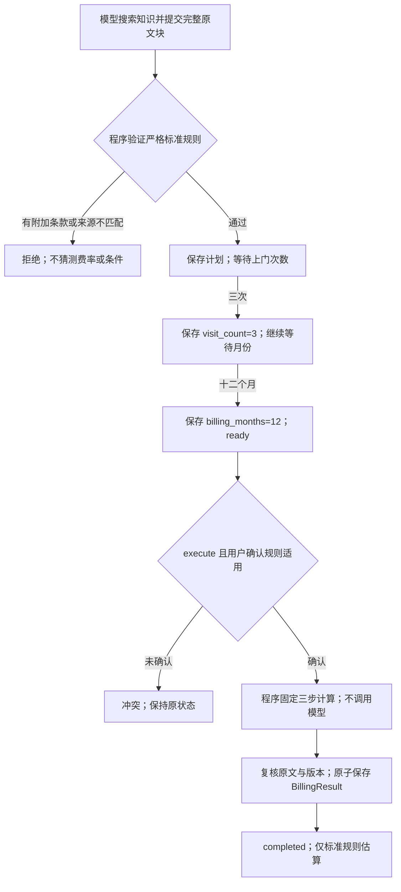

# 阶段 4.3：受控标准计费与完整条件恢复

## 1. 目标

把“月费 120 元，每次上门服务费 30 元”的知识与用户补充条件连接成一个可解释、
可恢复的有限业务流程：用户先回复“三次”，再补充计费月数，明确确认规则适用后，
程序执行固定公式并保存标准规则估算结果。

不是为了让模型会做任意数学题，也不是在这个模块实现通用收费解释器。

## 2. 原因

上一阶段已经有会话状态、用户数值来源和链式算术，但没有验证业务公式、计费期间与单位。
例如 120 × 3 的来源和乘法都可能正确，却不代表全年费用正确。
现在把三件事分开：会话状态保存待办，短期记忆提供近期聊天背景，受控工作流规定条件与计算。

## 3. 概念

- 待补条件：程序知道当前缺的是上门次数，因此“三次”可以绑定 visit_count；不是凭历史自由猜测。
- 多字段状态：先次数、后月份；补完第一项仍在等待，不因用户说“全年”就自动确认 12 个月。
- 固定公式与有限单位：元/个月 × 个月、元/次 × 次，两个元小计再相加；不等于通用单位换算。
- 明确确认：用户确认所选标准收费规则适用于这两个同一期间的条件，不是系统已核对所有合同政策。
- 完成结果：BillingResult 校验并提交后才是受控业务 completed；旧 Agent 算术结束不升级为业务完成。

用户条件、企业原文与程序派生金额保留不同来源，不能混写成“文档给出了总额”。

## 4. 设计

学习者选择 B，并说明固定公式只需代入条件。比较模型自由公式与受控固定流程的取舍见
[ADR 0021](adr/0021-controlled-standard-billing.md)。当前只支持一个有版本的 monthly_visit_v1 流程，
复用现有 Pydantic、Decimal、PostgreSQL JSONB、版本条件写回和幂等机制。



工具要求所选完整块正文仅为“月费 N 元，每次上门服务费 M 元”的标准语法。
不能在含优惠或套餐条款的块中只引用前半句；若规则散在多块或带其他正文，首版拒绝。
金额最多十二位整数和两位小数，模型不能提供自由金额、公式或单位。
完整规则最多 400 字符，单项价格引文最多 200 字符；保存真实原文，超长明确拒绝。
这仍没有核对所选块以外的其他政策；明确用户确认和受限结果标签是必要边界。

## 5. 实现

- billing/rules.py：完整匹配受控收费语法。
- billing/preparation.py：prepare_billing，绑定原文费率并创建两个有序待补字段。
- billing/contracts.py：标准计划、带单位的条件、固定三步和可校验结果。
- billing/workflow.py：显式确认后的确定性计算与结果说明，不调用模型、不扣费。
- conversations：持久保存两个确认条件，维护 waiting_for_user、ready、completed，复用请求重放与证据复核。
- 20261011_0007：扩展状态约束；存在当前或历史标准计费数据时拒绝不兼容降级。

迁移仍使用现有方式；先区分应用库与独立测试库，不把测试指向应用库：

```powershell
.\.venv\Scripts\python.exe -m alembic -c backend/alembic.ini upgrade head
```

下面示例用于已有 conversation_id 的消息接口：
`POST /api/v1/workspaces/{workspace_id}/knowledge-bases/{knowledge_base_id}/conversations/{conversation_id}/messages`。
示例 UUID 只表示格式，实际新请求生成新编号；重试保持原编号与整个 payload。

新会话 version=0 时先发送问题：

```json
{
  "request_id": "00000000-0000-0000-0000-000000000001",
  "expected_version": 0,
  "content": "按这个收费标准，全年需要多少钱？",
  "mode": "continue"
}
```

如果模型成功检索并选择 prepare_billing，回复 version=1、waiting_for_user，当前字段为 visit_count。
继续发送“三次”：

```json
{
  "request_id": "00000000-0000-0000-0000-000000000002",
  "expected_version": 1,
  "content": "三次",
  "mode": "continue"
}
```

此时 version=2，仍为 waiting_for_user，当前字段改为 billing_months。
用新的请求编号、expected_version=2、content="十二个月" 补充月份后，version=3、ready。
费用尚未计算；确认规则适用于同一期间后再发送：

```json
{
  "request_id": "00000000-0000-0000-0000-000000000004",
  "expected_version": 3,
  "content": "确认该标准收费规则适用于已补充的同一计费期间，执行估算",
  "mode": "execute",
  "confirm_billing_rule": true
}
```

对完整标准原文和上述条件，程序计算 120 × 12 = 1440、30 × 3 = 90、1440 + 90 = 1530 元。
响应 version=4、completed，billing_result 记录计划、用户条件、确认请求和固定三步。
这只是所选标准规则估算，不是实际账单，也没有扣费；更改条件用 new_task 开始新任务。

## 6. 验证

纯程序测试应验证完整规则绑定、费用精度、来源与字段篡改、固定三步及结果回验。
独立 PostgreSQL 测试应验证逐项跨请求恢复、月份边界、明确确认、重复请求、并发版本、
规则变化回滚、已完成任务保护、旧算术任务兼容及迁移降级守卫。

纯程序最终专项 **91 项通过（1.61 秒）**，新计费会话专项 **48 项通过（94.10 秒）**，
既有会话/执行/迁移专项 **48 项通过（78.64 秒）**。最终完整后端回归
**1273 项通过、无跳过（523.88 秒）**，新增 139 项；不把专项相加为一次完整覆盖。
首轮完整 1272 项通过（417.20 秒）后补了单项价格引文限长保护，最终版另行全量重跑。
模拟原生 HTTP 测试也验证新工具 schema、搜索配对及准备后停止，不付费请求真实模型。
模型准备流程用模拟规划器或 MockTransport 验证程序协议，不能证明真实模型会选择正确块与工具。
没有新增真实模型调用或真实任务成功率。核对本机应用库为本地 eaap、与测试库不同后，
正常升级 0006 → 0007，六张既有表的记录数均不变；没有在应用库运行测试。
迁移专项验证空模式升级与模型一致、旧消息保留、当前及历史计费数据拒绝不兼容降级。

## 7. 学习总结与小实践

学习者已确认 B，且独立说明固定公式的价值；来源、计费期间、单位和适用边界由导师继续解释。
导师负责本轮实现与自动化验证，不能记录为学习者已独立编码。上一阶段未完成的小实践不补记为已完成。

本模块的小实践：在标准计费纯测试中新加一个场景，保留费率 120 元/个月和 30 元/次，
将用户条件改为“二次”和“五个月”，断言月费小计 600、上门小计 60、总额 660。
必须同时更新各自 raw_text，使保存值与用户原回复一致，不能只改 expected 让测试通过。
新增测试名可用 test_standard_estimate_for_five_months_and_two_visits。
在 backend/tests/test_billing_workflow.py 末尾添加下面这个函数，复用文件已有 pending 辅助函数：

```python
def test_standard_estimate_for_five_months_and_two_visits():
    task = pending(visits=2, months=5)
    result = execute_billing(task, uuid4())
    assert (result.monthly_subtotal, result.visit_subtotal, result.total) == ("600", "60", "660")
```

pending 会同时生成匹配的数值、单位和原消息；它不是调用真实模型。
添加后运行 `.\.venv\Scripts\python.exe -m pytest backend/tests/test_billing_workflow.py -q -k standard_estimate_for_five_months -p no:cacheprovider`。
运行对应测试，随后尝试仅把 raw_text 改成“六个月”，观察来源回验拒绝不一致状态。
这是待学习者亲自修改和执行的实践，不因导师已有类似覆盖而记为完成。

准备三道面试题，教学时每次只讨论一道：

1. 如果数字来源和算术都正确，为什么仍需要固定业务公式与适用条件确认？
2. 同一会话两个补充请求或两个执行请求并发，版本条件更新和 request_id 分别解决什么问题？
3. 为什么收费规则已变更时要拒绝执行，且有历史计费结果时不能静默降级数据库？

## 8. 下一步

先完成实践与逐题讨论，再验收真实模型能否检索完整规则、选择 prepare_billing、正确追问和明确拒绝超范围收费。
结果按程序测试、模拟模型、真实调用与业务语义分别记录。
随后回到会话/记忆模块主线，推进长期记忆边界，再连接 MCP 与更通用的受限工作流；
不因这一个估算流程可完成就宣布整个平台、长期记忆或工作流模块完成。
