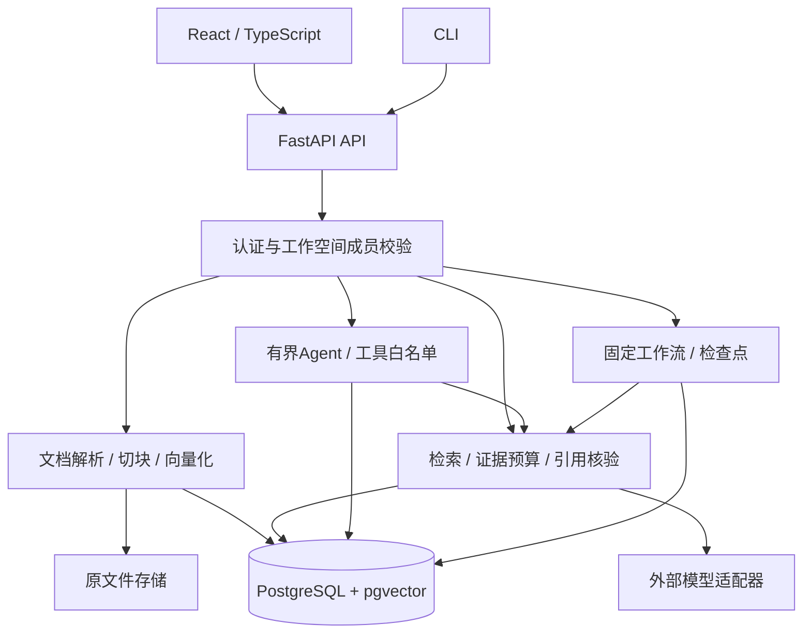

# 架构与工程设计

采用模块化单体。React负责页面与明确提交，FastAPI负责业务规则和权限，PostgreSQL/pgvector持久化资源、文本块、向量与执行状态。
外部向量、生成和可选重排服务通过适配器调用，便于替换服务商和进行受控测试。

## 数据与范围

数据层级为用户成员关系 → 工作空间 → 知识库 → 文档 → 文本块。
签名令牌确定身份，数据库成员关系决定访问空间；业务查询再限制父子归属。
前端核验响应中的ID/名称/状态可减少错误展示，但授权由后端执行。
当前owner/member是基础权限边界，不是细粒度RBAC或每用户私有会话。

原文件独立保存；文本块保留解析文本中的字符范围。PDF支持文字层，字符位置不等于原页码或文件字节偏移。
上传、数据库提交与外部调用不是单一原子事务；已有只读存储对账工具用于发现差异，不自动删除文件。

## 检索与证据回答

1. 按知识库和可检索状态限制候选，生成问题向量。
2. vector使用余弦距离；hybrid结合向量与词项通道的名次，按块ID融合，不直接相加两套原始分数。
3. 按字符预算选择完整块，不截断一个块冒充完整证据。
4. 模型输出回答、来源编号和引文；程序检查来源属于本次证据、引文连续存在且不重复，并构造真实ID和位置。
5. 无足够证据时返回业务弃答；模型故障、坏格式和伪造引用走错误路径。

网页独立检索最多3段，问答可选最多3/5段，两页分别选择vector/hybrid，默认不重排。
候选上限、实际上下文数量与引文数量不同；距离、融合得分、原文存在均不是答案正确率。
回答中的每项条件是否被证据支持仍需要语义评测和人工复核。

## Agent与工作流

Agent在有限决策预算内选择白名单工具，控制器校验参数、范围和动作；只读搜索、受限计算、文档状态各有结果契约。
持久会话保存结构化待补条件和有界近期上下文，支持标准规则估算；用户偏好不会自动改写证据或计算规则。
后端另有白名单本地stdio MCP接入，不开放任意命令或删除能力。

固定问答工作流由程序规定检索与生成步骤，保存检查点、版本和不可变回执，提供有限恢复与只读历史。
它不等于任意Agent恢复或通用可视编排。网页接入的是明确子集，hybrid历史详情等仍有范围限制。

## 可靠性

模型调用位于数据库事务外，避免长期占用事务。短事务、版本校验和请求回放控制本地一致性，
但不能保证跨外部调用的原子快照或模型费用恰好一次。
网页使用单次请求控制、取消信号和操作序号隔离迟到结果。超时保留“结果未确认”，不自动把未知写操作重发。
来源读取的局部失败可保留原已确认答案，导出只取提交快照，不重新检索生成。

详细设计见[ADR目录](../adr/README.md)，验证证据见[测试与验证](verification.md)。
